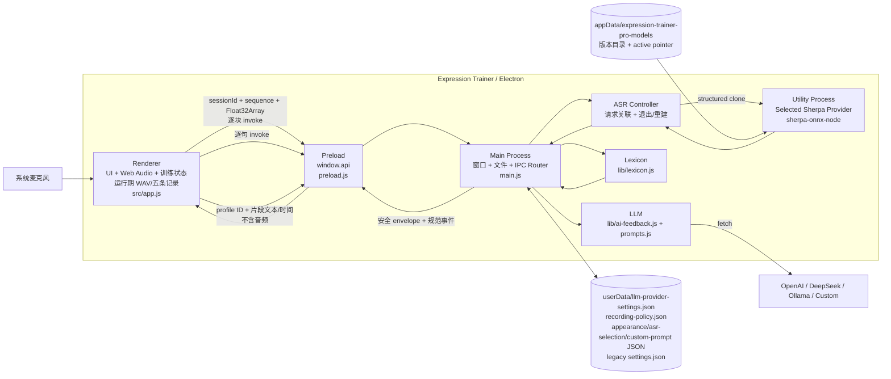

# 当前架构（As-Is）

> 状态：Verified from Source + Electron 43 / packaged smoke；内部开发/测试，录音回放、结构化同步分析、三款 streaming ASR、模型管理和内部包内默认资格已实现；公开模型分发仍受外部门禁约束
> 基线日期：2026-09-01
> 仓库：`https://github.com/morigejile/expression-trainer-pro.git`  
> 描述对象：当前集成分支的产品运行时、开发工具边界与已验证的内部安装基线

## 1. 证据边界

当前事实来自源码、依赖清单和 Git 状态，并由 Node 测试、Electron smoke、packaged native-load、真实 Paraformer 首次安装及升级 smoke 支持。已验证 Main/Preload/Renderer、utility-process IPC、执行单元退出与重建、Fake LLM、粘贴分析、首次录音告知、运行期 WAV 回放与结构化片段分析，以及 Electron AudioWorklet 对 16/44.1/48 kHz fixture 的适配。真实可配置麦克风、真实外部 LLM、接近资格线硬件及非 Windows x64 制品仍未形成证据。

2026-09-16 M1 增量：已增加[训练存储基础](training-storage.md)，包含 SQLite schema v1、受管 WAV、事务完成、中断恢复、完整性检查与可重试删除。当前仅由 focused tests 和显式 persistence smoke 使用，尚未接入普通录音/历史 UI；下文的五条内存记录仍准确描述当前产品行为，现有产品流程图暂不改变。

| 标记 | 含义 |
|---|---|
| **Source-verified** | 可由当前本地源码、配置或 Git 状态直接确认 |
| **Runtime-TBD** | 需要真实启动、设备、模型、网络或性能测试确认 |
| **Product-TBD** | 需要产品选择，代码不能回答 |

核心源码按运行边界组织：

| 边界 | 主要入口 | 职责 |
|---|---|---|
| Electron 控制面 | `main.js`、`preload.js` | 窗口、受控 IPC、文件、设置和 LLM 调度 |
| Renderer | `src/` | UI、Web Audio、训练状态、运行期 WAV 与安全渲染 |
| ASR 执行 | `lib/asr-*.js`、`lib/*asr-provider*.js` | session 契约、utility process、Sherpa Provider 和退出重建 |
| 模型管理 | `lib/model-*.js`、`models/registry.json` | Catalog、下载校验、原子激活、选择和失败回退 |
| 分析与配置 | `lib/ai-feedback.js`、`lib/lexicon.js`、`lib/*-store.js` | 本地规则、LLM、schema 迁移和 userData 原子写 |
| 共享运行时数据 | `shared/`、`data/` | Renderer/Main 共用规则与情绪词数据 |
| 验证与评测 | `test/`、`smoke/`、`benchmark/` | Node/Electron 回归与隔离的非发布 benchmark |

## 2. 当前目标与范围

当前系统实现两条输入路径：

```text
麦克风音频块 ┬→ 本地 ASR → final 文本 ┐
             └→ Renderer-only Int16/WAV（最多五条）→ 本地回放
粘贴逐字稿 ────────────────────────────┤
                                         └→ 词库分析 → 可选 LLM 实时反馈/报告 → UI/Markdown
ASR 最终片段 + 时间 → 结构化 LLM 回放分析 → 随播放进度显示
```

具体产品能力与 Existing/Partial/Planned 状态统一维护在[需求基线](../requirements/requirements.md)；本文只描述这些能力如何在当前源码中运行。

它没有大型前端框架、独立后端、数据库或微服务。音频、ASR、模型、配置和交付边界已从原型职责中拆开；Renderer 的训练编排仍集中在 `ExpressionTrainer`。

## 3. 当前技术栈与版本

| 区域 | 当前选择 | 证据/备注 |
|---|---|---|
| 应用 | Electron `43.4.1` + 原生 HTML/CSS/JavaScript | `package.json#version` 是应用与制品唯一版本源；无 bundler/前端框架 |
| 音频 | `getUserMedia` + 16 kHz AudioContext + AudioWorklet | 320 帧 mono Float32 送 ASR；Renderer 同时生成有界 Int16/WAV；epoch 隔离暂停前旧块 |
| 权限桥接 | Preload `contextBridge` + `ipcRenderer.invoke` | `contextIsolation:true`、`nodeIntegration:false` |
| ASR 引擎 | `sherpa-onnx-node` `1.13.3` | 仅由 utility process 内的当前 Provider 延迟加载，Main 不 require |
| ASR 模型 | Paraformer、Zipformer Small、Zipformer Large | schema-v2 Catalog 固定 archive/runtime；模型安装到 `appData/expression-trainer-pro-models`，权重不纳入 Git；当前 Catalog 默认是 Zipformer Large，但公开分发仍受许可约束 |
| 本地分析 | `lib/lexicon.js` + `data/emotion-lexicon.json` + `shared/expression-rules.js` | 146 个情绪词；16 个填充词、14 个犹豫词、20 组笼统词映射由 Renderer/Main 共用；未启用数据不放入活跃 `data/` 目录 |
| LLM | Node 原生 `fetch`，OpenAI/DeepSeek/Ollama/自定义 OpenAI-compatible | 在 Main 中发请求；连接/实时/报告/回放分析有独立超时，支持 AbortSignal、按 Renderer 取消和严格结构化响应验证；回放请求不含音频 |
| 设置 | `userData/appearance.json`、`userData/asr-selection.json`、`userData/llm-provider-settings.json`、`userData/recording-policy.json`、legacy `userData/settings.json`、`userData/custom-prompt.json` | Appearance、ASR 选择、多 LLM profile 与录音策略确认各自持久化且互不覆盖；只持久化确认布尔值，不保存录音内容；小文件原子发布；API Key 明文 |
| 构建/测试 | Node test + Electron smoke + Electron Forge 7.5/Squirrel | `package`/`make` 固定 Windows x64；packaged smoke 覆盖 Fake 产品流、utility-only Sherpa native load、完整 DLL unpack 和外部模型目录；尚无 CI |

开发工具精确版本见[开发与验证](../development.md)；已验证平台、制品和硬件边界见[支持矩阵](../support-matrix.md)。

### 3.1 Benchmark 与模型决策

独立 benchmark CLI 从 manifest 生成逐样本结果、汇总和环境快照，不进入产品 Audio/IPC/Main。BM-02～BM-04 已完成七候选同机比较，ADR-0009 据此采用 Zipformer Large 技术默认。候选具有固定 runtime hash、native-load 和 benchmark 证据，但再分发状态仍为 `not-approved`。

### 3.2 Model Manager 与生产模型

产品层以 `models/registry.json` 作为唯一 schema-v2 Catalog，不依赖 `benchmark/`。Catalog 只描述三款 streaming 模型；Factory 只接受代码内冻结的 Paraformer 与 online CTC Provider 类型。模型安装到 `appData/expression-trainer-pro-models`（Windows 为 `%APPDATA%\expression-trainer-pro-models`），与可能本地化的 Electron `userData` 路径分离；旧 `userData/models` 在目标不存在时整目录迁移，双目录并存时拒绝覆盖。模型经过大小和 hash 校验、白名单解压、不可变版本发布与 native 初始化后才激活；中断、空间不足或校验失败不替换上一可用版本。

`AsrModelService` 按严格命令行覆盖、持久选择、Catalog 默认值启动，并保证任意时刻最多一个识别 utility。模型切换先验证目标，再销毁旧 controller；失败时创建新的原模型 controller 回退，双失败进入 unavailable。安装由独立短生命周期 utility 执行，支持有界进度、取消和重试，不占用当前识别 controller。模型管理 IPC 只允许设置窗口调用四个固定 channel，Renderer 只接收脱敏快照并提交精确模型 ID。

### 3.3 Packaging、安装与升级

`forge.config.js` 是唯一打包配置，当前只构建 Windows x64 Squirrel；native Sherpa bundle 保持 ASAR unpack，模型位于 `appData/expression-trainer-pro-models`。内部制品已验证安装、真实模型首次准备、强制离线二次启动、1.0.0→1.0.1 前向升级和卸载数据保留，终端用户无需开发工具。

受支持更新路径是向前安装。手工运行旧完整 Setup 可能降级应用二进制，并可能用旧 schema 覆盖共享用户文件；重新运行当前 Setup 只能恢复应用版本，不能恢复已被覆盖的数据。该已知边界保留在支持文档，不为内部阶段增加 updater 框架。

显式内部构建可从 Git 外的绝对归档路径读取 Catalog 默认模型，校验精确字节数和 SHA-256，只把固定 `asr-models/<modelId>/<version>/<archive>` 加入 Forge `extraResource`。普通 `package`/`make` 仍不携带模型；Main 只从 `process.resourcesPath` 派生受信任包内归档位置，ModelManager 复用既有安装事务后激活。运行时始终从 `appData/expression-trainer-pro-models` 加载。

## 4. C4 Level 2：当前容器/运行边界



Main 负责 Electron 控制面、词库分析、小型 userData JSON 原子文件 I/O 和 LLM 请求编排；ASR 初始化与同步 decode 已移入单个 utility process。

## 5. 模块职责

### 5.1 Renderer / `src/app.js`

- `ExpressionTrainer` 编排录音、暂停、逐字稿、本地分析和 LLM 状态；`AudioCapture`/AudioWorklet 独立管理 16 kHz 采集、epoch 与 tail flush。
- 音频以最多 10 块的串行队列送入 ASR，overrun 失败关闭；Renderer 只接受当前 session 且 sequence 递增的规范事件。
- 同一 Float32 chunk 在 Renderer 转为有界 Int16。正常结束后组装 WAV，最多保留五条内存记录并在淘汰、删除或退出时撤销 Blob URL。
- final 文本进入逐字稿、本地统计和单调片段时间轴；片段边界统一规范为严格递增的整毫秒，因此不足一整块的录音尾块不会让回放分析输入校验整体失败。播放只根据片段边界切换已完成建议，不触发推理。
- 首次录音在申请麦克风前等待用户确认；回放分析的失败、取消或迟到响应不覆盖上一份成功结果。
- 字幕与报告通过 text node、受控 `span` 和 Markdown 允许列表渲染；外观切换只改根节点属性，不重建训练 DOM。

训练编排尚未形成全局显式状态机；当前通过 session 失效、stop single-flight、队列 drain 和请求代际过滤控制组合风险。

### 5.2 Preload / `preload.js`

通过 `contextBridge` 暴露显式的 Appearance、设置、Prompt、ASR、分析、LLM、录音策略和文件能力；BrowserWindow 使用 `contextIsolation:true`、`nodeIntegration:false`。

- ASR 只暴露 start/feed/stop/cancel，并保留 session、sequence 和有限 Float32 样本校验。
- LLM 只暴露脱敏 profile 摘要、分析和取消；主窗口不能读取 Key 或完整 endpoint。
- 录音策略只读写确认布尔值，音频、时间轴和分析结果不经过设置 IPC。

### 5.3 Main / `main.js`

- 管理窗口、应用生命周期、IPC handlers、词库、对话框和小型 userData JSON；设置使用同目录临时文件、fsync 和 rename 原子写。
- 通过配置模块规范化和单向迁移旧 schema；损坏文件保留原文，future schema 可读已知字段但拒绝降级保存。
- ASR 命令通过 Router/Controller 返回安全 envelope；Main 不加载 Sherpa，utility 退出后在下一次 start 重建。
- 本地分析、有超时的 LLM fetch、回放输入校验和 Markdown 保存均在 Main 执行；同类新 LLM 请求取消旧请求。
- Fake ASR/LLM 只在显式 smoke 参数和隔离 `userData` 下组合，普通启动不进入该路径。

### 5.4 ASR Provider / session、managed provider 与 Factory

Main 只持有 `AsrProcessController`；实际 session wrapper、managed provider、Sherpa adapter、模型安装和模型对象均位于 utility process。`lib/asr-session.js` 维护单一 active session：start 创建 session 并发出 `ready`，feed 验证连续 input sequence 并发出 `partial/final/error`，stop flush 后发出可选 `final` 和必有 `stopped`，cancel 不 flush 且发出 `stopped`。

`lib/asr-provider-factory.js` 只接受 Catalog 中代码支持的 provider type：Paraformer 由 `lib/asr.js` 创建，Zipformer Small/Large 由 `lib/zipformer-ctc-asr-provider.js` 创建。`lib/managed-asr-provider.js` 从选中模型的不可变 active 版本取得 role 文件，完成准备和 native 初始化后才把 Provider 交给 session wrapper；Factory 不接收 Renderer 提供的路径、URL、hash 或 provider type。

三款 Provider 均只支持一个并发识别流，使用 16 kHz mono Float32 输入、CPU、2 threads 和 greedy search。Paraformer 从 encoder、decoder、tokens role 创建 recognizer；Zipformer 从 model、tokens 及可选 BPE role 创建 online CTC recognizer。adapter `feed()` 同步 decode 并返回 `{text,isFinal}` / `null`，`stop()` flush 最后的未确认文本。重复 `initialize()` 复用 recognizer，session start 创建新 stream。`lib/fake-asr-provider.js` 通过同一 session wrapper 用于普通测试与 Electron smoke；没有通用插件系统或依赖注入容器。

`src/app.js` 把当前 session 的 `final` 事件经 `mergeFinalText()` 去重后合并；非空尾部文本进入逐字稿、分析统计和后续报告。`stopRecording()` 等待尾部 final 的本地分析完成后再开放报告操作；失败时仍复位录音状态和 UI。

### 5.5 Lexicon / `lib/lexicon.js`

`lib/lexicon.js` 读取情绪词并输出填充词、犹豫词、笼统词、情绪词、密度和建议；实时模式逐句调用，粘贴模式经 `analyze-texts` 一次提交整批句子，两者共用同一分析函数。Renderer 高亮与 Main 统计共用 `shared/expression-rules.js`；自定义词经去重、长度和 64 项上限后参与本地分析与 prompt。未接入运行时的词库不放在活跃 `data/` 目录。

### 5.6 LLM / `lib/ai-feedback.js`、`lib/prompts.js`

本节的实时反馈、最终报告和回放分析是三条历史实现路径，不定义三个目标 Screen，也不表示已确认保留实时 AI。目标用户任务与 Workspace 归属以 [Training Flow §13](../product/training-flow.md#13-screen-structure-收敛基线) 为准；实时 AI 的取舍与具体交互仍待对应阶段决定。下文继续记录 As-Is 技术行为。

- 支持 OpenAI、DeepSeek、Ollama 和自定义 OpenAI-compatible；自定义训练规则附加到 prompt。
- 连接测试、实时反馈、报告和回放分析使用独立超时与 AbortSignal；同类请求互相 supersede，迟到结果由 Main 协调和 Renderer 代际双重抑制。
- HTTP/超时/取消/响应结构错误返回稳定脱敏文本，不透传错误正文或自动重试。
- 回放分析只提交有界文本片段与时间，并对 segment ID、JSON 字段和建议长度做严格验证；不提交音频或路径。

### 5.7 设置与数据

`llm-provider-settings.json` 使用 schema-v2 `activeProfileId + profiles[]`；旧 schema/file 单向迁移，canonical 文件优先，不删除或双向同步 legacy 文件。损坏 JSON 保留原文，future schema 拒绝降级保存。API Key 当前仍明文保存。

`recording-policy.json` 只保存 `{schemaVersion:1,acknowledged:true}`。录音、逐字稿片段时间轴、本地统计和回放分析只存在于 Renderer 内存；关闭窗口释放全部五条记录和 Blob URL，不形成跨重启训练历史。用户主动复制或保存的原文/报告仍沿用现有明确操作边界。

`custom-prompt.json` 由 `lib/custom-prompt-store.js` 读写，与其余 store 同形；解析结果按 mtime+size 缓存、保存时失效，避免逐句分析反复同步读盘。

`appearance.json` 只保存四个主题和两个布局标识；缺失、损坏或未知值回退 Graphite/coach-rail，future schema 可读取已知值但拒绝显式保存。`asr-selection.json` 只保存 `selectedModelId`；缺失或稳定损坏在默认模型成功后原子恢复，瞬时初始化失败不改写选择。外观和模型操作都独立于 LLM 保存/连接测试。

### 5.8 Benchmark dataset boundary (BM-01)

数据集契约、冻结语料、来源与覆盖边界统一维护在 [`benchmark/datasets/README.md`](../../benchmark/datasets/README.md) 与 [`SOURCES.md`](../../benchmark/datasets/SOURCES.md)。Benchmark validator 不接入产品 Main、Preload、Renderer 或 ASR。

## 6. 当前关键数据流

### 6.1 音频到识别

```text
getUserMedia({audio:true})
→ 16 kHz AudioContext / AudioWorklet 下混并汇集 320 帧 Float32 chunk
├→ Preload/Main 校验 → AsrProcessController → utility process 同步 decode
│  → partial/final event → Renderer session/sequence 过滤后更新 UI
└→ Renderer Float32→Int16 → 当前有界录音缓冲（不经 IPC）
```

AudioCapture 返回并保留请求值、`audioContext.sampleRate` 与可用的 track rate；实际 context 不是 16000 时在创建 worklet 前失败关闭。固定 Electron fixture 已证明 16/44.1/48 kHz 确定性缓冲进入 16 kHz graph 后的总帧数、平台均值与时间过渡；真实麦克风/驱动仍为 Runtime-TBD。

每块仍经 TypedArray 规范化和两次 structured clone；空载吞吐已足够，当前保留 10-block 可观测队列而不增加共享内存。

### 6.2 结束与尾部文本

```text
Renderer 请求 AudioCapture flush，关闭队列入口并 drain 已接受 chunk
→ stopASR({sessionId}) / stop-asr
→ stream.inputFinished + decode
→ utility process 返回可选 final + stopped 事件
→ Renderer 过滤当前 session/sequence，并经 mergeFinalText 去重 final
→ 非空新文本进入字幕、统计、片段时间轴、分析和报告
→ Renderer 组装 16-bit mono WAV Blob，释放 PCM 分块
→ 加入最近五条内存队列；第六条撤销最老 Blob URL
→ 原生播放器显示当前记录；应用退出撤销全部 URL
```

### 6.3 分析与 LLM

```text
endpoint/final sentence
→ analyze-text invoke → Main lexicon → stats/建议
→ 累计文本较上次反馈增加 >=30 字
→ get-realtime-feedback invoke → Main 受控 fetch → 成功时更新右侧反馈

粘贴逐字稿
→ Renderer 分句后一次 analyze-texts invoke（有界数组，最多 5000 句、
  合计不超过与 report/realtime 相同的文本上限）
→ Main 取一次训练规则和 extraFillers，逐句复用同一 lexicon 分析
→ 整批返回后累计 stats；批量被拒时给固定文案并复位粘贴流程

停止/粘贴完成后用户点击生成报告
→ fullText + stats → Main fetch → Renderer 受控 Markdown token/DOM 渲染 → 可保存 Markdown

录音正常结束后自动分析，或用户选择 profile 后点击“重新分析”
→ Renderer 提交 {profileId, segments:[{id,text,startMs,endMs}]}，不提交音频
→ Preload / Main 校验输入并从设置读取完整 profile 快照
→ Main 结构化 LLM fetch → 严格校验 segment ID/JSON/长度
→ Renderer 仅在请求代际和当前记录仍匹配时整体替换上次成功结果
→ 播放/拖动跨越片段边界时更新当前字幕与建议，不再次推理
```

LLM 失败只返回安全的 `{success:false,error}`，不会修改本地词库结果或覆盖上一份成功的回放分析；粘贴模式在请求 LLM 前完成本地分析，实时模式的分析 IPC 与 LLM IPC 也彼此独立。

### 6.4 设置与 Prompt

Settings/Prompt Renderer 通过 Preload 调用 Main 中的 userData JSON store；LLM 请求在发起前重新读取 profile。首次录音只在 `recording-policy.json` 已确认后才启动 ASR 和申请麦克风。

## 7. 部署与安装现状

- Forge 7.5/Squirrel 只构建 Windows x64；当前没有 publish script 或 CI。
- `smoke/` 只在显式参数和隔离 `userData` 下执行；`test/`、`benchmark/`、`scripts/` 和 `docs/` 不进入制品。
- 普通制品不携带模型；内部制品可从 Git 外的 Catalog 固定归档导入默认模型，但运行时仍只从 `appData/expression-trainer-pro-models` 加载。
- 开发命令见[开发与验证](../development.md)，已验证制品与升级边界见[支持矩阵](../support-matrix.md)，未完成的公开交付工作见 [Roadmap](../roadmap.md)。

## 8. 当前开放风险

已由源码和现有验证关闭的历史边界不再逐项复制到本表；理由与落地证据保留在 ADR、Roadmap 和 Git 历史。当前仍会影响后续决策的风险如下：

| ID | 当前风险 | 已有边界 | 下一次触发条件 |
|---|---|---|---|
| TD-03 | 真实麦克风/驱动的采样率行为仍无设备证据 | 固定 Electron graph 已覆盖 16/44.1/48 kHz | 有可配置真实设备时复核；实测失败才评估 WASM 备选 |
| TD-04 | 320 样本块仍经两次 structured clone | 10-block 队列可观测且失败关闭 | 真实推理 profile 证明复制成为瓶颈时再换通道 |
| TD-07 | `ExpressionTrainer` 仍编排多个训练阶段 | session、stop single-flight、迟到结果和 overrun 已分别受控 | 新状态使现有局部状态无法可靠组合时再抽取状态机 |
| TD-08 | 无 CI，Experimental 平台无制品证据 | Windows x64 Node/Electron/安装/升级 smoke 已建立 | OPS-01 或实际新增支持平台时增加最小验证 |
| TD-09 | API Key 仍明文保存在 userData | 原子写、future-schema 防降级与日志脱敏已覆盖 | 公开发布且 keychain 收益超过 native/跨平台成本时复审 |
| TD-10 | settings/custom-prompt 尚无外层 payload 大小上限；页面也未启用 CSP/sandbox | ASR、文本分析、实时反馈、报告统计和 Markdown 保存已有精确或轻量输入边界；Renderer 无 Node integration | 对应 payload 出现具体资源风险，或进入公开发布安全收口时逐项处理 |
| TD-12 | LLM 瞬时失败仍需用户重试 | 超时、取消、迟到抑制、响应验证和错误脱敏已覆盖 | 产品确认重试语义后再实现，不在 fetch 层盲目重试 |
| TD-17 | Forge/Squirrel 的仅开发传递依赖仍有安全告警 | 生产依赖审计为 0，当前组合已有完整打包证据 | 出现具体安全/兼容风险时受控升级并重跑 make/native smoke |

已关闭的结构边界包括：ASR 移出 Main、AudioWorklet 替换废弃节点、Model Manager 安装与回退、配置原子写、安全 DOM 渲染、表达规则同源、未启用数据移出发布树，以及应用/模型版本口径分离。后续行为变化只更新受影响的当前事实，不恢复完整历史台账。

## 9. 当前架构评价

### 应保留

- 单一 Electron 桌面应用，无独立服务端和数据库；
- 原生 JS/HTML/CSS；
- 本地 Sherpa-ONNX 路线；
- 本地确定性分析 + 可选 LLM 的降级结构；
- `contextIsolation:true`、`nodeIntegration:false` 的权限方向；
- 用户数据已位于 `userData` 而非安装目录。

### 继续控制的复杂度

- Audio 逐块 invoke、TypedArray 规范化与跨进程 structured-clone 复制；
- 完整训练状态仍由一个 Renderer 编排类组合，只有状态继续增长时才做局部抽取；
- settings/custom-prompt 外层大小、页面 CSP/sandbox 与明文密钥留到对应具体风险或公开发布收口；
- 接近资格线性能、真实麦克风和 Experimental 平台仍无证据；
- 首次安装与 1.0.0→1.0.1 升级已可复现，后续只维护能发现实质回归的验证。

结论：当前内部基线的运行时、评测和交付边界已经收敛。剩余风险只随模型公开交付、utterance 轨道或其他已重开工作渐进处理，不开展脱离当前任务的全面重构。

需要补充的设备、平台和公开发布证据统一维护在[支持矩阵](../support-matrix.md)与[Roadmap](../roadmap.md)，本文件不复制验证待办。
