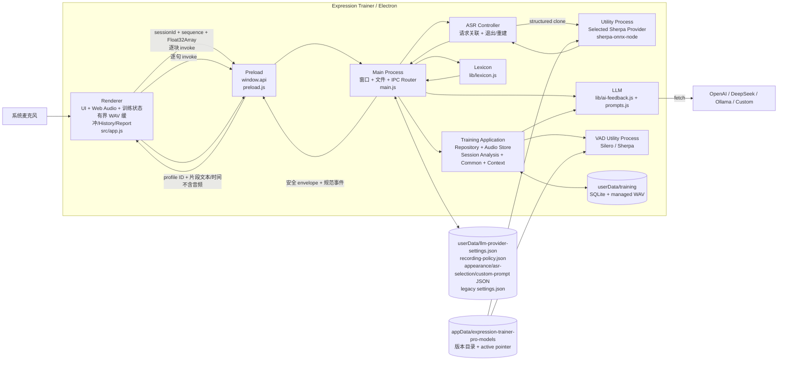

# 当前架构（As-Is）

> 状态：内部开发/测试。M2 按有限人工验收边界关闭，M3 首版已实现，M4 仍在进行；公开模型分发仍受外部门禁约束。
> 本页按模块查询当前实现；各节带日期的测试、设备及阶段记录仅代表当时范围，不是当前全仓或模型质量通过声明。早期切片中的暂缓事项以其后接入状态为准。
> 仓库：`https://github.com/morigejile/expression-trainer-pro.git`
> 描述对象：当前集成分支的产品运行时、开发工具边界与已验证的内部安装基线

| 当前查询 | 状态与入口 |
|---|---|
| 录音、保存与分析基础 | 已接入；存储 §10、时间基础 §12、证据／指标／诊断流水线 §13。SenseVoice 下载与实机验收仍延期。 |
| 训练、报告与工作区 | M4 实现见 §15；Frozen I0～I6 接入见 §16～§21，连续录音的有限稳定性证据见 §22。源码接入不等于 M4 整体验收。 |
| 主报告生产与实验 | 当前生产提示、问题库、质量限制和未接入实验集中见 §17；历史原始结果按该节证据链接查阅。 |
| 仍在推进的工作 | [M4 剩余任务](../milestones/m4-structured-training.md#remaining-work-and-blockers)；跨阶段与公开交付顺序见 [Roadmap](../roadmap.md)。 |

## 1. 证据边界

实现状态以源码、依赖清单和 Git 状态核对；既有 Node/Electron、打包、安装与设备验证按各节记录的日期和范围读取。M2 的默认真实麦克风 + Zipformer Small CTC 中文 INT8、Report/History 播放与保存恢复、VAD/Evidence 有限人工复核及真实外部 AI 曾获用户确认，结论见 [M2 验收矩阵](../milestones/m2-speech-evidence-and-ai-diagnosis.md#acceptance-criteria)。后续主报告质量实验的剩余问题见 §17，不能用此前服务端到端通过代替语义质量验收。多采样率/可配置设备、接近资格线硬件及非 Windows x64 制品仍不外推。

M1 增量：[训练存储与产品集成](current.md#10-m1-training-storage-foundation) 已接入普通录音、已有结果、训练历史与共享 Report；包含极简 Preparing、静默准备检查、删除和保存失败重试。旧图集已归档，§4 图按当前源码更新；自动化证据与真实设备验收分开记录。

| 标记 | 含义 |
|---|---|
| **Source-verified** | 可由当前本地源码、配置或 Git 状态直接确认 |
| **Runtime-TBD** | 需要真实启动、设备、模型、网络或性能测试确认 |
| **Product-TBD** | 需要产品选择，代码不能回答 |

核心源码按运行边界组织：

| 边界 | 主要入口 | 职责 |
|---|---|---|
| Electron 控制面 | `main.js`、`preload.js` | 窗口、受控 IPC、文件、设置和 LLM 调度 |
| Renderer | `src/` | UI、Web Audio、训练状态、运行期 WAV 与安全渲染 |
| ASR 执行 | `lib/asr-*.js`、`lib/*asr-provider*.js` | session 契约、utility process、Sherpa Provider 和退出重建 |
| 模型管理 | `lib/model-*.js`、`models/registry.json` | Catalog、下载校验、原子激活、选择和失败回退 |
| 分析与配置 | `lib/ai-feedback.js`、`lib/lexicon.js`、`lib/*-store.js` | 本地规则、LLM、schema 迁移和 userData 原子写 |
| 共享运行时数据 | `shared/`、`data/` | Renderer/Main 共用规则与情绪词数据 |
| 验证与评测 | `test/`、`smoke/`、`benchmark/` | Node/Electron 回归与隔离的非发布 benchmark |

## 2. 当前目标与范围

当前系统以麦克风训练为唯一输入：

```text
麦克风音频块 ┬→ 本地 ASR → final 文本 → 本地词库统计
             └→ Renderer 有界 Int16/WAV
结束 → Application → SQLite 事实 + 受管 WAV → VAD/Common/按设置 AI → 保存报告快照 → 共享 Report
训练历史 → 按 ID 读取同一 Session → 共享 Report/播放/手动分析/删除
诊断重试 → Main LLM → 带生成时来源的结果写回原 Session
```

具体产品能力与 Existing/Partial/Planned 状态统一维护在[需求基线](../product/requirements.md)；本文只描述这些能力如何在当前源码中运行。

普通录音结束时自动保存，跨重启历史由数据库查询；正常启动持有 SQLite 存储并注册 Application/Preload API（§10）。系统没有大型前端框架、独立后端或微服务。音频、ASR、模型、配置和交付边界已从原型职责中拆开；Renderer 的训练编排仍集中在 `ExpressionTrainer`。

## 3. 当前技术栈与版本

| 区域 | 当前选择 | 证据/备注 |
|---|---|---|
| 应用 | Electron `43.4.1` + 原生 HTML/CSS/JavaScript | `package.json#version` 是应用与制品唯一版本源；无 bundler/前端框架 |
| 音频 | `getUserMedia` + 16 kHz AudioContext + AudioWorklet | 320 帧 mono Float32 送 ASR；Renderer 同时生成有界 Int16/WAV；epoch 隔离暂停前旧块 |
| 权限桥接 | Preload `contextBridge` + `ipcRenderer.invoke` | `contextIsolation:true`、`nodeIntegration:false` |
| ASR 引擎 | `sherpa-onnx-node` `1.13.3` | 仅由 utility process 内的当前 Provider 延迟加载，Main 不 require |
| ASR 模型 | Paraformer、Zipformer Small、Zipformer Large、SenseVoice Small | schema-v2 Catalog 固定 archive/runtime；模型安装到 `appData/expression-trainer-pro-models`，权重不纳入 Git；默认仍为 Zipformer Large，SenseVoice 为可选整段识别；公开分发仍受许可约束 |
| 本地分析 | `lib/lexicon.js` + `data/emotion-lexicon.json` + `shared/expression-rules.js` | 146 个情绪词；16 个填充词、14 个犹豫词、20 组笼统词映射由 Renderer/Main 共用；未启用数据不放入活跃 `data/` 目录 |
| LLM | Node 原生 `fetch`，OpenAI/DeepSeek/Ollama/自定义 OpenAI-compatible | 在 Main 中发请求；连接测试与结构化诊断有独立超时，支持 AbortSignal、按 Renderer 取消和严格结构化响应验证；诊断请求不含音频 |
| 设置 | `userData/appearance.json`、`userData/asr-selection.json`、`userData/llm-provider-settings.json`、`userData/recording-policy.json`、legacy `userData/settings.json`、`userData/custom-prompt.json` | Appearance、ASR 选择、多 LLM profile 与录音策略确认各自持久化且互不覆盖；录音策略文件只保存确认布尔值，训练内容另存 SQLite/受管 WAV；小文件原子发布；API Key 系统加密存储（§5.7） |
| 构建/测试 | Node test + Electron smoke + Electron Forge 7.5/Squirrel | `package`/`make` 固定 Windows x64；packaged smoke 覆盖 Fake 产品流、utility-only Sherpa native load、完整 DLL unpack 和外部模型目录；尚无 CI |

开发工具精确版本见[开发与验证](../development.md)；已验证平台、制品和硬件边界见[支持矩阵](../support-matrix.md)。

### 3.1 Benchmark 与模型决策

独立 benchmark CLI 从 manifest 生成逐样本结果、汇总和环境快照，不进入产品 Audio/IPC/Main。BM-02～BM-04 已完成七候选同机比较，ADR-0009 据此采用 Zipformer Large 技术默认。候选具有固定 runtime hash、native-load 和 benchmark 证据，但再分发状态仍为 `not-approved`。

### 3.2 Model Manager 与生产模型

ASR 产品层以 `models/registry.json` 作为唯一 schema-v2 Catalog，不依赖 `benchmark/`。Catalog 描述三款 streaming 模型和可选 SenseVoice utterance 模型；Factory 只接受代码内冻结的 Provider 类型并延迟载入实现。模型安装到 `appData/expression-trainer-pro-models`（Windows 为 `%APPDATA%\expression-trainer-pro-models`），与可能本地化的 Electron `userData` 路径分离；旧 `userData/models` 在目标不存在时整目录迁移，双目录并存时拒绝覆盖。模型经过大小和 hash 校验、白名单解压、不可变版本发布与 native 初始化后才激活；中断、空间不足或校验失败不替换上一可用版本。独立 VAD 目录与任务见 §13。

`AsrModelService` 按严格命令行覆盖、持久选择、Catalog 默认值启动，并保证任意时刻最多一个识别 utility。模型切换先验证目标，再销毁旧 controller；失败时创建新的原模型 controller 回退，双失败进入 unavailable。安装由独立短生命周期 utility 执行，支持有界进度、取消和重试，不占用当前识别 controller。模型管理四个固定 channel 由主窗口 Settings Utility 调用，校验当前主窗口、主 frame 与预期文档；Renderer 只接收脱敏快照并提交精确模型 ID。

### 3.3 Packaging、安装与升级

`forge.config.js` 是唯一打包配置，当前只构建 Windows x64 Squirrel；native Sherpa bundle 保持 ASAR unpack，模型位于 `appData/expression-trainer-pro-models`。内部制品已验证安装、真实模型首次准备、强制离线二次启动、1.0.0→1.0.1 前向升级和卸载数据保留，终端用户无需开发工具。系统图标由 `src/assets/brand-mark.svg` 派生为 `app-icon.png / .ico`，通过 Main 的窗口图标、Packager 的可执行文件图标和 Squirrel 的 `setupIcon` 接入；本次图标接线不改变应用身份或数据路径，安装版与快捷方式图标尚未重新验证。

受支持更新路径是向前安装。手工运行旧完整 Setup 可能降级应用二进制，并可能用旧 schema 覆盖共享用户文件；重新运行当前 Setup 只能恢复应用版本，不能恢复已被覆盖的数据。该已知边界保留在支持文档，不为内部阶段增加 updater 框架。

显式内部构建可从 Git 外的绝对归档路径读取 Catalog 默认模型，校验精确字节数和 SHA-256，只把固定 `asr-models/<modelId>/<version>/<archive>` 加入 Forge `extraResource`。普通 `package`/`make` 仍不携带模型；Main 只从 `process.resourcesPath` 派生受信任包内归档位置，ModelManager 复用既有安装事务后激活。运行时始终从 `appData/expression-trainer-pro-models` 加载。

## 4. C4 Level 2：当前容器/运行边界



Main 负责 Electron 控制面、词库分析、小型 userData JSON 原子文件 I/O 和 LLM 请求编排；ASR 初始化与同步 decode 已移入单个 utility process。

## 5. 模块职责

### 5.1 Renderer / `src/app.js`

- `ExpressionTrainer` 编排录音、暂停、逐字稿、本地分析和 LLM 状态；`AudioCapture`/AudioWorklet 独立管理 16 kHz 采集、epoch 与 tail flush。
- 音频以最多 10 块的串行队列送入 ASR，overrun 失败关闭；Renderer 只接受当前 session 且 sequence 递增的规范事件。
- 同一 Float32 chunk 在 Renderer 转为有界 Int16。正常结束后组装 WAV 并通过 Application 持久化；内存仅缓存正在展示、保存失败或分析中的记录，离开、删除或退出时撤销不再使用的 Blob URL。
- streaming 单条录音最长 20 分钟；SenseVoice utterance 最长 5 分钟，结束后才转写，不显示伪 partial。达到上限走正常结束并保存可回放记录。首次录音前告知本地持久化、手动删除及远程 AI 数据边界，帮助页长期保留该说明。
- final 文本进入逐字稿、本地统计和单调片段时间轴；片段边界统一规范为严格递增的整毫秒，不足一整块的录音尾块仍有可保存的片段边界。播放按保存时间定位片段，不触发推理。
- 首次录音在申请麦克风前等待用户确认；结构化诊断的失败、取消或迟到响应不覆盖上一份成功结果。
- Report 回放区由 `src/report-playback.js` 适配现有 audio、媒体事件和保存片段，只负责播放、拖动、音量、倍速和片段选择；不再提供逐段反馈、模型切换或独立分析请求。产品交互规则见 Training Flow §7.5。
- 字幕与报告通过 text node、受控 `span` 和 Markdown 允许列表渲染；外观切换只改根节点属性，不重建训练 DOM。

训练编排尚未形成全局显式状态机；当前通过 session 失效、stop single-flight、队列 drain 和请求代际过滤控制组合风险。

### 5.2 Preload / `preload.js`

通过 `contextBridge` 暴露显式的 Appearance、设置、Prompt、ASR、分析、LLM、录音策略和文件能力；BrowserWindow 使用 `contextIsolation:true`、`nodeIntegration:false`。

- ASR 只暴露 start/feed/stop/cancel，并保留 session、sequence 和有限 Float32 样本校验。
- LLM 设置只返回可编辑的配置元数据（含服务地址）与 `hasApiKey`，不返回已保存 Key 或密文；新输入的 Key 仅随明确替换或连接测试提交 Main，分析与认证仍由 Main 执行。
- 录音策略只读写确认布尔值，音频、时间轴和分析结果不经过设置 IPC。

### 5.3 Main / `main.js`

- 管理窗口、应用生命周期、IPC handlers、词库、对话框和小型 userData JSON；设置使用同目录临时文件、fsync 和 rename 原子写。
- 通过配置模块规范化和单向迁移旧 schema；损坏文件保留原文，LLM future disk schema 拒绝读取与降级保存。
- ASR 命令通过 Router/Controller 返回安全 envelope；Main 不加载 Sherpa，utility 退出后在下一次 start 重建。
- 本地分析、有超时的 LLM fetch 和回放输入校验均在 Main 执行；同类新 LLM 请求取消旧请求。
- Fake ASR/LLM 只在显式 smoke 参数和隔离 `userData` 下组合，普通启动不进入该路径。

### 5.4 ASR Provider / session、managed provider 与 Factory

Main 只持有 `AsrProcessController`；实际 session wrapper、managed provider、Sherpa adapter、模型安装和模型对象均位于 utility process。`lib/asr-session.js` 维护单一 active session：start 创建 session 并在 `ready` 中声明识别与 timing 能力；feed 验证连续 input sequence 和绝对 sample cursor，结果标注已接收的 sample 区间；stop flush 后发出可选 `final` 及含最终 cursor/qualityEvents 的 `stopped`，cancel 不 flush 且发出 `stopped`。四款 ASR 均明确 `tokenTimestamps: false` / `timingSource: unavailable`；模型 token timing 尚未接入，独立后处理 VAD 保存为 §13 的结果快照。

`lib/asr-provider-factory.js` 只接受 Catalog 中代码支持的 provider type：Paraformer 由 `lib/asr.js` 创建，Zipformer Small/Large 由 `lib/zipformer-ctc-asr-provider.js` 创建，SenseVoice 由 `lib/sensevoice-asr-provider.js` 创建。`lib/managed-asr-provider.js` 从选中模型的不可变 active 版本取得 role 文件，完成准备和 native 初始化后才把 Provider 交给 session wrapper；Factory 不接收 Renderer 提供的路径、URL、hash 或 provider type。

三款 Provider 均只支持一个并发识别流，使用 16 kHz mono Float32 输入、CPU、2 threads 和 greedy search。Paraformer 从 encoder、decoder、tokens role 创建 recognizer；Zipformer 从 model、tokens 及可选 BPE role 创建 online CTC recognizer。adapter `feed()` 同步 decode 并返回 `{text,isFinal}` / `null`，`stop()` flush 最后的未确认文本。重复 `initialize()` 复用 recognizer，session start 创建新 stream。`lib/fake-asr-provider.js` 通过同一 session wrapper 用于普通测试与 Electron smoke；没有通用插件系统或依赖注入容器。

`src/app.js` 把当前 session 的 `final` 事件经 `mergeFinalText()` 去重后合并；非空尾部文本进入逐字稿、分析统计和后续报告。`stopRecording()` 等待尾部 final 的本地分析完成后再开放报告操作；失败时仍复位录音状态和 UI。

### 5.5 Lexicon / `lib/lexicon.js`

`lib/lexicon.js` 读取情绪词并输出填充词、犹豫词、笼统词、情绪词、密度和建议；录音模式逐句调用 `analyze-text`；粘贴入口、`analyzeTexts` Preload API 和 `analyze-texts` Main handler 已移除。Renderer 高亮与 Main 统计共用 `shared/expression-rules.js`；自定义词经去重、长度和 64 项上限后参与本地分析与 prompt。未接入运行时的词库不放在活跃 `data/` 目录。

### 5.6 LLM / `lib/ai-feedback.js`、`lib/structured-diagnosis.js`

旧实时 AI、自由文本报告、逐段反馈的生成接口、提示词与 Renderer 调用均已移除；新诊断统一使用 §13 的结构化流水线。历史数据仍可读取，报告内不再显示独立逐段建议。目标用户任务见 [Training Flow §13](../product/training-flow.md#13-screen-structure-收敛基线)，未来实时 AI 若重开仍按 Backlog B-19 决策。

- 支持 OpenAI、DeepSeek、Ollama 和自定义 OpenAI-compatible；自定义训练规则附加到 prompt。
- 连接测试与结构化诊断使用独立超时与 AbortSignal；同类请求互相 supersede，迟到结果由 Main 协调和 Renderer 代际双重抑制。
- HTTP/超时/取消/响应结构错误返回稳定脱敏文本，不透传错误正文或自动重试。

### 5.7 设置与数据

`llm-provider-settings.json` 使用 disk schema-v4 `activeProfileId + profiles[]`，Key 通过 Electron `safeStorage` 使用系统密钥服务加密为 `encryptedApiKey`，不保存明文。Main 私有运行时仍使用 schema-v3，Renderer 只接收元数据与 `hasApiKey`；自动启用字段见 §13。系统加密不可用（含 Linux `basic_text` 后端）、解密失败或未来磁盘版本均明确失败，不能降级写明文或把坏密文当作空 Key。

旧 schema-v1/v2/v3 与 `settings.json` 单向迁移：canonical 文件优先，先加密并原子写入 canonical，再原子剥离 legacy 中已知 LLM `apiKey` 字段，保留无关设置与原文件；清理失败明确报错并在下次读取重试，不创建明文备份。损坏 JSON 保留原文。Windows 首次创建系统加密封装时，Main 后台等待其写入 `Local State` 后才允许加密迁移；等待不阻塞窗口创建，相关设置/AI 操作等待初始化结束，失败仍保留原配置。配置文件连同系统密钥服务绑定当前本机账户，单独复制 JSON 不能作为可移植的密钥备份。

设置写入使用明确的 `keep / replace / clear` 指令。保留和复制密钥只按 Main 当前保存的配置 ID 解析；服务提供方或实际服务地址变化不能携带旧 Key，必须重新输入或明确移除。复制和移除密钥关闭自动分析；其他身份变更的撤销规则仍见 §13。连接测试只使用当前草稿、不保存或激活配置；成功保存或放弃草稿后清除 Renderer 中的新输入。本轮系统加密、迁移后强制退出和跨进程重启读取已在隔离 Windows userData 实测；macOS/Linux 系统密钥服务尚未实测。

`recording-policy.json` 使用 `{schemaVersion:2,acknowledged:true}`。旧版确认不代表已同意新的持久化告知，须重新确认；未知未来版本和损坏文件不被覆写。训练事实、WAV、本地统计及手动报告/回放结果保存在 §10 的训练存储中；Home 已移除粘贴、复制、保存和清空入口。

`custom-prompt.json` 由 `lib/custom-prompt-store.js` 读写，与其余 store 同形；解析结果按 mtime+size 缓存、保存时失效，避免逐句分析反复同步读盘。

Settings / Help 当前由主窗口的 Frozen Utility 承载，AI 与分析偏好不再从用户入口打开独立窗口。分析偏好通过 Utility 内导航进入，AI 配置选择通过现有设置保存接口持久化；已移除无界面调用的旧偏好快捷入口、配置摘要和独立选择 IPC。Settings 新增「外观」子页，旧主题／布局入口继续隐藏；外观切换规则见 Training Flow §12.1，Utility 接线与验证边界见 §20。

`appearance.json` 保持 schema 1，主题标识为 `graphite`（当前默认）、`coral-glow`、`ink-night`、`frosted-mist`（柔雾 · 毛玻璃）。预览标识 `frost` 只用于验收来源，不是正式配置值；新标识与旧 `mist` 独立。旧 `midnight/paper/mist`、未知主题和旧布局均规范为当前默认主题/`coach-rail`，已知新主题保留，布局固定为 `coach-rail`。读取不重写原文件；缺失、损坏或未知配置安全回退，future schema 可读取已知值但拒绝显式保存。`asr-selection.json` 只保存 `selectedModelId`；缺失或稳定损坏在默认模型成功后原子恢复，瞬时初始化失败不改写选择。外观和模型操作都独立于 LLM 保存/连接测试。

Appearance 与 ASR selection 当前均为 schema version 1；二者和 LLM provider 使用独立 config/store、Preload API 与 IPC，不共用配置快照。LLM provider 保留从 legacy settings.json 单向迁移和 canonical 文件优先规则；外观只从 appearance.json 读取，不重新合并旧 settings.json 偏好。损坏来源保留原文，future schema 只读可识别字段且拒绝显式保存。设置“保存”和“测试连接”保持独立。

`lib/appearance-config.js` 为 Main 与 Renderer 共享的四项校验/选项所有者；`src/appearance.js` 仅更新根节点属性，以单个保存队列处理最新选择，忽略保存期间较早广播，失败恢复最近成功值并反馈。沿用原 Main/Preload/store 的读取、原子保存与广播，不新增 localStorage。`src/themes.css` 集中维护新增主题的共享颜色/表面角色及专属材质，默认主题继续使用原样式；不包含预览数据或模拟行为。实底回退复用 CSS 支持检测、减少透明度偏好及实际模糊样式检查：珊瑚检查 Utility 的玻璃底；柔雾检查导航玻璃层，不把其本来就使用实底的 Utility 阅读面板误判为模糊失败。柔雾菜单与浮层回退为协调的不透明浅蓝表面。

### 5.8 Benchmark dataset boundary (BM-01)

数据集契约、冻结语料、来源与覆盖边界统一维护在 [`benchmark/datasets/README.md`](../../benchmark/datasets/README.md) 与 [`SOURCES.md`](../../benchmark/datasets/SOURCES.md)。Benchmark validator 不接入产品 Main、Preload、Renderer 或 ASR。

## 6. 当前关键数据流

### 6.1 音频到识别

```text
getUserMedia({audio:true})
→ 16 kHz AudioContext / AudioWorklet 下混并汇集 320 帧 Float32 chunk
├→ Preload/Main 校验 → AsrProcessController → utility process 同步 decode
│  → partial/final event → Renderer session/sequence 过滤后更新 UI
└→ Renderer Float32→Int16 → 当前有界录音缓冲（不经 IPC）
```

AudioCapture 返回并保留请求值、`audioContext.sampleRate` 与可用的 track rate；实际 context 不是 16000 时在创建 worklet 前失败关闭。固定 Electron fixture 已证明 16/44.1/48 kHz 确定性缓冲进入 16 kHz graph 后的总帧数、平台均值与时间过渡；当前默认真实麦克风主链路已通过用户验收；其他采样率/驱动组合仍为 Runtime-TBD。

每块仍经 TypedArray 规范化和两次 structured clone；空载吞吐已足够，当前保留 10-block 可观测队列而不增加共享内存。

### 6.2 结束与尾部文本

```text
Renderer 请求 AudioCapture flush，关闭队列入口并 drain 已接受 chunk
→ stopASR({sessionId}) / stop-asr
→ stream.inputFinished + decode
→ utility process 返回可选 final + stopped 事件
→ Renderer 过滤当前 session/sequence，并经 mergeFinalText 去重 final
→ 非空新文本进入字幕、统计、片段时间轴、分析和报告
→ Renderer 组装 16-bit mono WAV Blob，释放 PCM 分块
→ 使用录音开始时建立的 Session ID 完成事实/WAV 写入，再保存统计快照
→ 共享 Report 显示保存状态及播放器；失败时保留原音频供同 ID 重试
→ 历史查询不设五条保留上限；离开/删除/退出撤销不再使用的 URL
```

### 6.3 分析与 LLM

```text
endpoint/final sentence
→ analyze-text invoke → Main lexicon → 本地统计
→ Renderer 更新统计，随事实保存；不写入逐句提醒栏

录音结束 → 保存事实/WAV → Main VAD/Common/按 profile 启用的 AI 诊断 → 结果快照 → 共享 Report
历史打开 → 读取原快照 → 共享 Report（不自动请求 AI）
用户重试诊断 → Main 为同一训练追加结果 → 精确引用新快照，失败保留此前成功诊断
→ 播放/拖动跨片段更新字幕定位，不再次推理
```

导航不改变结果归属；删除后的迟到结果不能恢复记录。失败状态单独保存，上一份成功报告/回放结果仍可读。缺失的指标显示未知，不补零；M2 Common 不以旧 metrics 快照是否存在阻止重试，但历史词项统计遵循 Data Model §5.3 的快照复用/缺失规则。旧自由文本报告只保留已保存快照的读取与展示；事实未保存时先重试保存，不回退到另一种生成方式。生成时无法获知的来源字段保持 null。

### 6.4 设置与 Prompt

Settings/Prompt Renderer 通过 Preload 调用 Main 中的 userData JSON store；LLM 请求在发起前重新读取 profile。首次录音只在 `recording-policy.json` 已确认后才启动 ASR 和申请麦克风。

## 7. 部署与安装现状

- Forge 7.5/Squirrel 只构建 Windows x64；当前没有 publish script 或 CI。
- `smoke/` 只在显式参数和隔离 `userData` 下执行；`test/`、`benchmark/`、`scripts/` 和 `docs/` 不进入制品。
- 普通制品不携带模型；内部制品可从 Git 外的 Catalog 固定归档导入默认模型，但运行时仍只从 `appData/expression-trainer-pro-models` 加载。
- 开发命令见[开发与验证](../development.md)，已验证制品与升级边界见[支持矩阵](../support-matrix.md)，未完成的公开交付工作见 [Roadmap](../roadmap.md)。

## 8. 当前开放风险

已由源码和现有验证关闭的历史边界不再逐项复制到本表；理由与落地证据保留在 ADR、Roadmap 和 Git 历史。当前仍会影响后续决策的风险如下：

| ID | 当前风险 | 已有边界 | 下一次触发条件 |
|---|---|---|---|
| TD-03 | 默认真实麦克风链路已通过，其他采样率/驱动组合仍缺设备证据 | 固定 Electron graph 已覆盖 16/44.1/48 kHz | 有可配置真实设备时复核；实测失败才评估 WASM 备选 |
| TD-04 | 320 样本块仍经两次 structured clone | 10-block 队列可观测且失败关闭 | 真实推理 profile 证明复制成为瓶颈时再换通道 |
| TD-07 | `ExpressionTrainer` 仍编排多个训练阶段 | session、stop single-flight、迟到结果和 overrun 已分别受控 | 新状态使现有局部状态无法可靠组合时再抽取状态机 |
| TD-08 | 无 CI，Experimental 平台无制品证据 | Windows x64 Node/Electron/安装/升级 smoke 已建立 | OPS-01 或实际新增支持平台时增加最小验证 |
| TD-10 | 页面尚未启用 CSP/sandbox | I5 Utility 的 LLM profile / custom-prompt 命令已有精确字段、类型、数量和长度边界；ASR、文本分析和结构化诊断继续使用各自输入边界，Renderer 无 Node integration | 对应具体风险或公开发布安全收口时逐项处理 |
| TD-12 | LLM 瞬时失败仍需用户重试 | 超时、取消、迟到抑制、响应验证和错误脱敏已覆盖 | 产品确认重试语义后再实现，不在 fetch 层盲目重试 |
| TD-17 | Forge/Squirrel 的仅开发传递依赖仍有安全告警 | 生产依赖审计为 0，当前组合已有完整打包证据 | 出现具体安全/兼容风险时受控升级并重跑 make/native smoke |

已关闭的结构边界包括：ASR 移出 Main、AudioWorklet 替换废弃节点、Model Manager 安装与回退、配置原子写、安全 DOM 渲染、表达规则同源、未启用数据移出发布树，以及应用/模型版本口径分离。后续行为变化只更新受影响的当前事实，不恢复完整历史台账。

## 9. 当前架构评价

### 应保留

- 单一 Electron 桌面应用，无独立服务端；训练存储基础的集成状态见 §10；
- 原生 JS/HTML/CSS；
- 本地 Sherpa-ONNX 路线；
- 本地确定性分析 + 可选 LLM 的降级结构；
- `contextIsolation:true`、`nodeIntegration:false` 的权限方向；
- 用户数据已位于 `userData` 而非安装目录。

### 继续控制的复杂度

- Audio 逐块 invoke、TypedArray 规范化与跨进程 structured-clone 复制；
- 完整训练状态仍由一个 Renderer 编排类组合，只有状态继续增长时才做局部抽取；
- 页面 CSP/sandbox 仍留到对应具体风险或公开发布收口；I5 的 Utility 输入及已保存密钥边界已按 §5.7 收紧；
- 接近资格线性能、多采样率/其他麦克风组合和 Experimental 平台仍缺证据；默认真实麦克风链路见 M2 验收；
- 首次安装与 1.0.0→1.0.1 升级已可复现，后续只维护能发现实质回归的验证。

结论：当前内部基线的运行时、评测和交付边界已经收敛。剩余风险只随模型公开交付、utterance 轨道或其他已重开工作渐进处理，不开展脱离当前任务的全面重构。

需要补充的设备、平台和公开发布证据统一维护在[支持矩阵](../support-matrix.md)与[Roadmap](../roadmap.md)，本文件不复制验证待办。

## 10. M1 training storage foundation

存储基础：2026-09-16；Application、普通录音、已有结果与 History/Report 集成：2026-09-19。实现范围见 [M1](../milestones/m1-training-persistence.md)，数据语义仍由 [Data Model](data-model.md) 定义。

### Runtime and ownership

仅 Repository 使用运行时内置的 `node:sqlite/DatabaseSync`，没有新增依赖、ORM 或 native binding。正常 Main 启动在取得单实例锁后打开 `userData/training`，初始化及恢复完成后接受命令；第二实例只唤起已有主窗口。初始化失败返回安全类别，未知未来 schema 不改写。

窗口关闭先检查 Utility 未保存草稿，用户决定前不停止录音或改动任务；受信任的决定等待状态暂挂本次关闭计时，选择结束后恢复原有保护。随后 Renderer 停止录音、等待收尾、已有分析与保存，排空期间拒绝新录音/分析。保存失败可取消退出并重试；真正等待 Renderer / 排空超过 10 秒会明确提示继续等待或放弃未保存内容后退出。收到 Renderer 完成确认后，Application 拒绝新命令并排空已受理操作（默认 5 秒）；超时返回 `STORAGE_SHUTDOWN_TIMEOUT`，不伪报成功，下次启动恢复。这些预算与 M2 Processing timeout 无关。

### Application and Preload commands

`training-session-ipc.js` 只接受当前主窗口、主 frame、预期主文档（可含 hash）调用，其他窗口或文档返回 `FORBIDDEN`。命令使用 requestId，单条操作另带 sessionId；Renderer 不能指定文件路径。

| Preload API | 行为 |
|---|---|
| createTrainingSession | 建立稳定 ID、冻结 Main 提供的真实应用/ASR 来源，返回 recording |
| getTrainingSetup | 读取独立的上次实际使用配置，失败时允许无题目开始；见 §15 |
| finalizeTrainingSession | 同一 ID 保存事实和有界 WAV，重复完成不覆盖已完成数据 |
| interruptTrainingSession | recording 标记 incomplete；不覆写已完成或复活已删除记录 |
| appendTrainingResult | 幂等追加已有统计/报告/回放快照，拒绝过期输入版本及已删 Session |
| listTrainingSessions | 按创建时间和 ID 倒序分页，含状态/模式/有界摘要，不附音频全文 |
| getTrainingSession | 按 ID 读取事实、结果与完整性，删除/不存在返回 null |
| compareTrainingSessions | 两条 Session ID 的只读对比；可携带已固定的 Session/revision/Report 引用复核，返回逐项兼容性、差值与所属侧证据；不调用分析或保存 Comparison，详见 §14 |
| readTrainingAudio | 验证音频完整性和删除状态后返回字节，不暴露任意路径 |
| deleteTrainingSession | 删除 Session、子项与受管文件；部分失败可重试 |

错误类别包括输入无效、记录不存在/忙、完成失败、删除失败、音频不可用、结果过期、未知 schema、存储不可用/正在关闭及未授权。Application 映射固定安全文案；Renderer 分开显示事实保存失败、结果保存失败与分析失败。事实失败保留原 Blob，结果失败保留同一结果 ID，重试不会制造重复记录。

### Files and schema

```text
training/
  sessions.sqlite
  training-setup.json
  audio/<session-id>.wav
  staging/<session-id>.part
```

SQLite `user_version` 0→1 事务创建 sessions/transcripts/artifacts，1→2 增加 results（不可变快照 JSON，Session 外键级联删除），2→3 支持非空训练题目，3→4 支持 Structured 定义版本、本地题库和练习来源快照，4→5 支持独立主题与场景（均复用 facts_json，不改写历史事实）。打开前只读检查版本；大于 5 的数据库拒绝降级，保持字节不变。旧应用拒绝超出其支持版本的数据库，避免将新语义记录误判为损坏或丢失上下文/练习关系。没有旧版运行期内存记录可导入。

M1 初始 Session 只接受 microphone/free、null framework/trainingPrompt，title 显式为 null；M4 的自填 trainingPrompt 扩展见 §15。音频时长从校验后的固定 PCM 格式推算，独立 createdAt 未采集时为 null。片段保留稳定 ID、顺序和 estimated timing，未知 startSample/endSample/confidence 为 null，不冒充精确时间证据。

结果保留生成时间、输入修订、证据引用、定义/分析器版本以及实际使用的来源。统计标识为 expression-rules-v1/lexicon-v1；AI 来源在 Main 发起请求时捕获，只保存实际参与该类请求的分析指令及 provider/model/profileId，排除 Key、endpoint 和凭据。未知字段为 null，不用之后的设置重建历史来源。失败快照不覆盖上一份成功结果；损坏结果单独标记，健康事实继续可读。

### Writes, reads and deletion

- 录音开始建立 Session 后才启用音频提交；建立失败停止采集。停止等待 ASR 尾部与本地分析，完成事实/WAV 后追加统计。M2 随后自动运行 §13 分析链；历史打开不重跑，附加生成路径已经退出。
- WAV 发布经过 finalizing intent、独占 staging、flush/close、hash、同目录 rename，最终事务提交逐字稿和音频元数据。并发完成共享一次操作，已完成不能覆写；失败留下 incomplete，使用保留的原录音重试。
- 启动把中断的 recording/finalizing 变为 incomplete 并检查音频；只清理超过 24 小时且无引用的普通 staging 文件，不自动删除已保存录音。
- get/readAudio 在异步 I/O 后复查记录生命周期；Renderer 也检查导航代际和删除集合，迟到读取/结果不恢复已删记录。音频缺失/损坏只禁用播放，健康文本/结果仍可读；损坏记录与其他行隔离。
- 删除先标记 pending，再移除生成的受管音频/staging 文件，最后删除数据库行与子项；部分失败返回可重试状态并禁用播放。路径/符号链接边界阻止任意文件读写。
- History 每页 50 条，支持更多、空态与返回上下文；普通录音和历史打开复用 Report。内存缓存不是保留策略，不存在五条产品上限。

### Verification and remaining integration

2026-09-19 使用项目声明的 Node 24.20.0 / npm 11.19.0、Electron 43.4.1 验证。工具链下载仅用于临时验证，未更改全局运行时。`npm test` 共 575 项：573 通过、0 失败、2 跳过（Windows 不允许创建文件符号链接，不能计为通过）。Windows x64 `npm run package` 成功，`npm run smoke:package` 返回 `PACKAGED_APP_SMOKE_OK`。

```powershell
npm test
npm run package
npm run smoke:package
```

测试覆盖 Repository/Application 的事务失败、迁移、异常恢复、幂等、删除/读取竞态与来源过滤；Renderer 测试覆盖关闭排空、迟到请求、保存重试、静默准备检查及原有 ASR 暂停/恢复/过载/20 分钟上限。产品 Electron smoke 走正常 Renderer 录音完成路径，保存 7 条、手动分析、修改设置后重启核对历史来源、播放、缺失音频降级、删除和空态；无 LLM 配置时仍可本地保存。制品 smoke 另覆盖原生依赖与 API/存储/产品重启流。

| M1 验收映射 | 已运行的主要自动化证据 |
|---|---|
| AC-M1-01 | `test/training-product-electron.test.js`：正常 Renderer 完成 7 条、结果落盘、重启 History/Report/播放/返回 |
| AC-M1-02 | `test/microphone-readiness.test.js`、`test/transcript.test.js`、`test/electron-smoke.test.js`：静默预检/开始复检、入口移除、Help 诊断 |
| AC-M1-03 | `test/training-session-store.test.js`、`test/training-persistence-client.test.js`：失败注入、恢复、同 ID 重试；Renderer 关闭失败保护 |
| AC-M1-04 | `test/training-session-application.test.js`、`test/training-session-results.test.js`、`test/transcript.test.js`：重复完成/结果、导航与删除后的迟到响应 |
| AC-M1-05 | Store/Application/Product Electron 测试：文件与元数据删除、部分失败重试、删除后空态 |
| AC-M1-06 | Store/Results/Product Electron 测试：缺失/损坏音频、损坏结果与健康事实隔离 |
| AC-M1-07 | Store/Results/API Electron 测试：v1→v2、未知未来版本拒写与正常启动错误 |
| AC-M1-08 | `test/recording-policy-store.test.js`、`test/analysis-context.test.js`、现有 LLM/诊断/Renderer 测试：v2 告知、实际请求/来源白名单、授权前不申请麦克风 |
| AC-M1-09 | Product Electron offline/offline-read 两个进程：阻断 HTTP(S)/Main fetch 且无 AI 配置，完成同一记录的保存、重启、读取、播放与删除 |
| AC-M1-10 | `test/transcript.test.js` 与 ASR/audio/PCM/Electron 回归：暂停、恢复、收尾、过载和单条上限 |

上述 M1 历史 smoke 使用隔离 userData、确定性音频输入与 Fake ASR/LLM，当时未验证真实麦克风/驱动及外部 LLM；本轮默认真实录音、播放/恢复及 AI E2E 结果统一见 M2 人工验收，不能将历史缺口当成当前仍未测试。历史 2026-09-16/19 基础/API 切片使用替代工具链的证据仅代表当时切片；M1 代码实施与设备人工验收分别记录，后续 M2 增量另见 §13。

## 11. 诊断导出现状

诊断导出只在 Help 中保留，主导航入口已移除，与 [Training Flow §13.1](../product/training-flow.md#131-已确认的-ia-归属) 一致。

诊断按用户操作导出固定 schema 的 JSON：应用版本、OS/platform/arch、active 模型 ID/版本、请求/context/track 采样率、最近 ASR 初始化耗时和受控错误类别。文件不包含设置、API Key、Authorization、绝对路径、stack、音频、逐字稿或 LLM 内容；不在后台持续写日志，也不自动上传。未开始录音或未安装模型时，对应字段明确为 `null`/`not-installed`。

## 12. M2 timing foundation slice

本节保留 2026-09-19 首个切片的历史范围：适配器贯通采集 → ASR 接收游标 → Session 保存 → History 恢复。下述能力标记与 212 项测试属于该切片；后续 VAD、指标与诊断接入状态见 §13，不以此处的早期能力快照覆盖当前实现，也不据此认定整个 AC-M2-01 或 M2 完成。

- Renderer 的 WAV frame count 与 ASR 接收计数分开。暂停不计入录音时间，endpoint/final 不重置绝对游标；过期、外来、重复或越界游标事件不推进时间事实。
- 当前两种生产 ASR adapter 均无已接入的 token timing；Main 来源标记为 `unavailable`。Renderer 仅生成 `estimated` 回放片段，保留 `renderer-final-boundary-v1`，不把 chunk 接收范围变成词级边界；未知 sample/confidence 保持 null。
- `Session.timing` 是 schemaVersion 1 的完成/中断快照：16000 Hz、capturedSampleCount、最后实际观察到的 asrAcceptedSampleCount（未观察为 null），以及独立 evidence capabilities。当前只具 audioTimeline；speechSegments/tokenTimestamps 为 false。完成时核对真实 WAV 样本数与时长；这不是每块音频的持久事件日志。
- 快照沿用 SQLite v2 `facts_json` 的附加字段，质量标记沿用 `quality_json`，无需新表或历史重分析。旧记录 timing 为 null；已完成记录不被重试、中断或模型切换改写。
- ASR error event 即使装在 `ok:true` envelope 内也会失败关闭；queue overrun/ASR 失败把质量标记和可知计数保存在 incomplete Session，不声称中断音频已保存。正常完成保存 timing-unavailable/estimated，仍保留文本、音频和已有本地分析。

使用 Node 24.20.0 运行 ASR session/IPC/event/provider、capture/queue/PCM、训练存储/Application/client/Renderer 与 Electron API/product/smoke 的定向回归：212 项通过、无失败。新增测试先复现来源/质量丢失、错误事件伪成功和越界游标，再验证修复；覆盖暂停、连续 endpoint finals、零碎尾块、溢出、保存校验和跨进程重启恢复。Electron 使用隔离 userData、确定性输入与 Fake ASR/LLM，未做真实麦克风/模型时间戳校准、打包或全量里程碑验收。

协议当前映射见 [Speech Contract §11](speech-contract.md#11-current-adapter-mapping)，里程碑验收仍按 [M2 AC-M2-01](../milestones/m2-speech-evidence-and-ai-diagnosis.md#acceptance-criteria) 跟踪。后续 quality-event、VAD、Metrics/Finding 实施见 §13；原生 token 时间戳/独立 alignment 和已校准雷达尚未接入。

## 13. M2 analysis pipeline

2026-09-19：已保存训练由 Main 的 `session-analysis.js` 调度 Speech Evidence、Common Analysis、结构化 Diagnosis 和 Report snapshot；唯一数据定义见 [Data Model §5](data-model.md#5-later-derived-entities)。沿用 SQLite v2 的不可变 results，快照绑定本次确切结果 ID；Renderer 不能写入这四种受控结果。新增 `analyzeTrainingSession` 与 `cancelTrainingAnalysis` 主窗口 API。保存事实不依赖 AI，历史 get/list 不重新分析，显式重试追加结果，不覆盖先前成功诊断。

- 时间证据增加有序 quality-event、stopped 汇总及持久 `timing.qualityEvents`；queue overrun 保存可知的排队/拒绝块范围，未知范围保留 null。utterance 识别失败或用户取消收尾时保留已捕获 WAV，ASR 质量标为不可用，不能生成伪转写成功诊断。
- SenseVoice 使用冻结的可选 Provider，无 partial，最多 4,800,000 Float32 样本。停止时推理；取消能终止正在执行 stop 的识别子进程，下一会话重建。技术默认仍为 Zipformer Large；用户本轮选用并验收的实用主路径为 Zipformer Small CTC 中文 INT8。SenseVoice 本轮下载异常、真实设备/资源验收未完成，按 Backlog B-23 延期。
- Silero VAD 使用独立 `models/speech-evidence-registry.json`，复用 Model Manager 的固定文件大小/hash 安装与离线缓存；首次分析按需安装到 modelRoot 下的 speech-evidence 目录。独立 utility process 隔离 native 崩溃，并支持硬取消/超时；单个 Main 串行执行 VAD，最多接纳三条分析任务。整个分析预算为 120 秒，AI 请求预算为 60 秒。失败保存 unavailable，已保存事实与可用指标继续可读。
- Common 的 15 个指标是确定性观测值，不输出表达质量分。`session-analysis-inputs.js` 复用已保存词项输入，首次 finalize 的新训练才可采用当前词表；历史缺失统计不以当前设置补算。VAD 区间明确带未校准限制；缺失/不连续证据按依赖使指标 unknown，不用零填补。AnalysisContext 只携带当前文本、允许的指标/语音区间、质量及分析指令；没有音频字节、Key、endpoint、路径或其他记录。
- LLM 配置 schema 3 增加每个 profile 的自动诊断开关；新配置为空、旧配置迁移默认关闭。Main 在实际发起前重新解析精确 active profile，未启用、缺失或删除不会自动选择其他服务。界面披露实际本地/远程目标与发送内容；改变 Provider、模型或地址会清除该 profile 的自动启用状态。
- 训练中保留本地规则统计，旧隐藏反馈栏、逐句词语提醒及其状态更新已清除；本地计数、表达密度和事实保存保持原路径。报告显示摘要、首项 Finding、可展开的更多发现/指标、证据定位及缺失状态。Finding 的产品语义只见 [Training Flow](../product/training-flow.md)。Processing 在事实保存后可离开到 History，完成不会强制跳回；分析取消/失败可恢复，历史读取保持原快照。
- 保存期间取消分析后，Renderer 只读取已保存结果，不再调用可能新建任务的分析入口。分析刷新保留尚未写入的结果、统计和失败提示；成功重试同一结果 ID 后才清除待保存状态。

历史真实模型有限测量与本轮有限人工复核边界见 [M2](../milestones/m2-speech-evidence-and-ai-diagnosis.md#当前实施与有限证据)。真实 Electron 43.4.1 / 内置 Node 24.18.1 已验证 VAD 中文 WAV、损坏 ONNX 子进程退出隔离、取消及下一任务恢复；这些探测不代表准确率、资格线硬件或全部 M2 验收。

此前真实模型制品验证另从当次 `app.asar` 加载 VAD worker、SenseVoice Factory 和 Sherpa native 依赖，无源码 node_modules 回退。VAD 的上述四项场景通过；SenseVoice 对既有 5.592 秒中文 WAV 初始化约 1.49 秒、识别约 136 毫秒，返回「开饭时间早上九点至下午五点」，验证无 partial、取消后空结果及释放，峰值约 382 MiB。普通制品仍不携带模型权重，探针复用 Git 外缓存，不改变模型公开再分发状态。

2026-09-19 最终收尾验证：Node 24.20.0 / npm 11.19.0 下 `npm test` 共 724 项，722 通过、0 失败、2 项因 Windows 文件符号链接权限跳过。Windows x64 `npm run package` 成功，`npm run smoke:package` 返回 `PACKAGED_APP_SMOKE_OK`。桌面/制品产品流验证连续七条训练、自动诊断、修改设置后重启读取原来源、播放、删除及无配置断网保存；ASR/LLM 为确定性替身。定向测试另覆盖取消与采集尾块排空顺序、保存期间取消不重启分析、待保存结果不被刷新覆盖、超时、无效响应与引用、启用/撤销、保存重试和导航后的结果归属。

此前打包首次直连下载源超时；已有 Electron 43.4.1 ZIP 与安装包内 checksum 匹配，但打包器仍需获取远端校验清单。仅在重试命令环境中启用现有系统代理后打包成功，未关闭校验、修改依赖或持久更改代理配置。

本机 HTTP 回环集成验证经真实 fetch、Provider 协议、严格响应校验、SQLite 持久化和报告投影，覆盖 custom/Ollama 协议、401/429/503、超时、非法证据、活动请求取消与显式重试、撤销后不发送，以及修改词表后统计稳定、重启不重复请求。完整链路确认 Source/Metric/Diagnosis/Report 的精确 ID 与三类 Finding 引用（文本、指标、语音区间）；结果写入失败的故障注入确认重试不拼入孤立旧结果。服务响应及区间仍为受控 fixture，不代表外部 LLM 输出质量或 VAD 准确率。

人工核验已有 VAD 的入口为只读 [`inspect-speech-evidence.js`](../../scripts/inspect-speech-evidence.js)：读取 Report 精确引用的 Source、校验原 WAV，并导出语音区间、内部 gap、首尾非语音的 sample/秒边界与原始快照；用既有 Common Metric 定义核对已保存汇总。正式 Report、模型参数、持久化 Schema 均未改变。操作方法见 [Development](../development.md#m2-已保存-vad-区间核验)。现有粒度足以复核区间/汇总及当前 Finding 的文本、指标、语音区间引用；仍不提供词级对齐或证明 AI 解释在语义上成立，本轮用户反馈确认 AI Diagnosis 正常，不外推所有推理结论。

本次 Closeout 归档此前未提交的统计输入快照修复、取消/保存刷新修复、HTTP/异常测试及只读 VAD 核验工具，并落盘最终验收决定；本轮未新增实现。M2 正式关闭，人工证据和各项边界只在 [M2 验收矩阵](../milestones/m2-speech-evidence-and-ai-diagnosis.md#acceptance-criteria) 定义。SenseVoice 下载异常与真实 smoke/资源验收（B-23）明确延期；Report UX（B-22）、雷达完整校准（B-20）和扩大 VAD 校准（B-24）为非阻塞后续项，重开条件只见 [Backlog](../product/backlog.md#not-now)。雷达及 VAD 来源的未校准标记保持不变。

## 14. M3 comparison and review

M3 首版按用户选择交付可靠指标变化与两侧证据复盘。实现见 [Comparison Core](../../lib/session-comparison.js)、[共享报告选择](../../shared/report-selection.js) 和 [Comparison Renderer](../../src/comparison.js)；产品与数据规则仍由 Training Flow §13.2–§13.4、Data Model §10.1 定义，自动跨录音 Finding 语义变化判断按 R-R02 / Backlog B-25 延期。

- Application 的 `compare` 经既有主窗口 IPC / Preload 暴露。命令为 `{requestId, sessionIds:[id1,id2], snapshots?}`；固定引用每侧包含 `{sessionId,inputRevision,reportId}`，无结构化报告时 `reportId=null`。重复 ID、额外字段或非法引用拒绝；消失/删除输入返回 `SESSION_NOT_FOUND`，固定版本/报告失效返回 `COMPARISON_STALE`。未新增 SQLite 表或远程调用。
- Core 与 Report 共用稳定选择函数，并逐侧固定 Session、transcript revision 和精确 Source/Metric/Diagnosis/Report。使用保存输入及已知 V1 定义校验测量，不重新分词、不运行模型、不以今日设置补值或回写历史结果。词表、ASR/VAD 来源、Source 执行状态/producer、分母或引用不满足条件时局部降级；未知不是零，雷达仍不可用。
- History 增加 0–2 条 checkbox 和显式对比按钮；Comparison 展示两侧身份、Finding 复盘、指标原值/差值/限制与就近按需展开的证据。证据播放经受控音频 API 再次读取；旧记录使用 WAV 音轨时钟，不将历史墙钟时长当作音频终点。
- 复用既有 Report，返回时恢复原比较快照、展开态、滚动位置与焦点。History 恢复选择/位置；Help 关闭保持对比上下文。异步读取和播放按任务与操作序号隔离；音频读取期间删除再次复核，迟到响应不复活已删记录。离开对比释放播放 URL 和临时投影。

2026-09-19 使用 Node 24.20.0 / npm 11.19.0 执行最终 `npm test`：742 项，740 通过、0 失败、2 项因 Windows 文件符号链接权限跳过。Windows x64 `npm run package` 成功，`npm run smoke:package` 返回 `PACKAGED_APP_SMOKE_OK`。未修改依赖、全局工具链或用户训练数据。

证据包括纯函数 fixture 的版本/来源/单位/词表变化、零分母、旧记录、局部缺损、跨 Framework、Source 失败/未知版本与精确证据归属；Application/IPC 的只读/参数/权限与删除竞态；Renderer 的迟到读取、音频竞态、固定输入、失败重试身份及安全文本。真实 Electron 和包内产品流覆盖两条勾选/取消、显式进入、双方报告入口、对比内音频解码播放、Report 返回原 600px 滚动位置/展开/焦点、Help 返回、重启后的历史和无 AI 配置/断网复盘。源码产品流另验证删除 WAV 后的局部降级。

上述产品流使用隔离 userData、确定性音频与 Fake ASR/LLM；本轮未新增真实麦克风采样或用户人工交互验收，不据此评价真实语义判断、VAD 准确率或跨设备效果。M2 的既有人工结论保持原边界；M3 首版验收映射见 [M3 milestone](../milestones/m3-comparison-and-review.md#acceptance-matrix)。

## 15. M4 training context

[M4 首版功能](../milestones/m4-structured-training.md#delivery-slices) 已接入 Free / PREP / STAR / 金字塔、轻量 Guidance、自填或本地题库选题。Preparing 可修改，Recording / Processing 冻结，History / Report / Comparison 使用独立快照。开始失败可恢复编辑；采集中断保留错误提示。实现见 [Training Setup](../../src/training-setup.js)、[版本化框架与题库](../../shared/training-frameworks.js)、[Context 校验](../../shared/training-context.js) 与 [独立偏好存储](../../lib/training-setup-store.js)。产品定义只由 Flow §3 / §5、Data Model §4.1 维护。

- `getTrainingSetup({requestId})` 经既有主窗口 IPC 白名单读取准备偏好。恢复期间用户已经输入时，不用迟到的旧配置覆盖草稿；开始录音前等待该读取结束，并取独立上下文快照。
- Main 在成功创建录音记录后原子更新 `training/training-setup.json`（写入 schemaVersion 2，兼容读取 1）。该文件只保存准备配置，不保存 Practice Focus、凭据或音频。创建响应附 `setupSaved`，偏好写入失败不撤销已创建 Session；无法读取或未来版本的偏好文件保持原样。
- Preparing 使用默认隐藏的框架/主题/场景胶囊与轻量锚点，支持悬停、点击和键盘焦点展开。原生 Popover 承载选项、独立问号说明及自定义编辑，根据可用空间定位；主操作保持居中。主题与场景可独立选取六项预设或自填，v2 上下文分别保存来源和文本。Recording 保留只读上下文，不展示准备控件；历史单项上下文保持原形读取。
- Session 上下文和 `practice` 来源关系复用 facts_json；完成、分析或更改下次准备值不重写旧事实。SQLite 迁移/旧应用拒读见 §10。只读 VAD 检查脚本兼容 schema 2 / 3 / 4 / 5，不执行迁移。
- `AnalysisContext` 增加题目、原训练方式、单独的分析目标与对应 v1 定义；针对性练习只补充所选目标和前轮转写/质量。原始音频留本机。设置、首次说明/帮助和练习准备区披露发送内容；远程请求前重新核对启用配置。`structured-diagnosis-v4` 保留独立主题/场景及旧单项表示，明确本次分析目标优先于原训练方式；模型平铺返回 `frameworkSummary` / `frameworkFindings`，Main 按请求时冻结的框架身份组装为原有 `frameworkAnalysis` 快照，再执行完整校验。旧嵌套返回仍按原规则校验；混合结构、额外字段、错误框架/版本、未知引用、重复 Finding ID 和仅单侧证据的改善结论均拒绝。DeepSeek 的结构化诊断启用 JSON Output；其他兼容端点不增加该参数，不新增自动重试。
- 报告内换框架分析与外部 framework 参数已移除；历史失败重试保持原分析目标和可复用证据。报告保留原训练身份与之前结果。自动框架推荐已随 v10 下线；用户仍可手动选择训练框架。
- `practice-chain.js` 从来源报告的真实 Finding 建立关系快照；Renderer 不能写入链事实。报告展示目标、轮次、前后证据、前轮录音与内联历程；深入某轮报告后可以返回本轮。普通首页清除 Practice Focus，保留上次题目/框架。
- 删除来源不级联后续练习；历程保留删除位置，当前反馈及历程中的相关结论降级为不可复核。保存新诊断时在事务内检查前轮仍可用，防止等待 AI 期间删除来源后写入新的改善结论。

2026-09-19 在 Node 24.20.0 / npm 11.19.0 下运行 `npm test`：752 项，750 通过、0 失败、2 项 Windows 文件符号链接权限跳过。新增验证覆盖上下文快照与重启恢复、空值、删除独立性、非法输入、损坏/未来偏好、v2→v3 不改写历史事实、迟到恢复、录音异常后解锁，以及只读检查兼容性。Electron 产品流验证自填/清空、录音锁定、文本安全、报告与历史快照、重启恢复、无 AI/断网保存及既有 M3 对比；已检查 Preparing 输入展开截图。

2026-09-20 新增定向测试及 Electron M4 产品流，覆盖题库来源、框架版本/冻结、证据绑定与拒绝非法结果、原证据重分析、相邻轮比较、重启恢复、来源删除占位、继续练习和报告返回。独立代码审查发现的框架重试丢失、前轮读取期间撤销 AI、来源删除后残留改善结论均已补回归测试并修复。修复后在 Node 24.20.0 / npm 11.19.0 下执行最终 `npm test`：773 项，771 通过、0 失败、2 项因 Windows 文件符号链接权限跳过。

用户此前确认基础录音/保存/报告查看正常。上述新功能自动化使用隔离 userData、模拟音频和 Fake ASR/LLM，不能据此认定真实模型反馈质量或请求稳定性已验收。新增人工结果见本节末；未重新打包，不宣称 M4 已完成。

2026-09-20 胶囊首页与独立主题/场景整理后的验证：Node 24.20.0 / npm 11.19.0 下执行 `npm test`，共 775 项，773 通过、0 失败、2 项因 Windows 文件符号链接权限跳过。Electron 检查 960×640、1440×900、1920×1200 的默认收起、悬停展开、独立问号说明、自定义编辑/取消、清空单项、移开收起和键盘 Escape；浮层处于窗口内，主操作位置保持不变。另验证录音冻结、双项报告/重启恢复、离线保存、重分析及练习链，复核截图和重练目标首屏可见。

独立审查发现的迟到配置恢复与自定义取消冲突已补回归并修复；v4 单项事实和 v1 偏好迁移测试确认历史 JSON 不改写、只在实际录音后更新准备偏好。该轮未重新打包，桌面交互手感及真实 AI 质量仍待人工体验确认。

2026-09-20 用户补充的人工测试结果：

- 从 Finding 选择练习目标的功能流程已闭环；对应过程仍有多处 UI/交互待优化，未逐项提供具体问题，不视为体验验收完成。该目标仍属于 Practice Focus，不改变主题/场景的独立语义。
- 前后证据与练习历程显示正常；重启后轮次正确。使用专门测试记录删除中间轮后，有删除占位，后续轮次不变，仍能继续练习。本组恢复与删除降级路径已有用户人工通过证据。
- 改用不同表达框架重新分析不稳定、失败率高。报告当时尚未记录具体错误类型、模型/Provider 或复现条件；后续排查与修复证据见下段，当时尚未完成原失败场景的桌面复核。该入口现已移除，当前验收范围见本节末。

2026-09-20 重分析稳定性排查：只读已保存结果，最近一组 v3 的 5 次 DeepSeek / `deepseek-chat` 请求中 4 次为 `invalid-response`、1 次成功；历史未保存原始返回，不能还原每次失败的具体原因。独立虚构短文本复现了嵌套专项 Finding 返回漏闭合括号、字段层级错误，以及练习反馈把转写原文用作证据 ID；单独增加 JSON Output 或调整嵌套示例不足以稳定解决。上述 v4 平铺传输及明确两侧 `segment.id` 的修复保留原有存储格式、严格校验和历史结果，不修补损坏 JSON，也不自动重发请求。

修复验证：Node 24.20.0 下执行分析上下文、AI 请求、结构化诊断、Session analysis、真实本地 HTTP/SQLite、Report 和 Practice Chain 定向测试，106 项通过、0 失败、0 跳过。HTTP 回归覆盖 Free → PREP → STAR → 金字塔、失败后保留旧报告、重试保持 STAR、原事实/本地证据不改写及重启恢复；提示词示例与解析器的契约测试防止误恢复嵌套返回。真实 DeepSeek 的同一虚构短文本在三框架下均通过最终结构/证据校验；当时另检查 Free 推荐（v10 已下线）、可用前轮比较与来源删除降级。可用前轮比较在初次复测仍因原文代替 ID 失败，明确 ID 提示后同一样本通过；这些是有限样本的协议验证，不是稳定失败率统计或 AI 结论质量验收。未向外部重发用户历史转写、未改写用户记录、未重新打包。

上述跨框架重分析排查属于历史证据，入口移除不代表当时的模型问题已获质量验收，也不要求恢复该入口继续复核。当前 M4 按现行报告、诊断失败重试和完整表达重练路径验收 UI、真实 AI 反馈质量及最终制品；任务顺序和未完成项由 [M4 剩余任务](../milestones/m4-structured-training.md#remaining-work-and-blockers) 维护。

## 16. Frozen Demo I0 / I1 Renderer 接入

主窗口默认请求尺寸为1200×800，最小尺寸继续为960×640。Windows使用隐藏标题栏与原生窗口按钮叠加，Header留出原生按钮区域并支持拖动；其他窗口保持既有行为。准备与录音页在现有DOM上采用纵向Flex布局，中间区域伸缩，底部交互区保持在窗口底部；正常准备状态文字隐藏，失败提示及准备阻断仍由原状态驱动。

主 Renderer 的 App Shell、准备、倒计时、录音/暂停、处理和普通 Report 使用冻结 Demo `ab714d6` 的视觉资产与布局。[Flow View](../../src/frozen-flow-view.js) 只适配现有 DOM 与样式启用，[Report 投影](../../src/frozen-report.js) 只展示同一真实记录的事实和保存结果；字体许可保留在 [frozen-ui](../../src/frozen-ui/README.md)。当前 Renderer 只保留这套界面：普通报告与针对性练习不再接受新旧布局开关，对比控制器与当前渲染器统一在 `src/comparison.js`；旧对比渲染器、`src/styles.css`、旧帮助弹窗及回退入口已移除。主窗口固定加载当前训练样式，报告样式按 Screen 启用。Flow View 仍负责共享控件在训练／报告区域间的生命周期与位置，不再切换旧界面。I1 当时尚未迁移的 Practice、History、Comparison、Settings 和 Help 后续接入见 §18～§20，不能将其早期状态读作当前缺失。

`ExpressionTrainer` 在实际 ASR/capture 准备后执行倒计时；采集保持禁用，到零后才创建 Session 并接收音频。声音活动读取实际 PCM，处理页等待原收尾/分析任务，离开后由原操作保存结果。录音、ASR、VAD、SQLite、WAV 和保存重试仍复用既有实现；I1 未新增存储 schema、AI 告知机制或转写重试 API，后续 AI 接线见 §17。普通报告无 AI 时只显示真实事实、可用本地指标与未执行状态；缺失指标不补零。产品规则仍由 [Training Flow](../product/training-flow.md) 维护。

首页后续确认的文字与中线调整通过正式 HTML 和 `frozen-flow.css` 接入。标题放在 stage 内，以 CSS anchor 引用圆环实际顶部，文字居中于原中线边界到圆环顶部的区域；原边框厚度转为留白，保留圆环与设置位置。每次倒计时数字更新重置原淡入淡出动画的播放位置，避免首次一秒动画的 `both` 填充态将后续数字留在透明度零；每秒调度与录音启动门禁未改变。

本切片使用 Node 24.20.0 / npm 11.19.0、Electron 43.4.1 在 Windows x64 定向验证。Renderer 产品流覆盖四种训练方式、倒计时取消、保存/重启/回放、返回与已有练习/对比；960、1280、1440 对照冻结状态，390 仅观察。额外以真实中文语音 fixture 经 AudioWorklet、Zipformer Large、VAD、SQLite/WAV 完成四种方式并重启读取，未发送 AI 请求。fixture 替代物理麦克风，实际发声、设备权限、用户操作体验及真实 AI 尚未在本切片验收；未重新打包或运行全仓验收。

上述 I1 native 验证使用隔离 userData 与校验过哈希的模型副本。当时 Codex MSIX 环境中的 Roaming 路径重定向让默认模型缓存被路径检查拒绝（`Model file escapes install root`），普通启动路径尚未覆盖。I6 已修复这处路径视图误判，并使用原生产缓存验证正常 Main 分支；本轮证据及剩余限制见 §21。

部分 streaming 失败仍按既有机制中断并丢弃当前缓冲；已有 utterance/取消收尾可保留录音。界面不承诺不存在的转写恢复。音频保留与可追溯转写重试契约（迁移 MB3）留待单独决策，不将本切片视为该恢复能力完成。

2026-11-05 界面收敛：默认报告与练习渲染、历史／对比区域滚动、训练与 Utility 入口只使用当前界面；共享控件的 DOM 搬移仍是当前布局职责。236 项定向 Node 检查、I1 训练、I3 重练及 I5 设置帮助 Electron 用例通过，DPR 1／1.5 的 64 个组合视口检查通过；普通报告 6 类输入的 DOM 与还原点当前布局分支一致。独立复核发现并修复不可比指标展开的函数引用遗漏，增加对应回归。I2／I4 的多尺寸检查已按当前确认界面收敛为显式字重／字号、无横向溢出、证据／重练控件位置、双列对比、长文本与删除弹窗检查，不再要求与早期 Demo 的旧按钮结构和排版完全相同；完整 I2／I4 功能及重启用例通过。旧报告生成及历史读取、数据协议和 AI 提示未在此轮变更。

## 17. I2 普通报告与真实 AI 接入

**当前生产路径**

Main 新增独立 `ai-disclosure.json` 的原子持久化和统一请求门禁，记录覆盖的数据类别、处理位置、范围/说明版本及确认时间；不复用录音告知或配置凭据推断状态。Renderer 的报告弹窗通过受限 IPC 查询当前实际配置与范围并保存确认。首次自动请求先完成事实与本地结果保存、进入报告后确认；正常已覆盖的自动请求仍在 Processing 内完成。行为的唯一规则见 [Training Flow §6.1](../product/training-flow.md#61-m2-自动诊断的配置与启用)。

结构化诊断在真实发送前核对告知和精确选中的有效配置。手动请求与自动启用分开；配置保存处撤销服务/实际模型/地址变更后的自动启用，回环地址判断实际 endpoint。自定义服务的旧双模型字段读取实际 `customModel || model`。同 Session 的自动本地整理与手动分析串行衔接，保留同类去重和取消，不让自动关闭状态吞掉主动请求。连接测试只发送固定测试文本，不发送训练内容。

普通报告以保存的精确快照展示真实摘要、通用与框架 Finding、可展开的原文/语音/指标证据、建议及必要解释；通用与框架整体判断合入唯一摘要，原训练身份保持不变。新诊断使用 `structured-diagnosis-v12`，扩展契约与旧记录兼容由 [Data Model §5.4](data-model.md#54-structured-diagnosis-v1) 定义，不新增 SQLite/Session schema，不自动改写或重新分析旧结果。重试失败仍保留成功快照，空 Finding 不补样例；等待、未配置、未告知、自动关闭、失败与超时来自真实任务或结果。Finding 入口沿用现有真实 Preparing。后台收尾只刷新忙碌布局，不取消另一记录的告知、不夺回页面。

主报告使用 `structured-diagnosis-v12`／问题库 v0.4，沿用单次诊断请求。[问题库](../product/expression-problem-library.md)是内容维护源，生成脚本与一致性检查见 [Development](../development.md#问题库与主诊断提示)。运行时按共同规则、通用卡、所选框架卡、证据限制、条件练习规则和输出契约组装；文档保留完整练习方向，生产卡只发送适用、检查、排除、证据及相邻边界，不逐卡发送练习处方。33＋15 个编号保留；声音禁评／仅观察卡、缺时长的时长要求卡和局部练习的完整框架卡按现有能力／范围过滤，不按关键词或本地候选缺失排除语义检查，不截断原文。

Main 要求材料评价范围及练习可比性，解析时执行范围／状态与严格引用约束；Report 明示材料不足／有限分析，保留本地事实与旧快照。产品行为由 [Training Flow §7.1 / §10](../product/training-flow.md#71-完整分析与训练重点分层) 定义；当前响应契约、版本来源及历史补全回执的读取兼容由 [Data Model §5.4](data-model.md#54-structured-diagnosis-v1) 定义。旧回执仅用于读取既有快照，当前生产不进行字段补全或生成新回执。

v10 在 v9 篇幅规则基础上移除自动框架推荐：新提示与响应不再包含推荐字段，删除补 null 归一化、回执生成及其 Main／AI／分析编排回调，Report 不再显示推荐标题、理由或准备按钮。训练前框架选择、所选框架专项发现及 Finding 练习保留，报告内换框架分析随 v11 移除；旧推荐与回执仅保留读取兼容，不改写快照。v9 篇幅调整仅修改生成提示与文案示例，沿用现有字段、问题库、解析及展示路径；可读性规则见 [Training Flow §7.1](../product/training-flow.md#71-完整分析与训练重点分层)。同输入生成对照与验证边界见[篇幅对照](../../benchmark/prompt-evaluation/report-concision-v9/summary.md)，不把字数下降、结构通过或本轮风格确认当作报告语义质量验收。

v11 同时将解释改为可省略、移除表达参考和第二份框架摘要，并清理报告内换框架、逐段反馈和旧实时／自由文本生成接口。Report 与 Comparison 不显示雷达未校准占位；历史快照形状保持兼容。VAD、15 项 Common Metrics、问题排序及训练前选择不在本次精简范围。

2026-11-05 精简验证：Node 24.22.1 下 373 项定向检查通过；Electron 核心、训练数据 API、普通报告手动／自动、针对性报告、M4 练习链及多记录保存／重启读取共 7 条相关流程通过。独立只读复核另验证了新旧快照混合对比与框架 Finding 重练，未发现严重或重要代码问题。未执行真实 AI 质量复评、物理麦克风验收、全仓测试或打包。

**质量限制与未接入范围**

现有真实合成材料对照仍发现过度诊断、同一缺口重复和分类波动；结构／引用校验、格式接受或旧阶段端到端通过均不能证明语义真实性与整体稳定率。统一列表、独立局部范围和有界二次复核只在开发实验中实现，生产没有导入实验适配器或增加第二次复核调用。

生产仍由模型在同次诊断中判断语义合并和重要程度；v12 增加两组全部 Finding ID 的 `findingOrder`，排序依据由 [Training Flow §7.1](../product/training-flow.md#71-完整分析与训练重点分层) 定义。解析、报告选择与渲染共用 `shared/report-selection.js` 的顺序校验和读取；它只保证顺序完整、ID 有效，不保证语义去重或重要程度判断正确，不增加第二次 AI 调用。报告默认只显示排序第一条，其余放入默认收起的“更多”（不显示数量）；历史没有排序字段时保持原顺序并使用“发现的问题”标题。展开后连续展示问题，底部原生 summary 显示“收起”，入口前不显示独立分隔线。分类以“问题语义类型”辅助标注；练法紧凑对齐，“重新练习”和证据 summary 使用等宽浅边框同行布局，原生 details 内容在下方展开，报告状态恢复与引用回调保持原路径。分类字段及历史快照不变；手动主诊断和针对性练习复用当前主提示，不自动重算历史。

**实验与历史证据（按需查阅）**

| 证据 | 身份及保留的结论 |
|---|---|
| [问题单位实验](../../benchmark/prompt-evaluation/diagnosis-units-v1/summary.md) | v8 基线与独立实验候选的61次真实请求；统一列表有局部收益也有正常表达误报，二次复核未显示内容收益，未切换默认。原始／适配结果、盲化自评、冻结身份与限制由该结论链接。 |
| [v7 → v8 质量对照](../../benchmark/prompt-evaluation/problem-library-v08/summary.md) | 51次真实请求及窄格式兼容验证；保留失败、旧 E06 离线重放和模拟持久化证据，格式接受不代表内容通过。 |
| [问题库首批接入](../../benchmark/prompt-evaluation/problem-library-v03/summary.md) | v7 阶段的32次真实请求、156项定向检查及 E01 误报、E03 重复、E06 缺字段失败；不作为当前生产版本或整体验收声明。 |

<details>
<summary>I2 早期接入与 v6 阶段的历史验证记录</summary>

以下保留独有的当时执行记录；“本轮”“当前”“暂缓”均指对应阶段。后续主报告状态以上文为准，工作区后续接入见 §18～§21，未完成工作由 M4 milestone 维护。

2026-10-24：Node 24.20.0 下187项受影响模块测试、I2 手动/自动与 I3 针对性报告3项 Electron 用例通过，覆盖不足/有限状态可见、参考省略、固定快照/重启和来源删除。当前 DeepSeek 的6组虚构文本通过有限协议/内容检查，未使用用户历史录音；首轮暴露的比较字段嵌套、局部框架误判及参考补造促成了平铺返回和完整原文分句整理约束。全仓检查988项为975通过、11失败、2跳过，失败名称均在修改前版本复现；本批已将 I3 的范围用例及旧页面滚动/视口比对适配到当前契约后定向复测通过，其他基线失败不在首批扩修，不宣称全仓通过、模型整体质量通过或 M4 关闭。未重新打包。

I2 接入时在 Node 24.20.0 / npm 11.19.0、Electron 43.4.1（内嵌 Node 24.18.1）下通过 397 项定向模块测试和 7 项 Electron 定向测试；覆盖首次手动/自动告知、取消/关闭/Help、配置切换、成功/失败/超时/重试、依据不足、可选表达参考、迟到响应、SQLite/WAV 重启读取，以及既有 I1/M4/离线流程。1200×800、960、1280、1440 下对照冻结 Demo 的字体、展开内容与关键控件；不改 390 的既有小字号问题。

用户明确授权当前 DeepSeek / `deepseek-chat` 后，两段虚构 Free/PREP 文本经真实请求、严格解析与保存完成，告知确认前请求为零；应用重启后以真实保存结果在 Electron 普通报告重新呈现，读取没有追加 AI 请求。测试使用隔离 userData、生成的静音 WAV 和合成转写，不使用用户历史材料；这是有限样本的服务协议、保存与呈现证据，不代表物理麦克风/ASR、AI 结论质量或稳定失败率验收。未重新打包或运行全仓验收。当时尚未迁移的 Practice/History/Comparison/Settings/Help 后续接入见 §18～§20；MB3 等未完成范围以 M4／Backlog 为准。

</details>

## 18. I3 针对性报告与练习历程接入

针对性结果接入同一 Frozen Report Workspace，读取真实保存的目标、范围、轮次与报告反馈；对比证据、内联历程在延续动作之前。普通 Finding 的“重新练习”在“下一轮怎么练”下方默认显示，不随证据折叠；证据采用来源／时间与定位动作同一行、原话下一行的紧凑布局，长原话自然换行。普通 Finding 与当前目标入口都只提供“重新练习”，不显示范围下拉框；Main/Application 只接受 `scope=full` 的新练习请求，Preparing 提示重新讲完整表达。旧句子／片段记录继续按原范围读取和分析／比较，从旧记录继续时新轮固定为完整表达。开始时仍构建既有不可变练习关系，改选 Finding 以当前 Session 建新链，不复制该 Session；训练上下文与目标分开保存。未新增训练、存储或练习链实体，数据定义继续由 [Data Model §6](data-model.md#6-analysis-and-retraining-invariants) 维护。

历程查询可携带固定 `reportId`，校验报告所属 Session 与转写 revision，返回原轮次、少量真实引用及比较限制。删除位置不带原文或音频；缺失固定报告不回退到最新分析。比较读取相邻轮次的保存引用，来源删除、引用失效、未分析或失败时不显示可复核的改善结论；音频缺失在原文旁降级，估计时间保留来源标记。比较不可用不阻止读取该轮仍有效的固定报告。结果读取不触发 AI，也不重算历史指标或跨录音匹配 Finding。

Renderer 的 `report-view-state.js` 仅保存当前查看期间的展开、位置、播放位置与历程入口焦点，不再保存范围选中值；返回重新读取持久化事实与确切快照，不缓存报告 HTML 或已删除证据。同一页面、记录和快照的被动刷新也保留查看状态，主动分析可显式切换版本；并发下钻、失败读取、删除与迟到响应不改变另一记录的分析归属。证据区收起、重展或离开后，旧读取不会创建或启动播放器。Settings/Help 关闭后保留当前报告上下文。既有统一 AI 告知、精确配置、有界 AnalysisContext 和可选 `example` 契约继续使用，未修改提示版本或持久化 schema。

2026-10-12：Node 24.20.0 / npm 11.19.0 下 437 项定向模块测试通过，Electron 43.4.1（内嵌 Node 24.18.1）8 项定向回归通过；最后补充的删除缺口可读、缺失快照、失败下钻、迟到刷新与播放检查通过，并再次运行 I3 Electron 专项通过。覆盖三轮同目标、配置变化不改旧事实、更换目标新链、固定快照下钻返回、跨进程重启、删除 B 后 C/B 降级及继续 D 后 C/D 复盘，以及旧 Finding/可选表达参考、AI 关闭/部分结果/失败/超时、音频缺失与 I1/I2 关键流程。默认 1200×800 与 960/1280/1440 宽度下，以相同 CSS 视口对照冻结针对性报告的字体、内容宽度、展开网格和控件，未调整既有小字号问题。冻结目录及对应规范的 46 项内容身份检查通过。

I3 阶段的 Electron 测试使用隔离 userData 和确定性录音、ASR、LLM fixture，实际经过 Preload/Main、SQLite、WAV 保存及应用重启读取；删除和缺失音频测试只操作测试记录。当时没有执行物理麦克风/真实 ASR 或外部 AI 调用，不能据此宣称真实目标反馈质量验收通过，也未打包或运行全仓验收。后续 History/Comparison、既有指标适配和删除入口见 §19，Settings/Help 见 §20；MB3 转写恢复仍未接入，不沿用当时的整批“暂缓”描述。

## 19. I4 History / Comparison 接入

History 和 Comparison 接入同一 Frozen App Shell，沿用冻结列表、空态、双侧报告、按类别分析、就近展开证据和指标表的结构与字体；当前采用图标删除、同一套复选框多选，以及已有填充词指标。产品交互只由 [Training Flow §13](../product/training-flow.md#13-screen-structure-收敛基线) 定义。[History](../../src/history.js) 使用现有分页读取和受控删除 API；每个 Session 一行，显示真实训练方式、主题/场景、目标/轮次与记录状态。列表投影补充保存音频的 `audioDurationMs` 和最小练习信息，保留原训练时长字段，不改 SQLite schema 或历史事实。

同一选择集合支持任意条数，只有恰好两条且符合既有条件时才能显式进入 Comparison。内容按钮、复选框和删除按钮独立；Report 返回保留完整选择、列表和内容区滚动位置。单条及批量删除使用一次明确确认，捕获当时的 ID 集合并防止重复提交；取消、关闭和 Escape 不调用删除。执行仍经过既有 Main/Application，成功项移除，失败项保留并选中重试；返回丢失时以实际存储存在性核对，不能确认不存在就不宣布成功。离开 History 后完成删除也会移除旧行，失败的 pending 状态不会伪装成健康记录；未选中的后续练习不级联删除，复用 I3 的缺失来源/轮次降级。

主 Renderer 的长工作区使用 `history-scroll`、`report-scroll`、`comparison-scroll` 容器；Report View State 与既有导航控制器按容器位置保存和恢复上下文，继续校验异步材料/历程的记录、报告与导航身份。实时计时节点固定在 `transport-time`，不再还原到 Header；导航由居中 Flex 容器排列，取消按不同页面标题测量平移。固定区和滚动区的产品边界由 [Training Flow §12.1 / §13.6](../product/training-flow.md#121-跨-screen-的-ux-约束) 维护。

[Comparison Renderer](../../src/comparison.js) 展示既有只读 [Comparison Core](../../lib/session-comparison.js) 投影。进入时固定双方角色、Report 与结果引用，新增分析不替换输入；单侧完整报告下钻和返回恢复快照、展开、位置与焦点。无结构化报告的旧记录仍可固定读取健康事实，通用和框架 Finding 均保留 recommendation、可选解释和真实引用；不展示旧表达参考。删除输入会使原对比失效，不自动换记录或从缓存恢复证据；音频异步读取后继续检查固定输入和当前展开容器。

MB4 复用固定快照的填充词命中次数和每录音分钟频率，不新增单词/每百字统计，不以当前词表重算历史。录音时长来自已保存音频，指标定义与兼容规则仍由 [Data Model §5.3 / §10.1](data-model.md#101-m3-compatibility) 维护。保存值、原单位、词表、版本、ASR/VAD 来源、分母和覆盖逐项核对；缺失不补零，不能可靠比较时保留两侧保存值及原因、差值为空。总量、保存分母、实际识别来源差异与 VAD 未校准分别解释，只陈述观察，不生成好坏结论、雷达或跨录音 Finding 对应。

2026-10-12：Node 24.20.0 / npm 11.19.0 下 460 项定向模块测试通过，11 个受影响 JavaScript 文件语法及差异空白检查通过。Electron 43.4.1（内嵌 Node 24.18.1）的核心/既有产品、I1/I2/I3 与 I4 共 9 个定向用例均有本轮通过记录；旧 smoke 对两条选择上限及旧 UI 文案的断言已按确认规则调整后定向复测通过。最终 I4 专项再次通过，覆盖 55 条分批加载、0/1/2/3+ 选择、完整返回、固定快照、单条/批量取消与确认、重复提交、文件删除失败与重试、页面离开后的实际状态、对比输入删除，以及跨进程 SQLite/WAV 重启读取。历史/对比读取中的 AI、ASR、VAD 和重算请求为零，保存结果字节保持不变。1200×800、960、1280、1440 下以相同 CSS 视口对照冻结字体、容器/列表/双列网格、菜单、弹窗、长文本与展开内容，未调整既有小字号。冻结目录及其规范的 46 项内容身份检查通过。

I4 阶段的验证使用隔离 userData、确定性采集与 Fake ASR/LLM，实际经过现有 Preload/Main、SQLite 和 WAV；删除只操作测试自建记录。当时未重新执行物理麦克风、真实 ASR 或外部 AI，不将这些自动化证据当作设备或反馈质量验收，也未打包或运行全仓验收。MB4 的既有指标适配与 MB6 单条/批量删除入口在 I4 落地，Settings/Help 后续接入见 §20；MB3 转写恢复仍未接入。指标系统扩展、长期趋势、多条对比或回收机制不在此接入范围。

## 20. I5 Settings / Help 完整接入

主窗口新增同一原生 `dialog#utility`，复用冻结的 [utility.css](../../src/frozen-ui/utility.css) 和原字体/许可，AI、语音识别、分析偏好及四组帮助子页在该 Surface 内导航。既有设置、偏好及报告隐私帮助入口统一接入；旧独立设置／提示词窗口及其页面、控制器已移除，原打开接口继续路由到主窗口 Utility。旧窗口关闭 IPC、无界面调用的 Markdown 保存 IPC 和旧批量文本校验已移除；报告导出仍按 Backlog D-11 跟踪。旧主题／布局控件按确认隐藏，原配置与底层能力保留，不覆盖已迁移界面的冻结样式。版本显示在设置底部；结构与交互规则只由 [Training Flow §13.1](../product/training-flow.md#131-已确认的-ia-归属) 维护。

[Frozen Utility](../../src/frozen-utility.js) 仅管理界面草稿，持久化仍使用既有 LLM profile、custom-prompt 和模型管理 API。AI 新建、复制、删除、当前选择、自动开关及编辑保存读取真实存储；连接测试绑定当前编辑配置，不保存或触发训练分析。身份变更后的自动撤销以 Main 保存结果为准，再读取实际状态；失败保留草稿。分析偏好将冻结标签映射至已有 `goals / styleRef / customRules / customWords`，不新增配置文件、不修改训练主题/场景/目标或旧结果。I2 的告知文件与请求门禁保持独立，查看/编辑设置和连接测试不代替告知。

[Utility Content](../../src/utility-content.js) 读取实际 Catalog / 模型管理 DTO，分开显示持久选择与生效模型，按真实 action 接入安装、取消、重试、重新安装和切换。只有可信下载阶段与完整分母显示百分比，未知总量和校验阶段显示等待；没有初始化麦克风或移植模拟安装。帮助按子页直接显示正文及 FAQ；未呈现的搜索逻辑及其专用条目已移除；帮助与隐私说明同步当前保存、删除、AI 告知和恢复事实，不承诺 MB3 重新转写。诊断只在问题与反馈导出，调用既有脱敏快照和保存能力；反馈仍由用户主动打开白名单文档，不自动提交。

[Trusted Utility IPC](../../lib/trusted-utility-ipc.js) 将配置元数据与凭据操作、偏好、连接测试、模型、版本、诊断与反馈入口限定为当前主窗口、主 frame、精确主文档 URL。字段、类型、数量和长度有界，非法窗口/子 frame/文档和参数拒绝，失败不透传密钥、私有地址或原始错误。模型广播同时到主窗口，下载、校验、缓存、ASR 与存储机制未重写。Utility 关闭及替换时保护未保存修改，原生 Dialog 承担可见控件的 Tab 遍历；Escape 仍走草稿保护。真正的应用退出先等待明确草稿决定，再沿用既有训练排空与超时保护，决定等待不被误判为渲染器挂起。读取与操作完成按界面代际隔离，不让旧设置读取、模型、诊断导出或反馈响应覆盖新子页。

2026-10-12：使用项目基线 Node 24.20.0 / npm 11.19.0，Electron 43.4.1（内嵌 Node 24.18.1）。580 项定向模块测试、13 个受影响 JavaScript 文件语法检查与差异空白检查通过；分组执行的 10 个 Electron 用例均有本轮通过记录，包括核心、既有普通/离线/M4、I1–I4 回归及 I5 双阶段保存/重启。I5 最终键盘复测以真实输入事件确认 Shift+Tab 到可见菜单、正向 14 个可见目标循环和关闭焦点恢复。证据覆盖真实 profile / 偏好文件保存及重启、实际文件写入失败/重试、模型管理及缓存/安装协议、原生 Utility、Help 搜索/跳转、诊断 JSON 写入与脱敏、真实同 URL sandbox iframe 的权限拒绝，以及 Training、普通/针对性 Report、History 多选和固定 Comparison 的上下文恢复。录音、Processing 和分析期间开关 Surface 不重启任务或改写已冻结上下文；退出继续编辑不停止录音。关闭计时使用生产函数与模拟时钟验证长于 10 秒的明确决定等待及决定后恢复；不把直接 Renderer 退出准备验证当作实际 Main 等待时长验收。

正常 Electron 启动请求仍为 1200×800；本机 DPR 1.5 的原生实测外框为 1202×803、内容/CSS 视口为 1201×802，记录实际系统取整，不预先缩放来冒充默认尺寸。另以精确相同的 1200、960、1280、1440 CSS 视口对照冻结 Surface、侧栏、字体、长表单、草稿提示、滚动和 FAQ 展开。正式密钥输入可编辑且遮罩；本地搜索使用冻结已有样式接入真实能力（冻结脚本未实际渲染搜索输入）；复制配置与真实版本保留必要入口。未改变已确认字体、主题或既有小字号。

Electron 使用隔离 userData、确定性采集及 Fake ASR/LLM，配置/偏好、SQLite/WAV、诊断文件和重启经过真实 Main/Preload；模型进度/失败展示使用隔离状态快照，安装与恢复契约由受影响模块和核心 smoke 验证。本批未下载实际 Catalog 模型、未执行外部 AI 连接或物理麦克风/真实 ASR 验收，反馈启动被拦截以验证入口而不提交外部反馈。未打包、未全仓验收、未提交或修改冻结基线。MB3 音频保留与转写恢复继续单独收口；后续集成验收可复用完整 Utility、固定报告及返回上下文，本节不代表应用整体验收。

## 21. I6 源码集成验收与边界

2026-10-13：正常源码入口仍为 `npm start` → `electron .`。本轮原生验证启动器隔离 userData，并加载同一正式 Main / Preload / Renderer 与真实 ASR utility、VAD、SQLite、WAV 和 AI 请求能力；不使用 `--smoke-test`、模拟后端、模型选择覆盖或模型根目录替换。没有读取或发送用户已有历史。开发验证使用声明的 Node 24.20.0 / npm 11.19.0；Electron 43.4.1 自带 Node 24.18.1，二者分别记录。默认启动仍请求 1200×800，原生实测外框 1202×803、内容/CSS 1201×802、DPR 1.5，最小窗口 960×640。

[Model Manager](../../lib/model-manager.js) 修复 Windows 路径重定向误判：本机 native realpath 将模型目录保留为逻辑 Roaming 路径，却把同一文件解析到 MSIX LocalCache，原大小、SHA-256 及文件身份均正确。Windows 上对目录和文件统一使用跟随链接的 JS realpath；原包含关系、文件类型、大小和 SHA-256 校验保留，真正的外部 junction 仍被拒绝。修复前正常 Main readiness 失败，修复后当前 Zipformer Large 安装缓存正常就绪；没有下载模型、修改 Catalog/选择、缓存文件或 IPC 权限。I2 smoke 改为等待实际分析 Promise，避免告知状态读取尚未设置 `reportPending` 时提前检查旧报告；未改变分析业务行为。

| 验证路径 | 本轮实际证据 |
|---|---|
| Free / PREP / STAR / 金字塔 | 本地 SAPI 合成虚构短文，经 MediaStream、真实 AudioWorklet、已安装 native ASR/VAD、Processing 和生产存储完成；四种训练身份、非空真实转写与可用 WAV 一致。倒计时取消、真实采集暂停/继续及期间 Utility 关闭通过。四次自动分析关闭路径请求数为零，没有示例 Finding；重启读取和播放通过。合成音频替代物理麦克风，不等同于四种方式的真人设备验收。 |
| 人工麦克风 Free | 用户完成开始、朗读、暂停/继续和结束步骤。Realtek 输入保存 42 字转写与 29.744 秒 WAV；475904 个采样全部交给 ASR，AI 请求为零。跨进程终止后正常 Main 重启读取相同记录并播放成功。人工状态观察器在记录创建前日志不完整，暂停/继续的自动状态证据来自真实 native fixture，人工步骤由用户确认。 |
| DeepSeek · deepseek-chat | 核对用户当前选中的有效配置，仅将该配置用于隔离记录。六次真实调用保存成功：首次自动告知确认、首次告知取消后改为手动确认、两轮同目标自动分析、PREP 手动分析及按 STAR 视角追加分析。事实先保存并进入 Report，确认前/取消后请求数为零；告知不打开自动开关，重启不重复告知。材料全部为本轮编写的虚构短文及其本地合成音频的 ASR 文本，没有发送用户历史、人工录音或原始音频。recommendation 与通用/框架 Finding 的 example 保存、重启读取和展开显示通过；四类校验保持，原 PREP 身份未被 STAR 分析视角改写。少量样例不代表反馈质量或服务长期稳定性验收。 |
| 练习链 / History / Comparison | 健康基准与两轮真实训练/AI 构成三轮链，固定前后来源和快照正确，进入 Preparing 不自动录音。重启后目标/轮次/结果可读；真实保存结果的 History→Report、Comparison→单侧报告→Comparison→History 及 Utility 关闭恢复通过，读取请求数为零。0～4 条选择、四条选择下钻返回、单条删除取消/确认、批量删除及 WAV 移除通过。删除第 2 轮后，第 3 轮和缺失位置在重启后仍保留，不跨轮比较、不恢复删除证据；只操作本轮隔离数据。 |
| 设置 / 帮助 / 异常与兼容 | 606 项受影响模块测试通过，17 个 JavaScript 语法检查通过。10 个不同 Electron 用例分别有本轮通过证据：首跑 9/10，修正上述测试竞态后 I2 双阶段专项通过。覆盖 I1～I5、配置/偏好保存与重启、模型管理协议、隐私门禁、严格解析与旧 Finding、部分/失败/超时/重试/依据不足、迟到结果、来源删除、删除部分失败、草稿/键盘/焦点和可信 IPC。难以稳定触发的故障与模型安装使用受控服务/事件，不能当作真实网络安装证据。正常 Main 的诊断 JSON 实际生成，保存目的地由隔离启动器指定，密钥、完整转写、原始音频和原始 AI 响应未导出；未提交外部反馈。 |

默认实际窗口与相同 CSS 视口的 960 / 1280 / 1440 下，重新对照冻结 Report、Practice、History、Comparison、Settings、Help 和 Preparing；核对字体、展开、长真实文本、控件及跨页返回。额外启用冻结参照执行 I1 / I5 两项视觉 smoke 均通过，覆盖倒计时、录音/暂停、Processing、底部布局、准备阻断、长表单、草稿提示和 FAQ 展开；该组训练状态来自受控任务，不能代替真实录音证据。保留已确认底部布局、准备正常状态不显示文字等修正，未重设计页面或修改样式。390 仅在测试窗口暂时解除最小尺寸后观察，并恢复 960×640；未扩展移动支持或处理小字号。冻结清单与对应规范 46 项身份均未变，原有工作树修改和提交基线保留。

真实 native fixture 的两次后续连续录音触发既有 10 块音频队列的 `audio-overrun`；I6 当时尚未确定根因，后续专项定位与复验见 §22。实际行为是停止录音、显示“语音识别处理失败，录音已停止，请重新开始”、返回 Preparing，保留标记 `incomplete / audio-overrun` 的记录，没有生成可用音频 artifact 或伪造成功报告。停止了这两条依赖恢复的分支；新健康轮和人工记录继续验证。没有使用模拟转写重试，也没有扩展 MB3 契约。正常闭环与失败状态证据有效，但不能据此宣告连续 ASR 稳定性或失败录音恢复已验收。

本轮仅收口上述源码集成路径。真人四种方式的完整覆盖、长时间/连续录音稳定性、真实外部故障质量、真实网络模型安装及系统权限拒绝操作仍未全面验证。MB3 需另行确认音频保留/转写恢复契约并处理相应失败验证；内部可安装版本另行验证资源与模型路径、安装/升级、权限、签名及打包形态。没有打包、安装、升级、签名或公开发布验收，不将本节写成全部应用或 M4 全部验收完成。

## 22. 连续录音调度与有限稳定性证据

2026-10-13：专项确认了一处生产调度缺陷。AudioWorklet 按实时采样继续采集，隐藏窗口的 Renderer 消费端却受后台节流影响，消息积压后突发到达原有 10 块队列。使用单一原 Renderer、正常 Main 与当前已安装的 Zipformer Large，录音前断开调试器、录音中不执行页面轮询：修复前交替前台/隐藏的六轮中，前台三轮健康，隐藏三轮均发生 `audio-overrun`；一次消息间隔 339.4 ms 后集中到达 10 块。同期失败轮 native feed 最大耗时约 35–40 ms，累计解码耗时/音频时长约 0.10–0.12，不能据此认定模型吞吐不足。调试器与频繁页面轮询会掩盖这一现象；附带这类观察器的健康运行只作对照。I6 原始失败没有记录窗口可见性，不能追溯断言两次历史失败的触发条件完全相同。

[ASR recording scheduler](../../lib/asr-recording-scheduler.js) 仅在成功启动实际 ASR Session 后，暂时关闭该主窗口的后台节流；匹配的合法 stop/cancel 完成或失败后恢复原值。未通过原 ASR 参数校验的终端命令不改变调度，旧 Session 终止不影响新 Session，旧窗口迟到启动不作用于替换后的窗口，销毁的窗口不接收恢复调用。`main.js` 在异步启动前固定窗口归属；`lib/asr-ipc.js` 只导出并复用原有终端参数校验，没有放宽校验。后台活动录音保留实时调度，结束后恢复空闲节流；未增大队列、丢弃正常音频、修改样本游标、模型选择、录音/暂停产品语义、持久化或 MB3 契约。UI 与 AI 机制未改。

同一无观察器、实时合成虚构语音输入下，修复后六轮短录音及一轮隐藏窗口长录音均健康；长轮保存音频 121.780 秒。七轮队列峰值为 2–6、容量仍为 10，正常路径没有拒绝/丢弃/overrun，采集样本与 ASR 接收样本一致。新 Main 进程从 SQLite/WAV 恢复七条记录，16 kHz WAV 帧数等于两侧样本数，训练身份及非空转写保持，播放器实际播放时间推进。隔离配置关闭 AI，全过程请求数为零。这是合成语音经真实 AudioWorklet、native ASR、生产存储与播放的证据，不是物理麦克风证据。

受控慢消费在真实 native feed 的一个序号上阻塞约 350 ms，仍明确触发队列保护，保存 `incomplete / audio-overrun` 而非成功报告；随后健康 PREP 轮正常完成。该注入只在隔离启动器中使用，没有生产开关或模拟重试，不能当作设备持续吞吐测量。既有失败清理与下一轮恢复保留，失败录音恢复仍受 MB3 限制。

受影响音频/ASR 生命周期、时间/质量、PCM、存储、Utility 和 Main IPC 模块 245 项定向测试通过，包含新增调度保护 8 项；8 个受影响 JavaScript 的语法及差异空白检查通过。新增 Electron 回归先在原实现复现隐藏窗口失败，再在修复后通过，真实 AudioWorklet 与 WAV 搭配 Fake ASR，覆盖两轮隐藏录音、暂停/继续、Utility、倒计时取消及空闲节流恢复。原有核心与产品回归的 11 个不同用例分组具有通过证据：首跑 10/11，I3 测试将实际分析 Promise 改为 await 后专项双阶段通过；只修复测试提前读取旧快照的竞态，没有改变分析行为。补齐非法终端及窗口归属保护后，最终核心 Electron 与隐藏录音两项专项再次通过；不将分组证据写成一次全套 11/11 运行。

真人补验使用未经替换的物理 getUserMedia、单一原 Renderer、相同已安装模型与隔离 AI 关闭配置，用户确认完成四轮及暂停/继续、后台切回聊天，最后一轮两次打开帮助。前三轮约 30 秒、末轮约 2 分钟的计划用于覆盖不同生命周期，不新增性能资格线；实际保存结果如下。程序记录金字塔轮的 `recording → paused → recording`、四轮无序号异常、queue 峰值均为 3、拒绝/丢弃/overrun 均为零。帮助两次操作由用户确认，不以程序未统计的开关次数冒充自动化证据。

| 方式 | 已保存录音时长 | 非空转写字符数 | 采集 / ASR 接收 / WAV 帧数 |
|---|---:|---:|---:|
| Free | 39.936 秒 | 87 | 638976 / 638976 / 638976 |
| PREP | 41.368 秒 | 84 | 661888 / 661888 / 661888 |
| STAR | 40.064 秒 | 77 | 641024 / 641024 / 641024 |
| 金字塔 | 133.636 秒 | 221 | 2138176 / 2138176 / 2138176 |

四轮事实保存后，只终止已确认归属的隔离测试进程，再加载正常 Main 的新进程。从 History 逐条打开固定报告，训练身份与非空转写一致，四个 16 kHz mono WAV 的帧数均等于原采集/接收样本，播放器播放时间实际推进，AI 请求数仍为零。物理输入为系统默认麦克风阵列（Realtek Audio），track 实测 48 kHz，经既有 16 kHz AudioContext/Worklet 路径处理。未执行转写准确率或时间戳精度人工校准；当前 Provider 的 timing capability 仍为 unavailable，不把样本完整性验证写成精确词时间验收。

设备为 Windows x64 / Intel Core Ultra 9 185H，当前选择 `zipformer-large-ctc-zh-int8-2025-06-30`，沿用原生产模型缓存，无选择/目录覆盖、Catalog 变更或模型下载。最终定向模块使用声明的 Node 24.20.0 / npm 11.19.0；复核新增测试的中间 RED/GREEN 曾使用本机 Node 22.23.0，最终重新在声明版本执行。Electron 43.4.1 自带 Node 24.18.1，开发 Node 与运行内置版本分别记录。启动器只隔离 userData 并加载正常正式 Main，不启用 smoke 后端；自动化 Electron 回归另使用受控服务，证据不混用。

本节只覆盖上述设备、模型、轮次和时长；其他驱动、长时极限、所有设备及长期稳定性未验收。MB3 无重新转写或失败录音保留扩展；系统权限拒绝、打包/安装/升级/签名及可发布版本仍不在专项范围。
