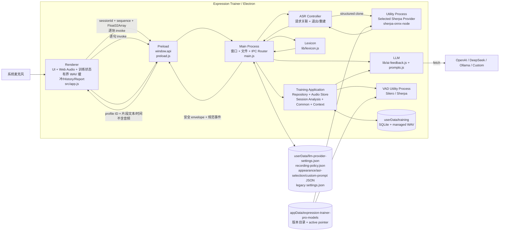

# 当前架构（As-Is）

> 状态：Verified from Source + Electron 43；内部开发/测试，M2 已按有限人工验收边界关闭；SenseVoice 下载与实机验收延期，M2 证据见 §13，M3 首版实现与自动化/制品证据见 §14；公开模型分发仍受外部门禁约束
> 运行时基线日期：2026-09-01；存储基础证据：2026-09-16；M1 产品集成证据：2026-09-19
> 仓库：`https://github.com/morigejile/expression-trainer-pro.git`
> 描述对象：当前集成分支的产品运行时、开发工具边界与已验证的内部安装基线

## 1. 证据边界

当前事实来自源码、依赖清单和 Git 状态，并由 Node 测试、Electron smoke、packaged native-load、真实 Paraformer 首次安装及升级 smoke 支持。已验证 Main/Preload/Renderer、utility-process IPC、执行单元退出与重建、Fake LLM、M1 首次录音告知、持久化 WAV 回放与结构化片段分析，以及 Electron AudioWorklet 对 16/44.1/48 kHz fixture 的适配。本轮真实麦克风 + Zipformer Small CTC 中文 INT8、Report/History 播放与保存恢复、VAD/Evidence 有限人工复核及真实外部 AI 已获用户确认，结论见 M2 验收矩阵。多采样率/可配置设备、接近资格线硬件及非 Windows x64 制品仍不外推。

M1 增量：[训练存储与产品集成](current.md#10-m1-training-storage-foundation) 已接入普通录音、已有结果、训练历史与共享 Report；包含极简 Preparing、静默准备检查、删除和保存失败重试。旧图集已归档，§4 图按当前源码更新；自动化证据与真实设备验收分开记录。

| 标记 | 含义 |
|---|---|
| **Source-verified** | 可由当前本地源码、配置或 Git 状态直接确认 |
| **Runtime-TBD** | 需要真实启动、设备、模型、网络或性能测试确认 |
| **Product-TBD** | 需要产品选择，代码不能回答 |

核心源码按运行边界组织：

| 边界 | 主要入口 | 职责 |
|---|---|---|
| Electron 控制面 | `main.js`、`preload.js` | 窗口、受控 IPC、文件、设置和 LLM 调度 |
| Renderer | `src/` | UI、Web Audio、训练状态、运行期 WAV 与安全渲染 |
| ASR 执行 | `lib/asr-*.js`、`lib/*asr-provider*.js` | session 契约、utility process、Sherpa Provider 和退出重建 |
| 模型管理 | `lib/model-*.js`、`models/registry.json` | Catalog、下载校验、原子激活、选择和失败回退 |
| 分析与配置 | `lib/ai-feedback.js`、`lib/lexicon.js`、`lib/*-store.js` | 本地规则、LLM、schema 迁移和 userData 原子写 |
| 共享运行时数据 | `shared/`、`data/` | Renderer/Main 共用规则与情绪词数据 |
| 验证与评测 | `test/`、`smoke/`、`benchmark/` | Node/Electron 回归与隔离的非发布 benchmark |

## 2. 当前目标与范围

当前系统以麦克风训练为唯一输入：

```text
麦克风音频块 ┬→ 本地 ASR → final 文本 → 本地词库统计
             └→ Renderer 有界 Int16/WAV
结束 → Application → SQLite 事实 + 受管 WAV → VAD/Common/按设置 AI → 保存报告快照 → 共享 Report
训练历史 → 按 ID 读取同一 Session → 共享 Report/播放/手动分析/删除
诊断重试与手动回放分析 → Main LLM → 带生成时来源的结果写回原 Session
```

具体产品能力与 Existing/Partial/Planned 状态统一维护在[需求基线](../product/requirements.md)；本文只描述这些能力如何在当前源码中运行。

普通录音结束时自动保存，跨重启历史由数据库查询；正常启动持有 SQLite 存储并注册 Application/Preload API（§10）。系统没有大型前端框架、独立后端或微服务。音频、ASR、模型、配置和交付边界已从原型职责中拆开；Renderer 的训练编排仍集中在 `ExpressionTrainer`。

## 3. 当前技术栈与版本

| 区域 | 当前选择 | 证据/备注 |
|---|---|---|
| 应用 | Electron `43.4.1` + 原生 HTML/CSS/JavaScript | `package.json#version` 是应用与制品唯一版本源；无 bundler/前端框架 |
| 音频 | `getUserMedia` + 16 kHz AudioContext + AudioWorklet | 320 帧 mono Float32 送 ASR；Renderer 同时生成有界 Int16/WAV；epoch 隔离暂停前旧块 |
| 权限桥接 | Preload `contextBridge` + `ipcRenderer.invoke` | `contextIsolation:true`、`nodeIntegration:false` |
| ASR 引擎 | `sherpa-onnx-node` `1.13.3` | 仅由 utility process 内的当前 Provider 延迟加载，Main 不 require |
| ASR 模型 | Paraformer、Zipformer Small、Zipformer Large、SenseVoice Small | schema-v2 Catalog 固定 archive/runtime；模型安装到 `appData/expression-trainer-pro-models`，权重不纳入 Git；默认仍为 Zipformer Large，SenseVoice 为可选整段识别；公开分发仍受许可约束 |
| 本地分析 | `lib/lexicon.js` + `data/emotion-lexicon.json` + `shared/expression-rules.js` | 146 个情绪词；16 个填充词、14 个犹豫词、20 组笼统词映射由 Renderer/Main 共用；未启用数据不放入活跃 `data/` 目录 |
| LLM | Node 原生 `fetch`，OpenAI/DeepSeek/Ollama/自定义 OpenAI-compatible | 在 Main 中发请求；连接/实时/报告/回放分析有独立超时，支持 AbortSignal、按 Renderer 取消和严格结构化响应验证；回放请求不含音频 |
| 设置 | `userData/appearance.json`、`userData/asr-selection.json`、`userData/llm-provider-settings.json`、`userData/recording-policy.json`、legacy `userData/settings.json`、`userData/custom-prompt.json` | Appearance、ASR 选择、多 LLM profile 与录音策略确认各自持久化且互不覆盖；录音策略文件只保存确认布尔值，训练内容另存 SQLite/受管 WAV；小文件原子发布；API Key 明文 |
| 构建/测试 | Node test + Electron smoke + Electron Forge 7.5/Squirrel | `package`/`make` 固定 Windows x64；packaged smoke 覆盖 Fake 产品流、utility-only Sherpa native load、完整 DLL unpack 和外部模型目录；尚无 CI |

开发工具精确版本见[开发与验证](../development.md)；已验证平台、制品和硬件边界见[支持矩阵](../support-matrix.md)。

### 3.1 Benchmark 与模型决策

独立 benchmark CLI 从 manifest 生成逐样本结果、汇总和环境快照，不进入产品 Audio/IPC/Main。BM-02～BM-04 已完成七候选同机比较，ADR-0009 据此采用 Zipformer Large 技术默认。候选具有固定 runtime hash、native-load 和 benchmark 证据，但再分发状态仍为 `not-approved`。

### 3.2 Model Manager 与生产模型

ASR 产品层以 `models/registry.json` 作为唯一 schema-v2 Catalog，不依赖 `benchmark/`。Catalog 描述三款 streaming 模型和可选 SenseVoice utterance 模型；Factory 只接受代码内冻结的 Provider 类型并延迟载入实现。模型安装到 `appData/expression-trainer-pro-models`（Windows 为 `%APPDATA%\expression-trainer-pro-models`），与可能本地化的 Electron `userData` 路径分离；旧 `userData/models` 在目标不存在时整目录迁移，双目录并存时拒绝覆盖。模型经过大小和 hash 校验、白名单解压、不可变版本发布与 native 初始化后才激活；中断、空间不足或校验失败不替换上一可用版本。独立 VAD 目录与任务见 §13。

`AsrModelService` 按严格命令行覆盖、持久选择、Catalog 默认值启动，并保证任意时刻最多一个识别 utility。模型切换先验证目标，再销毁旧 controller；失败时创建新的原模型 controller 回退，双失败进入 unavailable。安装由独立短生命周期 utility 执行，支持有界进度、取消和重试，不占用当前识别 controller。模型管理 IPC 只允许设置窗口调用四个固定 channel，Renderer 只接收脱敏快照并提交精确模型 ID。

### 3.3 Packaging、安装与升级

`forge.config.js` 是唯一打包配置，当前只构建 Windows x64 Squirrel；native Sherpa bundle 保持 ASAR unpack，模型位于 `appData/expression-trainer-pro-models`。内部制品已验证安装、真实模型首次准备、强制离线二次启动、1.0.0→1.0.1 前向升级和卸载数据保留，终端用户无需开发工具。

受支持更新路径是向前安装。手工运行旧完整 Setup 可能降级应用二进制，并可能用旧 schema 覆盖共享用户文件；重新运行当前 Setup 只能恢复应用版本，不能恢复已被覆盖的数据。该已知边界保留在支持文档，不为内部阶段增加 updater 框架。

显式内部构建可从 Git 外的绝对归档路径读取 Catalog 默认模型，校验精确字节数和 SHA-256，只把固定 `asr-models/<modelId>/<version>/<archive>` 加入 Forge `extraResource`。普通 `package`/`make` 仍不携带模型；Main 只从 `process.resourcesPath` 派生受信任包内归档位置，ModelManager 复用既有安装事务后激活。运行时始终从 `appData/expression-trainer-pro-models` 加载。

## 4. C4 Level 2：当前容器/运行边界



Main 负责 Electron 控制面、词库分析、小型 userData JSON 原子文件 I/O 和 LLM 请求编排；ASR 初始化与同步 decode 已移入单个 utility process。

## 5. 模块职责

### 5.1 Renderer / `src/app.js`

- `ExpressionTrainer` 编排录音、暂停、逐字稿、本地分析和 LLM 状态；`AudioCapture`/AudioWorklet 独立管理 16 kHz 采集、epoch 与 tail flush。
- 音频以最多 10 块的串行队列送入 ASR，overrun 失败关闭；Renderer 只接受当前 session 且 sequence 递增的规范事件。
- 同一 Float32 chunk 在 Renderer 转为有界 Int16。正常结束后组装 WAV 并通过 Application 持久化；内存仅缓存正在展示、保存失败或分析中的记录，离开、删除或退出时撤销不再使用的 Blob URL。
- streaming 单条录音最长 20 分钟；SenseVoice utterance 最长 5 分钟，结束后才转写，不显示伪 partial。达到上限走正常结束并保存可回放记录。首次录音前告知本地持久化、手动删除及远程 AI 数据边界，帮助页长期保留该说明。
- final 文本进入逐字稿、本地统计和单调片段时间轴；片段边界统一规范为严格递增的整毫秒，因此不足一整块的录音尾块不会让回放分析输入校验整体失败。播放只根据片段边界切换已完成建议，不触发推理。
- 首次录音在申请麦克风前等待用户确认；回放分析的失败、取消或迟到响应不覆盖上一份成功结果。
- 回放区模型下拉框只显示模型名；切换配置不自动请求，用户点击“重新分析”才用所选配置分析当前录音。
- 字幕与报告通过 text node、受控 `span` 和 Markdown 允许列表渲染；外观切换只改根节点属性，不重建训练 DOM。

训练编排尚未形成全局显式状态机；当前通过 session 失效、stop single-flight、队列 drain 和请求代际过滤控制组合风险。

### 5.2 Preload / `preload.js`

通过 `contextBridge` 暴露显式的 Appearance、设置、Prompt、ASR、分析、LLM、录音策略和文件能力；BrowserWindow 使用 `contextIsolation:true`、`nodeIntegration:false`。

- ASR 只暴露 start/feed/stop/cancel，并保留 session、sequence 和有限 Float32 样本校验。
- LLM 只暴露脱敏 profile 摘要、分析和取消；主窗口不能读取 Key 或完整 endpoint。
- 录音策略只读写确认布尔值，音频、时间轴和分析结果不经过设置 IPC。

### 5.3 Main / `main.js`

- 管理窗口、应用生命周期、IPC handlers、词库、对话框和小型 userData JSON；设置使用同目录临时文件、fsync 和 rename 原子写。
- 通过配置模块规范化和单向迁移旧 schema；损坏文件保留原文，future schema 可读已知字段但拒绝降级保存。
- ASR 命令通过 Router/Controller 返回安全 envelope；Main 不加载 Sherpa，utility 退出后在下一次 start 重建。
- 本地分析、有超时的 LLM fetch、回放输入校验和 Markdown 保存均在 Main 执行；同类新 LLM 请求取消旧请求。
- Fake ASR/LLM 只在显式 smoke 参数和隔离 `userData` 下组合，普通启动不进入该路径。

### 5.4 ASR Provider / session、managed provider 与 Factory

Main 只持有 `AsrProcessController`；实际 session wrapper、managed provider、Sherpa adapter、模型安装和模型对象均位于 utility process。`lib/asr-session.js` 维护单一 active session：start 创建 session 并在 `ready` 中声明识别与 timing 能力；feed 验证连续 input sequence 和绝对 sample cursor，结果标注已接收的 sample 区间；stop flush 后发出可选 `final` 及含最终 cursor/qualityEvents 的 `stopped`，cancel 不 flush 且发出 `stopped`。四款 ASR 均明确 `tokenTimestamps: false` / `timingSource: unavailable`；模型 token timing 尚未接入，独立后处理 VAD 保存为 §13 的结果快照。

`lib/asr-provider-factory.js` 只接受 Catalog 中代码支持的 provider type：Paraformer 由 `lib/asr.js` 创建，Zipformer Small/Large 由 `lib/zipformer-ctc-asr-provider.js` 创建，SenseVoice 由 `lib/sensevoice-asr-provider.js` 创建。`lib/managed-asr-provider.js` 从选中模型的不可变 active 版本取得 role 文件，完成准备和 native 初始化后才把 Provider 交给 session wrapper；Factory 不接收 Renderer 提供的路径、URL、hash 或 provider type。

三款 Provider 均只支持一个并发识别流，使用 16 kHz mono Float32 输入、CPU、2 threads 和 greedy search。Paraformer 从 encoder、decoder、tokens role 创建 recognizer；Zipformer 从 model、tokens 及可选 BPE role 创建 online CTC recognizer。adapter `feed()` 同步 decode 并返回 `{text,isFinal}` / `null`，`stop()` flush 最后的未确认文本。重复 `initialize()` 复用 recognizer，session start 创建新 stream。`lib/fake-asr-provider.js` 通过同一 session wrapper 用于普通测试与 Electron smoke；没有通用插件系统或依赖注入容器。

`src/app.js` 把当前 session 的 `final` 事件经 `mergeFinalText()` 去重后合并；非空尾部文本进入逐字稿、分析统计和后续报告。`stopRecording()` 等待尾部 final 的本地分析完成后再开放报告操作；失败时仍复位录音状态和 UI。

### 5.5 Lexicon / `lib/lexicon.js`

`lib/lexicon.js` 读取情绪词并输出填充词、犹豫词、笼统词、情绪词、密度和建议；录音模式逐句调用 `analyze-text`；粘贴入口、`analyzeTexts` Preload API 和 `analyze-texts` Main handler 已移除。Renderer 高亮与 Main 统计共用 `shared/expression-rules.js`；自定义词经去重、长度和 64 项上限后参与本地分析与 prompt。未接入运行时的词库不放在活跃 `data/` 目录。

### 5.6 LLM / `lib/ai-feedback.js`、`lib/prompts.js`

历史实时反馈和自由文本报告接口保留兼容，但普通录音已不调用实时 AI，完成后的 M2 结构化诊断接线见 §13。手动回放分析仍保留。目标用户任务与 Workspace 归属以 [Training Flow §13](../product/training-flow.md#13-screen-structure-收敛基线) 为准；后续可选实时 AI 见 Backlog B-19。

- 支持 OpenAI、DeepSeek、Ollama 和自定义 OpenAI-compatible；自定义训练规则附加到 prompt。
- 连接测试、实时反馈、报告和回放分析使用独立超时与 AbortSignal；同类请求互相 supersede，迟到结果由 Main 协调和 Renderer 代际双重抑制。
- HTTP/超时/取消/响应结构错误返回稳定脱敏文本，不透传错误正文或自动重试。
- 回放分析只提交有界文本片段与时间，并对 segment ID、JSON 字段和建议长度做严格验证；不提交音频或路径。

### 5.7 设置与数据

`llm-provider-settings.json` 使用 schema-v3 `activeProfileId + profiles[]`，自动启用字段见 §13；旧 schema/file 单向迁移，canonical 文件优先，不删除或双向同步 legacy 文件。损坏 JSON 保留原文，future schema 拒绝降级保存。API Key 当前仍明文保存。

`recording-policy.json` 使用 `{schemaVersion:2,acknowledged:true}`。旧版确认不代表已同意新的持久化告知，须重新确认；未知未来版本和损坏文件不被覆写。训练事实、WAV、本地统计及手动报告/回放结果保存在 §10 的训练存储中；Home 已移除粘贴、复制、保存和清空入口。

`custom-prompt.json` 由 `lib/custom-prompt-store.js` 读写，与其余 store 同形；解析结果按 mtime+size 缓存、保存时失效，避免逐句分析反复同步读盘。

`appearance.json` 只保存四个主题和两个布局标识；缺失、损坏或未知值回退 Graphite/coach-rail，future schema 可读取已知值但拒绝显式保存。`asr-selection.json` 只保存 `selectedModelId`；缺失或稳定损坏在默认模型成功后原子恢复，瞬时初始化失败不改写选择。外观和模型操作都独立于 LLM 保存/连接测试。

Appearance 与 ASR selection 当前均为 schema version 1；二者和 LLM provider 使用独立 config/store、Preload API 与 IPC，不共用配置快照。三种配置的新文件不存在时才从 legacy settings.json 单向迁移，新文件存在后以其为准；损坏来源保留原文，future schema 只读可识别字段且拒绝显式保存。设置“保存”和“测试连接”保持独立。迁移、原子发布失败、新文件优先和 future schema 边界已有对应测试。

### 5.8 Benchmark dataset boundary (BM-01)

数据集契约、冻结语料、来源与覆盖边界统一维护在 [`benchmark/datasets/README.md`](../../benchmark/datasets/README.md) 与 [`SOURCES.md`](../../benchmark/datasets/SOURCES.md)。Benchmark validator 不接入产品 Main、Preload、Renderer 或 ASR。

## 6. 当前关键数据流

### 6.1 音频到识别

```text
getUserMedia({audio:true})
→ 16 kHz AudioContext / AudioWorklet 下混并汇集 320 帧 Float32 chunk
├→ Preload/Main 校验 → AsrProcessController → utility process 同步 decode
│  → partial/final event → Renderer session/sequence 过滤后更新 UI
└→ Renderer Float32→Int16 → 当前有界录音缓冲（不经 IPC）
```

AudioCapture 返回并保留请求值、`audioContext.sampleRate` 与可用的 track rate；实际 context 不是 16000 时在创建 worklet 前失败关闭。固定 Electron fixture 已证明 16/44.1/48 kHz 确定性缓冲进入 16 kHz graph 后的总帧数、平台均值与时间过渡；当前默认真实麦克风主链路已通过用户验收；其他采样率/驱动组合仍为 Runtime-TBD。

每块仍经 TypedArray 规范化和两次 structured clone；空载吞吐已足够，当前保留 10-block 可观测队列而不增加共享内存。

### 6.2 结束与尾部文本

```text
Renderer 请求 AudioCapture flush，关闭队列入口并 drain 已接受 chunk
→ stopASR({sessionId}) / stop-asr
→ stream.inputFinished + decode
→ utility process 返回可选 final + stopped 事件
→ Renderer 过滤当前 session/sequence，并经 mergeFinalText 去重 final
→ 非空新文本进入字幕、统计、片段时间轴、分析和报告
→ Renderer 组装 16-bit mono WAV Blob，释放 PCM 分块
→ 使用录音开始时建立的 Session ID 完成事实/WAV 写入，再保存统计快照
→ 共享 Report 显示保存状态及播放器；失败时保留原音频供同 ID 重试
→ 历史查询不设五条保留上限；离开/删除/退出撤销不再使用的 URL
```

### 6.3 分析与 LLM

```text
endpoint/final sentence
→ analyze-text invoke → Main lexicon → stats/建议
→ Renderer 本地规则提示

录音结束 → 保存事实/WAV → Main VAD/Common/按 profile 启用的 AI 诊断 → 结果快照 → 共享 Report
历史打开 → 读取原快照 → 共享 Report（不自动请求 AI）
用户重试诊断 → Main 为同一训练追加结果 → 精确引用新快照，失败保留此前成功诊断
用户手动回放分析 → profileId + 片段文本/估计时间 → Main 校验 → 结构化 fetch
→ 将结果与实际使用的 profile/model/分析指令快照保存到原 Session
→ 播放/拖动跨片段更新字幕与已有建议，不再次推理
```

导航不改变结果归属；删除后的迟到结果不能恢复记录。失败状态单独保存，上一份成功报告/回放结果仍可读。缺失的指标显示未知，不补零；M2 Common 不以旧 metrics 快照是否存在阻止重试，但历史词项统计遵循 Data Model §5.3 的快照复用/缺失规则。旧自由文本报告仅留兼容接口。生成时无法获知的来源字段保持 null。

### 6.4 设置与 Prompt

Settings/Prompt Renderer 通过 Preload 调用 Main 中的 userData JSON store；LLM 请求在发起前重新读取 profile。首次录音只在 `recording-policy.json` 已确认后才启动 ASR 和申请麦克风。

## 7. 部署与安装现状

- Forge 7.5/Squirrel 只构建 Windows x64；当前没有 publish script 或 CI。
- `smoke/` 只在显式参数和隔离 `userData` 下执行；`test/`、`benchmark/`、`scripts/` 和 `docs/` 不进入制品。
- 普通制品不携带模型；内部制品可从 Git 外的 Catalog 固定归档导入默认模型，但运行时仍只从 `appData/expression-trainer-pro-models` 加载。
- 开发命令见[开发与验证](../development.md)，已验证制品与升级边界见[支持矩阵](../support-matrix.md)，未完成的公开交付工作见 [Roadmap](../roadmap.md)。

## 8. 当前开放风险

已由源码和现有验证关闭的历史边界不再逐项复制到本表；理由与落地证据保留在 ADR、Roadmap 和 Git 历史。当前仍会影响后续决策的风险如下：

| ID | 当前风险 | 已有边界 | 下一次触发条件 |
|---|---|---|---|
| TD-03 | 默认真实麦克风链路已通过，其他采样率/驱动组合仍缺设备证据 | 固定 Electron graph 已覆盖 16/44.1/48 kHz | 有可配置真实设备时复核；实测失败才评估 WASM 备选 |
| TD-04 | 320 样本块仍经两次 structured clone | 10-block 队列可观测且失败关闭 | 真实推理 profile 证明复制成为瓶颈时再换通道 |
| TD-07 | `ExpressionTrainer` 仍编排多个训练阶段 | session、stop single-flight、迟到结果和 overrun 已分别受控 | 新状态使现有局部状态无法可靠组合时再抽取状态机 |
| TD-08 | 无 CI，Experimental 平台无制品证据 | Windows x64 Node/Electron/安装/升级 smoke 已建立 | OPS-01 或实际新增支持平台时增加最小验证 |
| TD-09 | API Key 仍明文保存在 userData | 原子写、future-schema 防降级与日志脱敏已覆盖 | 公开发布且 keychain 收益超过 native/跨平台成本时复审 |
| TD-10 | settings/custom-prompt 尚无外层 payload 大小上限；页面也未启用 CSP/sandbox | ASR、文本分析、实时反馈、报告统计和 Markdown 保存已有精确或轻量输入边界；Renderer 无 Node integration | 对应 payload 出现具体资源风险，或进入公开发布安全收口时逐项处理 |
| TD-12 | LLM 瞬时失败仍需用户重试 | 超时、取消、迟到抑制、响应验证和错误脱敏已覆盖 | 产品确认重试语义后再实现，不在 fetch 层盲目重试 |
| TD-17 | Forge/Squirrel 的仅开发传递依赖仍有安全告警 | 生产依赖审计为 0，当前组合已有完整打包证据 | 出现具体安全/兼容风险时受控升级并重跑 make/native smoke |

已关闭的结构边界包括：ASR 移出 Main、AudioWorklet 替换废弃节点、Model Manager 安装与回退、配置原子写、安全 DOM 渲染、表达规则同源、未启用数据移出发布树，以及应用/模型版本口径分离。后续行为变化只更新受影响的当前事实，不恢复完整历史台账。

## 9. 当前架构评价

### 应保留

- 单一 Electron 桌面应用，无独立服务端；训练存储基础的集成状态见 §10；
- 原生 JS/HTML/CSS；
- 本地 Sherpa-ONNX 路线；
- 本地确定性分析 + 可选 LLM 的降级结构；
- `contextIsolation:true`、`nodeIntegration:false` 的权限方向；
- 用户数据已位于 `userData` 而非安装目录。

### 继续控制的复杂度

- Audio 逐块 invoke、TypedArray 规范化与跨进程 structured-clone 复制；
- 完整训练状态仍由一个 Renderer 编排类组合，只有状态继续增长时才做局部抽取；
- settings/custom-prompt 外层大小、页面 CSP/sandbox 与明文密钥留到对应具体风险或公开发布收口；
- 接近资格线性能、多采样率/其他麦克风组合和 Experimental 平台仍缺证据；默认真实麦克风链路见 M2 验收；
- 首次安装与 1.0.0→1.0.1 升级已可复现，后续只维护能发现实质回归的验证。

结论：当前内部基线的运行时、评测和交付边界已经收敛。剩余风险只随模型公开交付、utterance 轨道或其他已重开工作渐进处理，不开展脱离当前任务的全面重构。

需要补充的设备、平台和公开发布证据统一维护在[支持矩阵](../support-matrix.md)与[Roadmap](../roadmap.md)，本文件不复制验证待办。

## 10. M1 training storage foundation

存储基础：2026-09-16；Application、普通录音、已有结果与 History/Report 集成：2026-09-19。实现范围见 [M1](../milestones/m1-training-persistence.md)，数据语义仍由 [Data Model](data-model.md) 定义。

### Runtime and ownership

仅 Repository 使用运行时内置的 `node:sqlite/DatabaseSync`，没有新增依赖、ORM 或 native binding。正常 Main 启动在取得单实例锁后打开 `userData/training`，初始化及恢复完成后接受命令；第二实例只唤起已有主窗口。初始化失败返回安全类别，未知未来 schema 不改写。

窗口关闭先请求 Renderer 停止录音、等待收尾、已有分析与保存，排空期间拒绝新录音/分析。保存失败可取消退出并重试；10 秒未响应会明确提示继续等待或放弃未保存内容后退出。收到 Renderer 完成确认后，Application 拒绝新命令并排空已受理操作（默认 5 秒）；超时返回 `STORAGE_SHUTDOWN_TIMEOUT`，不伪报成功，下次启动恢复。这些预算与 M2 Processing timeout 无关。

### Application and Preload commands

`training-session-ipc.js` 只接受当前主窗口、主 frame、预期主文档（可含 hash）调用，其他窗口或文档返回 `FORBIDDEN`。命令使用 requestId，单条操作另带 sessionId；Renderer 不能指定文件路径。

| Preload API | 行为 |
|---|---|
| createTrainingSession | 建立稳定 ID、冻结 Main 提供的真实应用/ASR 来源，返回 recording |
| finalizeTrainingSession | 同一 ID 保存事实和有界 WAV，重复完成不覆盖已完成数据 |
| interruptTrainingSession | recording 标记 incomplete；不覆写已完成或复活已删除记录 |
| appendTrainingResult | 幂等追加已有统计/报告/回放快照，拒绝过期输入版本及已删 Session |
| listTrainingSessions | 按创建时间和 ID 倒序分页，含状态/模式/有界摘要，不附音频全文 |
| getTrainingSession | 按 ID 读取事实、结果与完整性，删除/不存在返回 null |
| compareTrainingSessions | 两条 Session ID 的只读对比；可携带已固定的 Session/revision/Report 引用复核，返回逐项兼容性、差值与所属侧证据；不调用分析或保存 Comparison，详见 §14 |
| readTrainingAudio | 验证音频完整性和删除状态后返回字节，不暴露任意路径 |
| deleteTrainingSession | 删除 Session、子项与受管文件；部分失败可重试 |

错误类别包括输入无效、记录不存在/忙、完成失败、删除失败、音频不可用、结果过期、未知 schema、存储不可用/正在关闭及未授权。Application 映射固定安全文案；Renderer 分开显示事实保存失败、结果保存失败与分析失败。事实失败保留原 Blob，结果失败保留同一结果 ID，重试不会制造重复记录。

### Files and schema

```text
training/
  sessions.sqlite
  audio/<session-id>.wav
  staging/<session-id>.part
```

SQLite `user_version` 0→1 事务创建 sessions/transcripts/artifacts，1→2 增加 results（不可变快照 JSON，Session 外键级联删除）。打开前只读检查版本；大于 2 的数据库拒绝降级，保持字节不变。没有旧版运行期记录可导入。

Session 只接受 microphone/free、null framework/trainingPrompt，title 显式为 null。音频时长从校验后的固定 PCM 格式推算，独立 createdAt 未采集时为 null。片段保留稳定 ID、顺序和 estimated timing，未知 startSample/endSample/confidence 为 null，不冒充精确时间证据。

结果保留生成时间、输入修订、证据引用、定义/分析器版本以及实际使用的来源。统计标识为 expression-rules-v1/lexicon-v1；AI 来源在 Main 发起请求时捕获，只保存实际参与该类请求的分析指令及 provider/model/profileId，排除 Key、endpoint 和凭据。未知字段为 null，不用之后的设置重建历史来源。失败快照不覆盖上一份成功结果；损坏结果单独标记，健康事实继续可读。

### Writes, reads and deletion

- 录音开始建立 Session 后才启用音频提交；建立失败停止采集。停止等待 ASR 尾部与本地分析，完成事实/WAV 后追加统计。M2 随后自动运行 §13 分析链；历史打开不重跑，回放分析仍为手动操作。
- WAV 发布经过 finalizing intent、独占 staging、flush/close、hash、同目录 rename，最终事务提交逐字稿和音频元数据。并发完成共享一次操作，已完成不能覆写；失败留下 incomplete，使用保留的原录音重试。
- 启动把中断的 recording/finalizing 变为 incomplete 并检查音频；只清理超过 24 小时且无引用的普通 staging 文件，不自动删除已保存录音。
- get/readAudio 在异步 I/O 后复查记录生命周期；Renderer 也检查导航代际和删除集合，迟到读取/结果不恢复已删记录。音频缺失/损坏只禁用播放，健康文本/结果仍可读；损坏记录与其他行隔离。
- 删除先标记 pending，再移除生成的受管音频/staging 文件，最后删除数据库行与子项；部分失败返回可重试状态并禁用播放。路径/符号链接边界阻止任意文件读写。
- History 每页 50 条，支持更多、空态与返回上下文；普通录音和历史打开复用 Report。内存缓存不是保留策略，不存在五条产品上限。

### Verification and remaining integration

2026-09-19 使用项目声明的 Node 24.20.0 / npm 11.19.0、Electron 43.4.1 验证。工具链下载仅用于临时验证，未更改全局运行时。`npm test` 共 575 项：573 通过、0 失败、2 跳过（Windows 不允许创建文件符号链接，不能计为通过）。Windows x64 `npm run package` 成功，`npm run smoke:package` 返回 `PACKAGED_APP_SMOKE_OK`。

```powershell
npm test
npm run package
npm run smoke:package
```

测试覆盖 Repository/Application 的事务失败、迁移、异常恢复、幂等、删除/读取竞态与来源过滤；Renderer 测试覆盖关闭排空、迟到请求、保存重试、静默准备检查及原有 ASR 暂停/恢复/过载/20 分钟上限。产品 Electron smoke 走正常 Renderer 录音完成路径，保存 7 条、手动分析、修改设置后重启核对历史来源、播放、缺失音频降级、删除和空态；无 LLM 配置时仍可本地保存。制品 smoke 另覆盖原生依赖与 API/存储/产品重启流。

| M1 验收映射 | 已运行的主要自动化证据 |
|---|---|
| AC-M1-01 | `test/training-product-electron.test.js`：正常 Renderer 完成 7 条、结果落盘、重启 History/Report/播放/返回 |
| AC-M1-02 | `test/microphone-readiness.test.js`、`test/transcript.test.js`、`test/electron-smoke.test.js`：静默预检/开始复检、入口移除、Help 诊断 |
| AC-M1-03 | `test/training-session-store.test.js`、`test/training-persistence-client.test.js`：失败注入、恢复、同 ID 重试；Renderer 关闭失败保护 |
| AC-M1-04 | `test/training-session-application.test.js`、`test/training-session-results.test.js`、`test/transcript.test.js`：重复完成/结果、导航与删除后的迟到响应 |
| AC-M1-05 | Store/Application/Product Electron 测试：文件与元数据删除、部分失败重试、删除后空态 |
| AC-M1-06 | Store/Results/Product Electron 测试：缺失/损坏音频、损坏结果与健康事实隔离 |
| AC-M1-07 | Store/Results/API Electron 测试：v1→v2、未知未来版本拒写与正常启动错误 |
| AC-M1-08 | `test/recording-policy-store.test.js`、`test/analysis-provenance.test.js`、现有 LLM/诊断/Renderer 测试：v2 告知、实际请求/来源白名单、授权前不申请麦克风 |
| AC-M1-09 | Product Electron offline/offline-read 两个进程：阻断 HTTP(S)/Main fetch 且无 AI 配置，完成同一记录的保存、重启、读取、播放与删除 |
| AC-M1-10 | `test/transcript.test.js` 与 ASR/audio/PCM/Electron 回归：暂停、恢复、收尾、过载和单条上限 |

上述 M1 历史 smoke 使用隔离 userData、确定性音频输入与 Fake ASR/LLM，当时未验证真实麦克风/驱动及外部 LLM；本轮默认真实录音、播放/恢复及 AI E2E 结果统一见 M2 人工验收，不能将历史缺口当成当前仍未测试。历史 2026-09-16/19 基础/API 切片使用替代工具链的证据仅代表当时切片；M1 代码实施与设备人工验收分别记录，后续 M2 增量另见 §13。

## 11. 诊断导出现状

诊断导出只在 Help 中保留，主导航入口已移除，与 [Training Flow §13.1](../product/training-flow.md#131-已确认的-ia-归属) 一致。

诊断按用户操作导出固定 schema 的 JSON：应用版本、OS/platform/arch、active 模型 ID/版本、请求/context/track 采样率、最近 ASR 初始化耗时和受控错误类别。文件不包含设置、API Key、Authorization、绝对路径、stack、音频、逐字稿或 LLM 内容；不在后台持续写日志，也不自动上传。未开始录音或未安装模型时，对应字段明确为 `null`/`not-installed`。

## 12. M2 timing foundation slice

2026-09-19 首个切片：适配器贯通采集 → ASR 接收游标 → Session 保存 → History 恢复。下述 212 项为该切片历史证据，后续增量见 §13，不代表整个 AC-M2-01 或 M2 完成。

- Renderer 的 WAV frame count 与 ASR 接收计数分开。暂停不计入录音时间，endpoint/final 不重置绝对游标；过期、外来、重复或越界游标事件不推进时间事实。
- 当前两种生产 ASR adapter 均无已接入的 token timing；Main 来源标记为 `unavailable`。Renderer 仅生成 `estimated` 回放片段，保留 `renderer-final-boundary-v1`，不把 chunk 接收范围变成词级边界；未知 sample/confidence 保持 null。
- `Session.timing` 是 schemaVersion 1 的完成/中断快照：16000 Hz、capturedSampleCount、最后实际观察到的 asrAcceptedSampleCount（未观察为 null），以及独立 evidence capabilities。当前只具 audioTimeline；speechSegments/tokenTimestamps 为 false。完成时核对真实 WAV 样本数与时长；这不是每块音频的持久事件日志。
- 快照沿用 SQLite v2 `facts_json` 的附加字段，质量标记沿用 `quality_json`，无需新表或历史重分析。旧记录 timing 为 null；已完成记录不被重试、中断或模型切换改写。
- ASR error event 即使装在 `ok:true` envelope 内也会失败关闭；queue overrun/ASR 失败把质量标记和可知计数保存在 incomplete Session，不声称中断音频已保存。正常完成保存 timing-unavailable/estimated，仍保留文本、音频和已有本地分析。

使用 Node 24.20.0 运行 ASR session/IPC/event/provider、capture/queue/PCM、训练存储/Application/client/Renderer 与 Electron API/product/smoke 的定向回归：212 项通过、无失败。新增测试先复现来源/质量丢失、错误事件伪成功和越界游标，再验证修复；覆盖暂停、连续 endpoint finals、零碎尾块、溢出、保存校验和跨进程重启恢复。Electron 使用隔离 userData、确定性输入与 Fake ASR/LLM，未做真实麦克风/模型时间戳校准、打包或全量里程碑验收。

协议当前映射见 [Speech Contract §11](speech-contract.md#11-current-adapter-mapping)，里程碑验收仍按 [M2 AC-M2-01](../milestones/m2-speech-evidence-and-ai-diagnosis.md#acceptance-criteria) 跟踪。后续 quality-event、VAD、Metrics/Finding 实施见 §13；原生 token 时间戳/独立 alignment 和已校准雷达尚未接入。

## 13. M2 analysis pipeline

2026-09-19：已保存训练由 Main 的 `session-analysis.js` 调度 Speech Evidence、Common Analysis、结构化 Diagnosis 和 Report snapshot；唯一数据定义见 [Data Model §5](data-model.md#5-later-derived-entities)。沿用 SQLite v2 的不可变 results，快照绑定本次确切结果 ID；Renderer 不能写入这四种受控结果。新增 `analyzeTrainingSession` 与 `cancelTrainingAnalysis` 主窗口 API。保存事实不依赖 AI，历史 get/list 不重新分析，显式重试追加结果，不覆盖先前成功诊断。

- 时间证据增加有序 quality-event、stopped 汇总及持久 `timing.qualityEvents`；queue overrun 保存可知的排队/拒绝块范围，未知范围保留 null。utterance 识别失败或用户取消收尾时保留已捕获 WAV，ASR 质量标为不可用，不能生成伪转写成功诊断。
- SenseVoice 使用冻结的可选 Provider，无 partial，最多 4,800,000 Float32 样本。停止时推理；取消能终止正在执行 stop 的识别子进程，下一会话重建。技术默认仍为 Zipformer Large；用户本轮选用并验收的实用主路径为 Zipformer Small CTC 中文 INT8。SenseVoice 本轮下载异常、真实设备/资源验收未完成，按 Backlog B-23 延期。
- Silero VAD 使用独立 `models/speech-evidence-registry.json`，复用 Model Manager 的固定文件大小/hash 安装与离线缓存；首次分析按需安装到 modelRoot 下的 speech-evidence 目录。独立 utility process 隔离 native 崩溃，并支持硬取消/超时；单个 Main 串行执行 VAD，最多接纳三条分析任务。整个分析预算为 120 秒，AI 请求预算为 60 秒。失败保存 unavailable，已保存事实与可用指标继续可读。
- Common 的 15 个指标是确定性观测值，不输出表达质量分。`session-analysis-inputs.js` 复用已保存词项输入，首次 finalize 的新训练才可采用当前词表；历史缺失统计不以当前设置补算。VAD 区间明确带未校准限制；缺失/不连续证据按依赖使指标 unknown，不用零填补。AnalysisContext 只携带当前文本、允许的指标/语音区间、质量及分析指令；没有音频字节、Key、endpoint、路径或其他记录。
- LLM 配置 schema 3 增加每个 profile 的自动诊断开关；新配置为空、旧配置迁移默认关闭。Main 在实际发起前重新解析精确 active profile，未启用、缺失或删除不会自动选择其他服务。界面披露实际本地/远程目标与发送内容；改变 Provider、模型或地址会清除该 profile 的自动启用状态。
- 训练中只使用本地规则。报告显示摘要、首三项 Finding、可展开的更多发现/指标、证据定位及缺失状态。四类 Finding 与未校准雷达的产品语义只见 [Training Flow](../product/training-flow.md)。Processing 在事实保存后可离开到 History，完成不会强制跳回；分析取消/失败可恢复，历史读取保持原快照。
- 保存期间取消分析后，Renderer 只读取已保存结果，不再调用可能新建任务的分析入口。分析刷新保留尚未写入的结果、统计和失败提示；成功重试同一结果 ID 后才清除待保存状态。

历史真实模型有限测量与本轮有限人工复核边界见 [M2](../milestones/m2-speech-evidence-and-ai-diagnosis.md#当前实施与有限证据)。真实 Electron 43.4.1 / 内置 Node 24.18.1 已验证 VAD 中文 WAV、损坏 ONNX 子进程退出隔离、取消及下一任务恢复；这些探测不代表准确率、资格线硬件或全部 M2 验收。

此前真实模型制品验证另从当次 `app.asar` 加载 VAD worker、SenseVoice Factory 和 Sherpa native 依赖，无源码 node_modules 回退。VAD 的上述四项场景通过；SenseVoice 对既有 5.592 秒中文 WAV 初始化约 1.49 秒、识别约 136 毫秒，返回「开饭时间早上九点至下午五点」，验证无 partial、取消后空结果及释放，峰值约 382 MiB。普通制品仍不携带模型权重，探针复用 Git 外缓存，不改变模型公开再分发状态。

2026-09-19 最终收尾验证：Node 24.20.0 / npm 11.19.0 下 `npm test` 共 724 项，722 通过、0 失败、2 项因 Windows 文件符号链接权限跳过。Windows x64 `npm run package` 成功，`npm run smoke:package` 返回 `PACKAGED_APP_SMOKE_OK`。桌面/制品产品流验证连续七条训练、自动诊断、修改设置后重启读取原来源、播放、删除及无配置断网保存；ASR/LLM 为确定性替身。定向测试另覆盖取消与采集尾块排空顺序、保存期间取消不重启分析、待保存结果不被刷新覆盖、超时、无效响应与引用、启用/撤销、保存重试和导航后的结果归属。

此前打包首次直连下载源超时；已有 Electron 43.4.1 ZIP 与安装包内 checksum 匹配，但打包器仍需获取远端校验清单。仅在重试命令环境中启用现有系统代理后打包成功，未关闭校验、修改依赖或持久更改代理配置。

本机 HTTP 回环集成验证经真实 fetch、Provider 协议、严格响应校验、SQLite 持久化和报告投影，覆盖 custom/Ollama 协议、401/429/503、超时、非法证据、活动请求取消与显式重试、撤销后不发送，以及修改词表后统计稳定、重启不重复请求。完整链路确认 Source/Metric/Diagnosis/Report 的精确 ID 与三类 Finding 引用（文本、指标、语音区间）；结果写入失败的故障注入确认重试不拼入孤立旧结果。服务响应及区间仍为受控 fixture，不代表外部 LLM 输出质量或 VAD 准确率。

人工核验已有 VAD 的入口为只读 [`inspect-speech-evidence.js`](../../scripts/inspect-speech-evidence.js)：读取 Report 精确引用的 Source、校验原 WAV，并导出语音区间、内部 gap、首尾非语音的 sample/秒边界与原始快照；用既有 Common Metric 定义核对已保存汇总。正式 Report、模型参数、持久化 Schema 均未改变。操作方法见 [Development](../development.md#m2-已保存-vad-区间核验)。现有粒度足以复核区间/汇总及当前 Finding 的文本、指标、语音区间引用；仍不提供词级对齐或证明 AI 解释在语义上成立，本轮用户反馈确认 AI Diagnosis 正常，不外推所有推理结论。

本次 Closeout 归档此前未提交的统计输入快照修复、取消/保存刷新修复、HTTP/异常测试及只读 VAD 核验工具，并落盘最终验收决定；本轮未新增实现。M2 正式关闭，人工证据和各项边界只在 [M2 验收矩阵](../milestones/m2-speech-evidence-and-ai-diagnosis.md#acceptance-criteria) 定义。SenseVoice 下载异常与真实 smoke/资源验收（B-23）明确延期；Report UX（B-22）、雷达完整校准（B-20）和扩大 VAD 校准（B-24）为非阻塞后续项，重开条件只见 [Backlog](../product/backlog.md#not-now)。雷达及 VAD 来源的未校准标记保持不变。

## 14. M3 comparison and review

M3 首版按用户选择交付可靠指标变化与两侧证据复盘。实现见 [Comparison Core](../../lib/session-comparison.js)、[共享报告选择](../../shared/report-selection.js) 和 [Comparison Renderer](../../src/comparison.js)；产品与数据规则仍由 Training Flow §13.2–§13.4、Data Model §10.1 定义，自动跨录音 Finding 语义变化判断按 R-R02 / Backlog B-25 延期。

- Application 的 `compare` 经既有主窗口 IPC / Preload 暴露。命令为 `{requestId, sessionIds:[id1,id2], snapshots?}`；固定引用每侧包含 `{sessionId,inputRevision,reportId}`，无结构化报告时 `reportId=null`。重复 ID、额外字段或非法引用拒绝；消失/删除输入返回 `SESSION_NOT_FOUND`，固定版本/报告失效返回 `COMPARISON_STALE`。未新增 SQLite 表或远程调用。
- Core 与 Report 共用稳定选择函数，并逐侧固定 Session、transcript revision 和精确 Source/Metric/Diagnosis/Report。使用保存输入及已知 V1 定义校验测量，不重新分词、不运行模型、不以今日设置补值或回写历史结果。词表、ASR/VAD 来源、Source 执行状态/producer、分母或引用不满足条件时局部降级；未知不是零，雷达仍不可用。
- History 增加 0–2 条 checkbox 和显式对比按钮；Comparison 展示两侧身份、Finding 复盘、指标原值/差值/限制与就近按需展开的证据。证据播放经受控音频 API 再次读取；旧记录使用 WAV 音轨时钟，不将历史墙钟时长当作音频终点。
- 复用既有 Report，返回时恢复原比较快照、展开态、滚动位置与焦点。History 恢复选择/位置；Help 关闭保持对比上下文。异步读取和播放按任务与操作序号隔离；音频读取期间删除再次复核，迟到响应不复活已删记录。离开对比释放播放 URL 和临时投影。

2026-09-19 使用 Node 24.20.0 / npm 11.19.0 执行最终 `npm test`：742 项，740 通过、0 失败、2 项因 Windows 文件符号链接权限跳过。Windows x64 `npm run package` 成功，`npm run smoke:package` 返回 `PACKAGED_APP_SMOKE_OK`。未修改依赖、全局工具链或用户训练数据。

证据包括纯函数 fixture 的版本/来源/单位/词表变化、零分母、旧记录、局部缺损、跨 Framework、Source 失败/未知版本与精确证据归属；Application/IPC 的只读/参数/权限与删除竞态；Renderer 的迟到读取、音频竞态、固定输入、失败重试身份及安全文本。真实 Electron 和包内产品流覆盖两条勾选/取消、显式进入、双方报告入口、对比内音频解码播放、Report 返回原 600px 滚动位置/展开/焦点、Help 返回、重启后的历史和无 AI 配置/断网复盘。源码产品流另验证删除 WAV 后的局部降级。

上述产品流使用隔离 userData、确定性音频与 Fake ASR/LLM；本轮未新增真实麦克风采样或用户人工交互验收，不据此评价真实语义判断、VAD 准确率或跨设备效果。M2 的既有人工结论保持原边界；M3 首版验收映射见 [M3 milestone](../milestones/m3-comparison-and-review.md#acceptance-matrix)。
