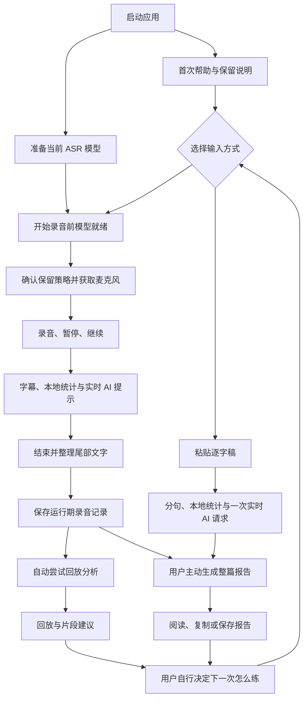
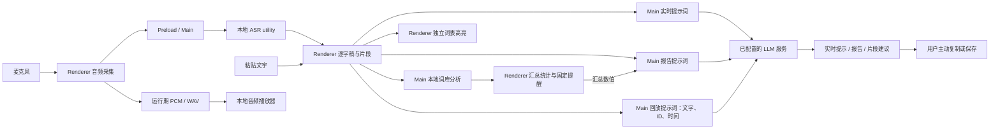

# 整体业务逻辑与数据流梳理（评审工作稿）

> **身份：Archived。** 历史源码观察、提案和评审结论均非当前事实或验收依据。现行定义与承接位置见 [职责矩阵](../../README.md)。未被当前 Canonical 接受的建议不因归档而晋升。

> **状态：历史评审快照。** 其中产品建议已由 2026-09-16 的 [需求基线](../../product/requirements.md)、[目标架构](../../architecture/target.md)和[当前 Roadmap](../../roadmap.md)取代；本文只用于追溯当时的源码观察，不作为当前需求或计划。
> 日期：2026-09-11；源码快照：`c859fd6`。
> 用途：围绕“帮助用户发现表达问题、获得改善建议”，逐项判断现有业务的必要性和优化方向。
> 证据：当前源码、现有测试用例与文档对照；本稿不代表真实用户研究、外部 AI 效果或设备验收结论。
> 文中“现状”是实现事实；“建议／待判断”是产品评审输入，尚未成为已实施行为。

## 1. 如何使用这份梳理

按用户行为从入口追到结果，再从结果反查它用了什么数据。每项业务都回答：

| 要回答的问题 | 记录什么 | 对优化的用途 |
|---|---|---|
| 用户为什么需要它？ | 目标、使用场景、预期获得的结果 | 判断是否服务核心目标 |
| 什么情况下启动？ | 用户操作、自动触发条件、前置状态 | 发现隐式执行与不必要请求 |
| 实际怎么判断？ | 条件、阈值、分支、优先级、默认值 | 发现错误假设与重复规则 |
| 数据从哪里来、到哪里去？ | 生产者、字段、消费者、保存位置、失效方式 | 发现未使用数据、重复计算、错用旧结果 |
| 中途失败或切换会怎样？ | 取消、超时、重试、回退、删除与保留 | 判断保护逻辑是否必要 |
| 输出改变了用户什么行动？ | 可理解的发现、可执行建议、重练动作 | 区分功能存在与实际有效 |

### 1.1 六个视图放在同一份工作稿中

1. **业务地图**：覆盖哪些用户任务，哪些是核心能力或运行支撑。
2. **流程图**：一次操作经过哪些角色、系统和分支。
3. **规则表**：把“如果……就……”明确写出，包含自动触发。
4. **状态表**：进入条件、可进行的操作、退出及失败结果。
5. **数据表**：字段来源、用途、传输、保存及销毁。
6. **价值评审表**：保留、修改、合并、降为辅助、移除候选或待验证。

这里的“完整”以用户可见业务为边界：每个入口、自动触发、持久化写入、外部请求，以及会改变结果的异常分支都能找到对应说明。文件中的每个工具函数不必成为独立业务。

### 1.2 证据和判断分开

- **源码事实**：以入口函数、条件判断及实际消费数据的位置为依据。
- **行为验证**：对影响判断的具体路径使用已有测试或针对性复现，不把测试通过等同于产品有效。
- **产品判断**：代码不能证明某条提醒有帮助，也不能证明用户愿意配置或重练。
- **文档差异**：既有说明可能早于实现，不直接复制成当前缺陷。

本轮发现：当前字数已排除标点；粘贴后录音选择入口已保留；空 AI 反馈已有正常状态；启动时已有帮助、保留说明和模型准备逻辑。不能把这些继续列为旧版未修问题。[源码：统计](../../../shared/text-statistics.js)、[源码：主流程](../../../src/app.js)。

历史 [UI state audit](ui-state-audit-2026-09-02.md) 仍以 `7252005` 为基线，其中记录的用户决定曾作为评审输入，但行为表需按当前代码复核。本文不覆盖或改写该历史快照。

## 2. 业务地图：完整表达训练需要什么

本轮评审目标来自当前讨论：帮助用户找到表达中的问题，提供优化改善建议，并能据此练习。

| 用户任务 | 当前能力 | 产出的用户价值 | 当前缺口／评审重点 |
|---|---|---|---|
| 准备使用 | 首次帮助、录音保留说明、ASR 预加载、设置 | 知道如何开始，具备识别条件 | 引导是否足够清楚，需要真实新用户验证 |
| 确定怎么练 | 训练目标、规则、风格、额外口癖词编辑 | 自定义训练方向 | 没有一次训练专属的结构化场景；设置应用范围不一致 |
| 输入表达 | 录音、暂停、继续、结束；粘贴逐字稿 | 获得可分析的内容 | 两种输入的反馈行为不完全一致 |
| 讲话时获得帮助 | 字幕、高亮、本地统计、固定提醒、实时 AI | 及时察觉可能的问题 | 固定提醒缺少语境判断；实时 AI 上下文不完整 |
| 完成后复盘 | WAV 回放、同步建议、整篇报告 | 定位原句并理解改善方向 | 两类 AI 复盘独立产生，没有统一结论 |
| 对照模型结果 | 保存多组 LLM 配置，切换后主动重分析 | 尝试不同模型的分析 | 保留的是最近成功的一份回放分析，不是多模型对照记录 |
| 留下结果 | 复制原文／报告、导出 Markdown | 用户自行保留内容 | 无跨启动训练历史、无独立音频导出入口 |
| 再练一次 | 再次录音，可回看本次运行中的旧录音 | 具备重复练习的基础 | 没有把某条建议明确带入下一次并比较的业务关系 |
| 维持应用可用 | ASR 模型安装／切换、配置保存、故障恢复 | 支撑核心训练 | 不能因“用户不直接看到”而认定这些逻辑无价值 |
| 获取帮助 | 帮助页、诊断导出、打开反馈文档 | 排查障碍、记录意见 | 效果依赖实际内测反馈，当前不自动采集用户内容 |

模型 benchmark、打包、签名和发布属于维护／交付流程，沿用[路线图](../../roadmap.md)和[当前架构](../../architecture/current.md)，不展开成表达训练的用户步骤。

## 3. 用户流程与系统数据流

### 3.1 一次训练的业务流程

模型预加载与首次引导可并行；粘贴分析不以 ASR 或麦克风可用为前提。图中的 AI 节点是尝试请求，缺配置或请求失败时仍保留本地能力。当前没有自动关联前后两次训练的比较流程。

### 3.2 数据在哪里处理

AI 是 OpenAI、DeepSeek、Ollama 或自定义兼容后端中的所选配置。音频送往本地 ASR，WAV 用于本地回放；当前三类表达分析请求都不发送原始音频。Ollama 的联网边界取决于用户配置的服务地址，不能仅凭 provider 名称认定它一定在本机。

### 3.3 两种输入的实际差异

| 环节 | 录音 | 粘贴 |
|---|---|---|
| 文本形成 | ASR final 片段；partial 只展示临时字幕 | 按 `。！？` 或换行分句 |
| 本地分析 | 每个 final 片段调用一次 | 整批句子一次 IPC，Main 逐句分析 |
| 统计 | 逐片段累加 | 整批结果返回后累加 |
| 固定词库提醒 | 界面根据返回类别自行生成 | 该路径不逐句弹出录音时的固定提醒 |
| 实时 AI | final 到达后，较上次请求增加至少30个字符串字符时触发 | 本地分析完成后触发一次；没有30字符门槛 |
| 时间 | 录音样本形成的实际时长 | 时长为0，显示“文字分析 · 无录音时长” |
| 回放 | 有音频和片段时间轴 | 没有音频时间轴 |
| 整篇报告 | 可主动生成 | 可主动生成；语速与每分钟频率不适用 |

源码入口：[主训练流程](../../../src/app.js) 的 `handleASRResult`、`analyzeCurrentSentence`、`analyzePastedText`；[主进程](../../../main.js) 的 `analyze-text`、`analyze-texts`。

## 4. 业务规则清单

以下表格中的行为均描述当前实现。每条规则的必要性在第8节评审，不把“代码存在”当成保留理由。

### 4.1 准备、输入和录音生命周期

| ID | 触发／条件 | 当前行为 | 失败、替换或边界 | 源码锚点 |
|---|---|---|---|---|
| R01 | 主窗口初始化 | 自动显示未看过的帮助，安排保留说明；同时准备 ASR、读取 LLM 摘要 | 引导展示标记在 localStorage；录音同意在独立 JSON | `src/app.js` constructor、`showFirstRunHelp` |
| R02 | ASR 准备 | `prepareASR` 初始化当前模型，必要时走模型准备路径 | 未就绪不能开始录制；失败按钮变为“重试加载”；粘贴可用 | `prepareSpeechModel`、`startRecording` |
| R03 | 开始录音 | 检查引导与启动状态，确认保留说明，建立 ASR 会话并启动采集 | 未同意、确认保存失败、模型失败或麦克风失败时不完成录音启动 | `ensureRecordingPolicyAcknowledged`、`startRecording` |
| R04 | 当前是未保存粘贴文本，开始新录音 | 确认替换；回看已有录音时直接开始新录音 | 旧录音留在运行期记录中；视图切换不等于删除记录 | `startRecording` |
| R05 | ASR partial / final | partial 更新临时字幕；final 追加文本、统计、片段并触发分析 | 会话及事件序号过滤旧／重复事件；最终片段文字合并本身是追加 | `handleASRResult`、`src/asr-event-state.js` |
| R06 | 暂停／继续 | 停止／恢复接受采集块并调整计时 | 暂停期间不加入有效录音；暂停前旧块由采集代际隔离 | `pauseRecording`、`resumeRecording`、`src/audio-capture.js` |
| R07 | 用户结束或达到20分钟样本上限 | flush 尾块，排空队列，停止 ASR，处理尾部 final，然后形成 WAV 记录 | 同一结束操作复用 promise；收尾期间停止／暂停／继续禁用 | `stopRecording`、`completeRecordingStop`、`src/pcm-wav.js` |
| R08 | 音频队列溢出、送入失败、收尾失败 | 终止当前录音会话并提示恢复操作 | 当前录音缓冲被丢弃；已有成功记录可保留；不保证故障录音恢复 | `failActiveRecording`、`finishOwnedAsrStopAndUi` |
| R09 | 粘贴空内容或录音中导入 | 拦截并提示；有不同的未保存粘贴内容时确认替换 | 正在分析时重复分析被拦截；当前开始录音也仍被拦截等待 | `openPasteModal`、`analyzePastedText`、`startRecording` |
| R10 | 从粘贴视图选择旧录音 | 有文字时确认替换视图，恢复记录文本与统计 | 录音／启动／停止／粘贴分析忙碌时拒绝从选择器切换 | `selectTrainingRecord` |

### 4.2 本地规则和展示

| ID | 输入／条件 | 当前处理 | 下游影响 | 源码 |
|---|---|---|---|---|
| R11 | 每个非空片段 | 在静态词表中优先匹配长词；未命中则拆单字 | 仅词形归类，不判断上下文用途 | [lexicon.js](../../../lib/lexicon.js) `segmentText` |
| R12 | 命中填充／犹豫／笼统／情绪词 | 返回词、分词位置、替换候选或情绪元数据 | 计数与提醒；部分输出无当前界面消费者 | `analyzeText` |
| R13 | 本地数字统计 | 只计文字数字；排除标点与符号；密度按被排除的填充／犹豫字符计算 | 笼统词不参与密度排除；重叠命中同一位置只排除一次 | [text-statistics.js](../../../shared/text-statistics.js) |
| R14 | 录音片段包含笼统词／至少2次填充词／至少1次犹豫词 | 固定前三个替换词／“试试停顿”／“直接说” | 与 AI 提示混合出现在右侧，无统一价值排序 | [app.js](../../../src/app.js) `analyzeCurrentSentence` |
| R15 | `analyzeText` 返回 `suggestions` | 模块内部另生成建议，填充阈值3、犹豫阈值2 | 当前主界面未消费该数组，而自行按 R14 生成提醒 | `lib/lexicon.js` `generateSuggestions` |
| R16 | 展示最终字幕、粘贴文本、回放字幕 | 前端独立正则匹配，先笼统、再填充、再犹豫 | 共享静态词表，但不使用分析结果位置；额外口癖未进入这条高亮链路 | [safe-rendering.js](../../../src/safe-rendering.js) |
| R17 | 新本地或实时 AI 提示到达 | 最近3条完全相同内容去重，最多保留12条 | 按到达顺序追加，无统一严重程度或原句证据结构 | `app.js` `addFeedbackItem` |

### 4.3 AI 请求与结果

| ID | 触发 | 发给模型的数据 | 结果／约束 | 源码 |
|---|---|---|---|---|
| R18 | 录音增长30字符或粘贴分析完成 | 最近500个字符串字符＋自定义上下文；没有本地统计或本地建议 | 提示词要求一条短提示；允许空结果；无历史对话消息 | [ai-feedback.js](../../../lib/ai-feedback.js) `sendFeedback` |
| R19 | 实时提示词构建 | 函数支持已讲时长、开头主题、历史观点，但调用传 `null` | 时间、跨段重复与跑题判断缺少对应输入；不能把模板字段当成已接入能力 | [prompts.js](../../../lib/prompts.js) `getRealtimePrompt` |
| R20 | 用户主动生成报告 | 完整逐字稿＋程序汇总统计＋部分训练设置 | AI 写正文；程序追加主观评分说明及统计表；无时长则频率不适用 | `getReportPrompt`、`sendReport` |
| R21 | 录音记录正常形成，或用户重分析 | 片段 `id/text/startMs/endMs`＋部分训练设置 | 自动分析一次；最多600片段、合计30000字符；本地分析与音频被排除 | `app.js` `finalizeTrainingRecord`、`analyzeSelectedRecording` |
| R22 | 回放 AI 返回 | JSON `items[{segmentId, advice}]` | 校验 ID 存在且不重复、字段精确、建议≤500字符；失败保留旧结果 | [playback-analysis.js](../../../lib/playback-analysis.js) |
| R23 | 同一窗口同类 AI 新请求 | 取消上一同类请求 | 实时15秒、报告60秒、回放60秒；没有自动重试；不同类型可各自运行 | `ai-feedback.js` `createRequestCoordinator`、`callAPI` |
| R24 | 开始新内容、删除／切换记录等 | 更新请求代际，并在相关路径取消请求 | 迟到结果按代际／记录归属过滤；结果结构校验不等于建议质量审核 | `app.js` 各 generation 与取消分支 |

### 4.4 回放、保留、配置和支撑操作

| ID | 条件 | 当前行为 | 数据与产品边界 | 源码 |
|---|---|---|---|---|
| R25 | 回放播放进度变化 | 根据时间找片段，片段变化时更新高亮和已存建议 | 播放、暂停和拖动不触发 AI；无该片段建议时显示暂无特别建议 | `app.js` `handlePlaybackTimeUpdate`、`renderPlaybackAnalysis` |
| R26 | 已有5条记录后完成第6条 | 淘汰最老记录，撤销音频 Blob URL | 只保留运行期间最近5条；退出释放；全程无识别文字的正常录音仍可有记录 | [training-records.js](../../../src/training-records.js)、`finalizeTrainingRecord` |
| R27 | 回放视图点“清空” | 删除选中的录音并选择剩余记录 | 该路径直接删除，无粘贴清空的同一确认；其他空闲文字清空需确认 | `app.js` `clearAll`、`removeSelectedTrainingRecord` |
| R28 | 保存原文或报告 | 打开文件对话框，用户主动写出 Markdown | 复制写剪贴板；保存内容不受应用退出时的内存清理影响 | `saveOriginalText`、`saveReport`、`main.js` `save-file` |
| R29 | 修改 LLM 配置 | 设置页维护多组草稿，保存后持久化；连接测试不保存 | “当前使用”和“当前编辑”是不同选择；配置是否存在不等于已连接成功 | [settings.js](../../../src/settings.js)、[llm-provider-config.js](../../../lib/llm-provider-config.js) |
| R30 | 回放区切换模型配置 | 持久化切换全局 active profile，不自动分析 | 影响后续其他 AI 请求；当前旧回放分析仍标记原生成模型，直至成功重分析 | `selectPlaybackProfile`、`main.js` `select-llm-profile` |
| R31 | 保存训练规则 | 保存目标、规则、风格与额外口癖；自然语言字段拼入特定提示词 | 各链路消费范围见第6节；不是本地自然语言规则执行器 | [prompt-editor.html](../../../src/prompt-editor.html)、[custom-prompt-config.js](../../../lib/custom-prompt-config.js) |
| R32 | 下载／切换 ASR | 只接受 Catalog 模型；下载校验后激活；无活动录音时切换 | 切换失败尝试恢复原模型；两者失败才不可用；ASR 模型与 LLM 配置是两套选择 | [asr-model-management.js](../../../lib/asr-model-management.js)、[asr-model-service.js](../../../lib/asr-model-service.js) |
| R33 | 更改主题／布局 | 即时应用、单独保存、窗口间同步 | 不通过 LLM 配置保存，也不重建训练数据 | [settings.js](../../../src/settings.js) `selectAppearance`、[appearance.js](../../../src/appearance.js) |
| R34 | 导出诊断／打开反馈文档 | 用户主动导出白名单 JSON、或打开固定反馈链接 | 诊断不含音频、逐字稿和密钥；不会自动把训练内容提交到反馈文档 | [diagnostics.js](../../../lib/diagnostics.js)、[support-links.js](../../../shared/support-links.js) |

## 5. 状态与异常：用迁移表检查遗漏

当前状态由多个字段组合决定，下表是用于评审的业务归纳，不是代码里已有的单一状态枚举。模型准备、弹窗、报告请求等可以与内容状态叠加，不能把所有组合画成一条互斥状态链。

| 状态／事件 | 当前可观察行为 | 下一状态或结果 | 需要特别核对的分支 |
|---|---|---|---|
| 模型准备中 | 开始录音受限，粘贴可用 | 就绪／失败重试 | 只想粘贴时也会自动预加载模型 |
| 录音启动中 | 开始和粘贴禁用，保留原视图直至成功启动 | 录音中／回到可操作状态 | 旧内容区并未全部禁用；不能按旧文档期望推断已实现 |
| 录音中 | 累积音频与 final 文字，显示暂停／结束 | 暂停／收尾／故障停止 | 自定义设置变动可能影响后续分析；是否冻结本次规则尚未定义 |
| 暂停中 | 不接受新的有效录音块，保留当前内容 | 继续／收尾 | 有效音频时长不包括暂停 |
| 收尾中 | 停止／暂停／继续禁用，等待尾部结果 | 运行期录音记录／失败 | 当前未实现“立即换成结束后布局、后台收尾”的全部产品想法 |
| 粘贴分析中 | 分析按钮、报告和记录选择受限 | 文字分析结果／失败 | 开始录制仍提示等待，不支持确认后中断分析并开始 |
| 回放查看 | 展示当前记录与已生成片段建议 | 切换记录／重新分析／新录音／删除 | 记录选择与文字替换确认；无识别结果尚未添加专用记录标签 |
| AI 请求中 | 显示对应加载状态 | 成功／空建议／超时／取消／失败 | 本地结果保留；报告与回放并非同一请求 |
| 设置保存失败 | 显示失败，原成功持久化版本保留 | 重试或继续编辑 | 连接成功不等于已经保存配置 |
| 应用退出 | 释放运行期录音资源 | 再启动只恢复配置、模型和引导标记 | 用户主动导出的 Markdown 独立保留 |

针对关键流程至少走四种路径：正常完成、条件不满足、处理中切换、失败后恢复。只需要验证能改变本轮产品判断的路径，不为每个布尔组合新增测试矩阵。

## 6. 数据字典、消费关系与生命周期

| 数据对象 | 生产者／主要字段 | 谁消费 | 存储与失效 | 是否进入表达分析 LLM |
|---|---|---|---|---|
| 音频块 | AudioCapture，16kHz mono Float32、session、sequence | 本地 ASR；Renderer WAV 采集器 | 有界队列；处理后释放，故障或取消丢弃待处理块 | 否 |
| WAV / Blob URL | PCM 采集器，Int16 WAV | 本地 audio 播放器 | 当前运行期间最多5条；删除、淘汰、退出时释放 | 否 |
| `fullText` / `sentences` | ASR final 追加或粘贴分句 | 本地分析、高亮、实时 AI、报告、导出 | Renderer 当前视图；录音另保留在记录对象中 | 是 |
| `segments` | final 文字与音频采集位置；ID、文字、起止毫秒、localAnalysis | 回放定位；回放分析输入组装 | 随录音记录保留／释放 | 只发 ID、文字和时间 |
| 本地分析结果 | `analyzeText`：各类命中、候选、density、suggestions、emotionWords | 统计、本地提醒；录音片段保留 localAnalysis | 内存；当前 `suggestions`、`emotionWords` 没有主界面直接消费者 | 对象本身不发 |
| `stats` | 汇总字数、各类次数、排除字符数、犹豫字符数、duration | 统计面板、整篇报告、导出 | 当前视图；录音中复制为记录快照 | 报告输入包含其计算数据表 |
| 实时提示 | AI 文本，或本地固定文案 | 右侧反馈列表 | 最多12条界面项；重置或回放会更换展示内容 | 不作为后续 AI 对话历史 |
| `lastReport` | `sendReport` 生成正文并追加固定说明和统计表 | 报告弹窗、复制、保存 | Renderer 当前报告字段；没有存入每条录音记录 | 不作为回放或实时 AI 输入 |
| `playbackAnalysis` | 片段建议数组＋生成它的 profile 摘要 | 当前播放片段建议 | 归属于录音；成功重分析覆盖，失败保留旧值 | 不作为整篇报告输入 |
| LLM profiles | ID、名称、provider、model、endpoint、Key、activeProfileId | Main 请求构建；设置窗口编辑；主窗口只取摘要 | `userData/llm-provider-settings.json`；当前 Key 明文保存 | 所选配置用于路由／认证，其他配置不作为分析正文 |
| 训练设置 | goals、customRules、styleRef、customWords | 本地额外口癖及不同提示词 | `userData/custom-prompt.json`；保存后后续加载可读 | 按下表选择字段 |
| 外观选择 | theme、layout | 各 Renderer 外观 | `userData/appearance.json` | 否 |
| ASR 选择与模型 | selectedModelId、Catalog、版本文件、active指针 | ASR service / provider | 选择在 userData；模型在独立 appData 模型目录 | 否 |
| 引导／同意 | localStorage help-seen、recording-policy-seen；JSON acknowledged | 初次引导和开始录音 | 展示标记与录音同意分别保存；展示过不等于同意 | 否 |
| 主动导出 | 原文／报告 Markdown、诊断 JSON | 用户选择的文件或剪贴板 | 用户控制的外部文件；应用不按5条录音策略管理它们 | 保存操作不发 LLM |

字段来源：[app.js](../../../src/app.js)、[training-records.js](../../../src/training-records.js)、[main.js](../../../main.js)、[preload.js](../../../preload.js)、[ipc-input.js](../../../lib/ipc-input.js)。

### 6.1 自定义设置消费矩阵

| 字段 | 本地统计 | 字幕高亮 | 实时 AI | 整篇报告 | 回放 AI |
|---|---|---|---|---|---|
| goals | 无 | 无 | 有 | 有 | 有 |
| customRules | 无 | 无 | 有 | 无 | 有 |
| styleRef | 无 | 无 | 有 | 有 | 有 |
| customWords | 解析成额外填充词 | 无 | 有 | 有 | 无 |

证据：[prompts.js](../../../lib/prompts.js) 三个提示词构建函数；[main.js](../../../main.js) 的本地分析 handler。这个矩阵能直接发现“用户以为统一生效，实际只影响部分功能”的缺口。

### 6.2 实际边界值

| 对象 | 当前边界 | 产品上需要回答的问题 |
|---|---|---|
| 单条录音 | 19,200,000个16kHz样本，即20分钟 | 到上限正常结束是否符合主要训练场景 |
| 运行期录音 | 5条，先进先出 | 是否足以支持同题重练与对照 |
| 音频排队 | 包含在途块最多10块 | 溢出停止的提示与恢复是否可理解 |
| 实时触发／输入 | 新增30字符串字符；发给模型最近500字符 | 提醒频率和上下文能否支持目标判断 |
| 普通文字输入 | 最多200000字符串字符；粘贴最多5000句 | 能被接受的长文本是否仍能被所选模型有效分析 |
| 回放输入 | 最多600片段、合计30000字符 | 录音可保留不等于任意规模都可回放分析 |
| 回放建议 | 每条≤500字符，最多600项 | 结构合法不等于建议可执行或有依据 |
| AI 请求 | 实时15秒／150输出token；报告60秒／8192；回放60秒／4096 | 超时、截断或取消如何影响完成一次训练 |

界限来自 [pcm-wav.js](../../../src/pcm-wav.js)、[audio-feed-queue.js](../../../src/audio-feed-queue.js)、[ipc-input.js](../../../lib/ipc-input.js)、[ai-feedback.js](../../../lib/ai-feedback.js)。输入大小上限不构成模型上下文容量或响应完整性的承诺。

## 7. 用一个真实入口示范怎样评审规则

### R14：出现“可能”就提示“直接说”

| 评审项 | 本项目中的具体内容 |
|---|---|
| 用户目标 | 准确说明故障原因及不确定性 |
| 输入示例 | “根据现有证据，故障可能与网络有关。” |
| 触发 | ASR final → analyzeCurrentSentence → 本地分析 |
| 匹配规则 | “可能”在 HEDGE_WORDS 中，命中1次 |
| 数据变化 | hedges加1，排除字符增加；密度随之降低 |
| 实际提醒 | 该片段犹豫词≥1，展示“「可能」→直接说” |
| AI 是否审核 | 不审核；实时 AI 走独立请求 |
| 移除该提醒的影响 | 仍有原文、词语计数、AI分析；失去强制式本地提示 |
| 当前产品判断 | 不应仅凭这次命中认定表达不好；确定性程度应结合语境 |
| 建议处理 | 降为辅助观察，语境化修改由 AI 主导；属于提案，未实施 |
| 验收例子 | 不因合理保留“可能”要求更肯定；真实反复口癖仍能被发现 |

这张表把业务价值、实际条件、数据副作用和替代方式放在一起。对“30字符触发AI”“自动回放分析”“5条记录淘汰”使用同一模板，就可以比较它们各自的必要性。

## 8. 必要性和优化评审表

不按代码量或功能数量打分。逐项判断：解决哪个已存在的问题；用户是否消费结果；移除后损失什么；是否与其他能力重复；是否有成本更低的实现。下面是本轮建议，尚未批准为实施计划。

| 项目 | 已确认现状 | 建议分类 | 判断理由与下一步证据 |
|---|---|---|---|
| 本地识别、稳定采集、尾部收尾 | 构成录音与完整文字来源 | 保留核心能力 | 少字、丢尾句会直接损害所有后续分析；不能为了简化状态而删除保护 |
| 本地固定替换与“直接说” | 缺少语境，直接提示 | 降为辅助／修改 | 当前反例已说明可能改变原意；验证正常表达不误报，同时保留对真实口癖的发现能力 |
| `suggestions` 重复生成 | 词库和界面两套阈值；词库返回数组未被主界面消费 | 合并或移除候选 | 统一实际消费者；实施前确认所有调用与测试，避免仅删返回字段却改变分词行为 |
| 独立高亮匹配 | 与统计使用不同算法，自定义词覆盖不同 | 合并判断来源候选 | 用“我觉得”和自定义口癖例子确认前后端一致；无需为此引入通用规则平台 |
| 三类 AI 分析 | 独立提示词、数据和结果 | 明确分工；复盘结果可考虑合并 | 实时提示解决讲话中的动作；结束诊断解决完整表达问题；评估报告与回放能否共用一次诊断 |
| 实时30字符触发 | 无按时间冷却；同类新请求取消旧请求 | 修改候选 | 观察快语速下提示是否完成、是否重复和打断；不以请求次数衡量效果 |
| 模板支持但未传入的上下文 | 时间、主题、历史观点为null | 补齐必要数据或收窄能力 | 每项判断只保留有输入支撑的范围；无需先建设长期记忆系统 |
| 自定义规则矩阵 | 不同功能只消费部分字段 | 统一或明确适用范围 | 用户设置一个目标后，关键分析是否都遵循；不必增加复杂配置页 |
| `emotionWords` / `localAnalysis` | 有生成／保存，但缺少当前展示消费者 | 核对用途后保留或移除 | 情绪词字典还影响匹配，不能因返回字段未展示就删除整份词典；不要直接变成质量分 |
| 五条运行期记录 | 可回放，无跨启动恢复 | 先保留，验证是否满足重练 | 先观察同题前后对照是否需要更多记录；持久化历史仍需产品决定 |
| 训练结果到重练 | 用户自行决定，没有前后练习关联 | 小范围验证 | 选择一个场景，验证“一条重点→再练→针对该重点比较”；先复用现有记录 |
| LLM模型选择 | 设置页草稿选择与回放全局选择生效时机不同 | 澄清交互 | 核对用户能否知道哪个模型用于下一次请求及旧结果来自哪个模型 |
| 自动模型预加载 | 应用启动即准备，无论用户最终是否粘贴 | 待验证 | 比较首次录音等待与纯文字用户的下载／资源成本，再决定是否改为按需准备 |
| 模型安装回退、请求取消、脱敏诊断 | 支撑可用性和恢复 | 保留必要支撑 | 分别防止损坏模型激活、旧结果污染和排障暴露内容；有明确当前风险 |
| 全局状态框架、更多模型或外部平台 | 不属于上述问题的必要条件 | 本轮不新增 | 根据具体修正需要选择最小改动，避免把业务梳理变成架构扩张 |

## 9. 如何把梳理变成实际决策

建议按以下顺序评审，而不是同时重做全部模块：

1. **先定分析职责**：明确 AI 负责哪些判断，本地只保留哪些可证明的统计与观察。当前讨论倾向 AI 主导，但尚未落到实现。
2. **沿一条完整旅程验证**：选一个表达场景，从首次输入、获得发现、理解建议到再练；同时检查没有配置 AI 时的路径。
3. **逐条评审规则**：从 R11–R24 的分析规则开始，标记保留／修改／合并／移除候选及可观察的验收结果。
4. **修正会影响结论的分支**：重点关注输入方式差异、切换中迟到结果、失败恢复、数据未保存和自动请求。
5. **再安排实现**：只将已选中的变更写入现有 Roadmap；保持每批都能独立验证用户收益。

建议的产品观察项：重要表达问题是否被发现；用户是否理解建议；建议是否保持原意；用户能否照着重练；重练是否改善指定问题。现阶段可通过现有内测反馈文档和人工对照记录，不需要先建设遥测或评分平台。

### 9.1 何时可以称这一轮梳理足够完整

- 主窗口、设置、规则编辑器的用户入口和自动任务，都能映射到业务地图与规则表。
- 每个主要结果都能反查输入与生产者；每个用户内容写入都有保存／释放说明。
- 关键旅程具有正常、失败、取消和切换的分支说明；未验证的真实设备／外部模型效果明确保留为未知。
- 实现事实、旧文档、用户已表达的选择和新建议有明确区分。
- 优化项能回答“改善什么、怎么观察改善”，不以删除模块或增加功能作为完成标准。

本稿已形成源码层面的整体评审底稿；实际用户收益、所有设备环境和所有操作交错并未逐一实测。细化某条规则时，应继续从这里链接的实际入口追踪到它的消费者。

## 10. 文档维护与结束条件

本稿是本轮业务优化的评审材料，不建立第二套长期架构真相源。相关长期入口仍为：

- [需求基线](../../product/requirements.md)：批准后的期望业务行为。
- [当前架构](../../architecture/current.md)：实际运行边界和数据实现。
- [界面状态审计快照](ui-state-audit-2026-09-02.md)：只用于追溯当时观察，按当前实现复核具体状态。
- [路线图](../../roadmap.md)：已选择的改动及先后关系。

本轮评审结束后，把已接受结论分别吸收到上述文档；不再需要逐项对照时删除本工作稿及其 README 导航，历史由 Git 保留。后续读取本稿时先对比源码快照，避免把已修正行为再次列为现存问题。
