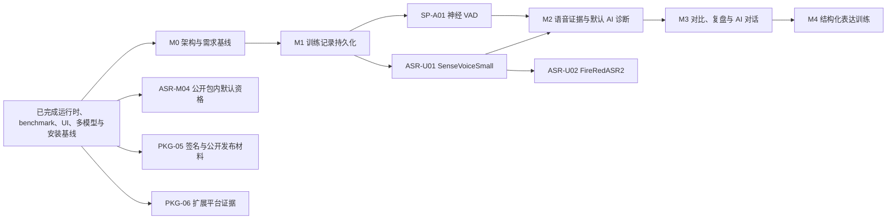

# Expression Trainer Roadmap

> 状态：Active
> 更新日期：2026-09-16
> 当前模式：内部开发/测试；公开模型分发、签名和扩展平台支持仍受外部条件约束。

## 1. 排序原则

- **P0**：没有它就无法安全继续，或会产生明显正确性、数据、构建或发布风险。
- **P1**：目标版本所需，但不阻塞最近一步。
- **P2**：稳定发布后再评估的增强。
- 每个阶段保持应用可运行，不同时重写 UI、Audio、ASR、模型和打包。
- 新增依赖、流程、门禁或抽象必须对应当前具体风险，并说明何时可以移除。
- 内部 benchmark 只服务模型选择与复评，不扩张为公开评测平台或审计系统。

## 2. 当前依赖关系

M0/M1 是当前产品关键路径。M2 在持久化音频之上加入神经 VAD、SenseVoiceSmall 辅助证据和默认 AI 诊断。ASR-M04 受模型再分发许可和公开制品条件约束，可作为独立外部门禁跟进；FireRedASR2 仍不进入当前关键路径。

## 3. 已完成基线

逐任务步骤和阶段 handoff 由 Git 历史承担；这里仅保留继续开发所需的结果。

| 范围 | 已完成结果 | Canonical 证据 |
|---|---|---|
| Phase 0-1 | 可复现开发基线、核心测试、安全渲染、设置迁移、LLM 请求控制、Electron smoke | [开发与验证](development.md)、[当前架构](architecture/current.md) |
| Phase 2-3 | 冻结语料、可复跑 benchmark、七候选比较、Zipformer Large 技术默认 | [Harness](benchmark/harness.md)、[BM-04 结果](benchmark/bm04-seven-model-comparison-2026-08-30.md)、[ADR-0009](architecture/adr/0009-productize-multiple-asr-models.md) |
| Phase 4 | ASR session/event、AudioCapture/AudioWorklet、有界传输、utility process、Model Manager、配置与诊断边界 | [当前架构](architecture/current.md) |
| Phase 5 | Windows x64 Forge/Squirrel 制品、真实模型首次安装、离线二次启动、升级和卸载数据保留 | [支持矩阵](support-matrix.md)、[ADR-0007](architecture/adr/0007-package-with-electron-forge.md) |
| CONV-01～03 | 文档职责收敛、benchmark writer 竞态修复、LLM provider 配置迁移 | [CHANGELOG](../CHANGELOG.md)、Git 历史 |
| UI-01～02 | 四套主题、双布局、窗口同步和响应式尺寸 | [当前架构](architecture/current.md) |
| ASR-M01～M04a | 三模型 Catalog/Factory、选择恢复、安装切换与内部包内默认资格 | [当前架构](architecture/current.md)、[ADR-0009](architecture/adr/0009-productize-multiple-asr-models.md) |

## 4. 当前执行轨道

### 4.1 Product baseline and persistence

| ID | P | 状态 | 任务 | 完成标准 |
|---|---|---|---|---|
| M0 | P0 | Complete | 冻结需求、目标架构、训练数据模型、训练/报告流程、Speech Engine 契约、Backlog 和 M1 范围 | M0 一致性审查通过；M1 无需重议产品目标、数据模型和主要架构边界即可开发 |
| M1 | P0 | Ready | Training Persistence | 满足 [M1 milestone](milestones/m1-training-persistence.md) 的 AC-M1-01～10 |

### 4.2 Streaming ASR public delivery

| ID | P | 状态 | 任务 | 完成标准 |
|---|---|---|---|---|
| ASR-M04 | P1 | External gate | Zipformer Large 包内默认、升级保留和真实模型资格验证 | 获得再分发批准；离线首次导入、native 初始化、二次启动和升级保留通过 |

### 4.3 M2 speech evidence and default AI diagnosis

| ID | P | 状态 | 任务 | 完成标准 |
|---|---|---|---|---|
| TIME-M201 | P0 | Planned / M2 | 契约化绝对时间与质量事件 | Speech adapter 输出声明的 timing capability、绝对采样位置和质量事件；不支持、端点重置或 overrun 时显式降级 |
| SP-A01 | P0 | Planned / M2 | 神经 VAD 语音活动与静音区间 | 版本化模型/阈值；标注样本、实时系数、内存、失败降级通过；不覆盖 ASR 时间戳 |
| ASR-U01 | P1 | Planned / M2 | SenseVoiceSmall 完成录音后辅助分析 | 不阻塞流式 ASR；支持 cancel、时长/资源上限、独立 provenance 和失败隔离；标签不直接解释为表达质量；公开分发前单独通过许可门禁 |
| METRIC-M201 | P0 | Planned / M2 | 时间度量与 Common Analysis | 使用声明的 timing source 和 quality event；确定性指标带定义版本、证据和降级状态；维度完成 MECE 与校准复核 |
| AI-M201 | P0 | Planned / M2 | 默认结构化 AI 诊断与建议 | 远程 profile 经数据类别披露并由用户启用后才可自动运行；本地 profile 单独标识；输出 schema 校验；缺配置/失败有引导和重试；本地事实不丢失 |
| REPORT-M201 | P1 | Planned / M2 | 统一报告与证据驱动雷达图 | 共用报告骨架；结论可定位证据；雷达维度有定义、范围、版本和缺失态；不使用无依据的 LLM 自由评分 |
| ASR-U02 | P2 | Deferred | FireRedASR2 多来源安装和 utterance UX | SenseVoiceSmall 实施完成后，产品证据表明第二个 utterance 模型能改变用户结果 |

### 4.4 Delivery and maintenance

| ID | P | 状态 | 任务 | 触发/完成条件 |
|---|---|---|---|---|
| PKG-05 | P1 | Planned | 代码签名、checksums 和 release notes | 公开发布前具备凭据并验证来源与完整性 |
| PKG-06 | P1 | Planned | 扩展支持矩阵 | 每个提升支持等级的平台均有对应 package/smoke 证据 |
| OPS-01 | P1 | Deferred | 最小 CI/内测取包自动化 | 跨机取包成为反复痛点时增加可移除的手工 Windows workflow |
| OPS-03 | P1 | Ongoing | 受控运行时与依赖升级 | 只因具体安全或兼容风险升级，并重跑能发现实质回归的验证 |
| OPS-04 | P1 | Planned | 模型生命周期 | 定义 current/deprecated/removed、兼容期和回退 |
| OPS-06 | P2 | Deferred | 自动更新评估 | 至少两个稳定手工发布后用 ADR 决定是否采用 |

## 5. 里程碑

| 里程碑 | 状态 | 包含 | 结果 |
|---|---|---|---|
| M0 Architecture & Requirements Baseline | Complete | Gap、Requirements、Data Model、Training Flow、Speech Contract、Target、Backlog、M1、Consistency Review | M1 有稳定、可追踪的实施边界 |
| M1 Training Persistence | Ready | R-P01～R-P09 | Session、逐字稿、已有结果和音频可跨重启恢复与删除；目标首页收敛为纯语音入口并移除复制/保存/清空 |
| M2 Speech Evidence & AI Diagnosis | Planned | R-A01～R-A11 | 按 [M2 milestone](milestones/m2-speech-evidence-and-ai-diagnosis.md) 依次交付时间/语音证据、确定性度量、Common Analysis、具有远程知情边界的默认结构化 AI 诊断、统一报告和证据驱动雷达图 |
| M3 Comparison & Review | Planned | R-R01～R-R04 | 历史对比、复盘、趋势和 Session 关联 AI 对话 |
| M4 Structured Training | Planned | R-F01～R-F08 | Free/Structured 选择、PREP/STAR/Pyramid、Framework Analysis 与重练闭环 |
| Streaming ASR public delivery | In progress | ASR-M01～M04 | Catalog/Factory、选择、单 controller 切换、安装设置入口及内部包内默认资格已完成；公开资格仍受外部门槛约束；这是并行交付轨道，不占用产品里程碑编号 |
| Public desktop delivery | External gate | PKG-05、PKG-06 | 签名、许可和目标平台证据满足公开发布；这是外部门禁，不是 M4 的后续产品里程碑 |

## 6. 明确不做

- M1 不重写为 Tauri、WASM、React/Vue 或独立后端。
- 不为每个 Structured framework 新建训练流程、Session 模型或报告架构。
- 除已进入 M2 的 SenseVoiceSmall 外，不为尚未进入产品批次的模型预建 adapter、下载器或 UI。
- 不把内部七候选结果包装为公开权威 benchmark。
- 除 M1 训练记录所需的最小 SQLite 元数据存储外，不增加通用数据库框架；不在没有当前风险时增加审批、审计、遥测、插件或通用状态框架。

## 7. 外部跟进

- 真实可配置麦克风和接近 4-core/8-GB/3-GB 资格线设备的运行证据。
- Zipformer Large 等模型的公开再分发许可。
- Windows 签名凭据；macOS/Linux/ARM64 对应构建与 native 模型证据。

## 8. 维护规则

- Roadmap 只保留未完成工作、依赖、外部门禁和一页已完成基线，不保存逐任务日志。
- 已完成任务移入“已完成基线”摘要；具体提交、命令和临时结论由 Git 历史承担。
- 当前实现事实写入[当前架构](architecture/current.md)，产品行为写入[需求基线](requirements/requirements.md)，决策理由写入 [ADR](architecture/adr/README.md)。
- 新增计划文件只用于尚未开始且需要跨步骤协调的工作；实施完成并吸收最终事实后删除。
